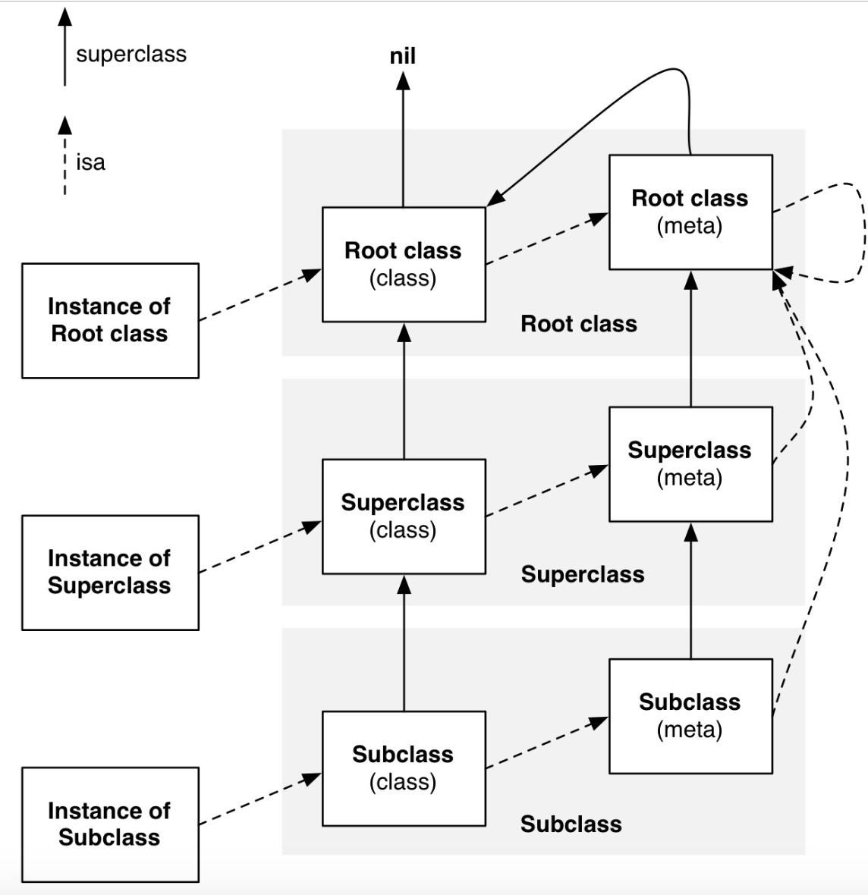

# awesome-ios-interview

系统化的iOS面试知识库，涵盖基础到进阶的完整知识体系！

> [知识点目录](articles/CATALOG.md) - 查看所有文章的完整目录

## iOS 相关面试题

### App 启动与优化

<details>
<summary><b>Q: APP启动的详细流程是什么？</b></summary>

iOS 应用启动分为冷启动、热启动和预热启动三种类型。冷启动是最完整的流程，分为 **Pre-main 阶段** 和 **main 阶段**。

**Pre-main 阶段**：

Pre-main 阶段由 dyld（动态链接器）负责，从用户点击 App 图标到 `main()` 执行之前。**主线程在内核 `fork()` 创建进程时同时创建**，后续所有 Pre-main 工作都在主线程上执行。

1. **加载可执行文件**：内核创建进程，使用 `mmap()` 将 Mach-O 文件映射到虚拟内存（惰性加载，只有实际访问的页才加载到物理内存）。解析 Mach-O Header（验证 Magic Number、CPU 架构匹配、文件类型识别）和 Load Commands（`LC_SEGMENT_64` 映射内存并设置权限、`LC_LOAD_DYLIB` 记录动态库依赖、`LC_MAIN` 计算入口地址等），最后验证代码签名。

2. **加载动态库（dyld）**：dyld 从主程序 Mach-O 的 `LC_LOAD_DYLIB` 中读取依赖的动态库路径，按搜索规则查找动态库实际位置（优先从共享缓存中查找），使用 `mmap()` 映射到进程虚拟地址空间，验证代码签名，然后使用**深度优先搜索**递归加载每个动态库的依赖（每个库只加载一次）。最终按依赖关系构建初始化顺序——被依赖的库先于依赖方（如 Foundation 在 UIKit 之前）。如果 App 使用 Swift，此阶段还会加载 Swift 标准库（iOS 12.2+ 位于系统共享缓存，无需嵌入 App）。

3. **Rebase & Bind**：由于 ASLR（地址空间布局随机化），App 每次启动的加载地址不同，需要修正指针。Rebase（重定位）修正指向 Mach-O **内部**的指针，将编译时地址加上 ASLR 偏移量（slide）；Bind（绑定）修正指向 Mach-O **外部**的指针，查找符号表绑定到正确的外部符号地址（如 `_objc_msgSend`）。

4. **ObjC Runtime 初始化**：dyld 通过 `_dyld_objc_notify_register` 回调通知 Runtime，触发 `_objc_init`（`map_images` 回调）。从 Mach-O 的 `__DATA` 系列段（`__DATA`、`__DATA_CONST`、`__DATA_DIRTY`）读取类列表（`__objc_classlist`）、Category 列表（`__objc_catlist`）、协议列表等元数据；遍历 `__objc_classlist` 将**所有类**注册到全局类表（`gdb_objc_realized_classes`）；然后对非懒加载类（实现了 `+load` 方法的类）**立即 realize**——调用 `realizeClassWithoutSwift` 创建可读写的 `class_rw_t` 结构（编译期的 `class_ro_t` 是只读的），建立继承链（`cls->superclass`）和元类关系（`cls->isa`），初始化方法缓存 `cache_t`；懒加载类则**延迟到首次收到消息时**才 realize（`objc_msgSend` → `lookUpImpOrForward` 触发），执行相同的初始化流程。遍历 `__objc_catlist` 处理 Category：若对应类已 realize，立即将 Category 的方法、属性、协议附加到其 `class_rw_t` 上（方法插入到列表**前面**，实现"覆盖"效果）；若对应类尚未 realize，则暂存到 `unattachedCategories` 表，待类 realize 时再附加。

5. **Swift Runtime 元数据注册**：ObjC Runtime 完成后，dyld 触发 Swift Runtime 之前通过 `_dyld_register_func_for_add_image` 注册的回调，遍历所有已加载镜像中的 Swift section，将元数据记录的**位置指针注册**到 Runtime 的全局缓存中：`__swift5_types`（类型元数据）、`__swift5_proto`（协议遵循表）、`__swift5_fieldmd`（字段描述符）等。此阶段只做轻量的指针注册，并不解析和实例化元数据；真正的解析延迟到首次使用时（如首次 `as?` 触发协议遵循查找、首次 `Mirror(reflecting:)` 触发字段描述符解析、泛型类型首次实例化时创建完整的 type metadata）。

6. **调用 +load 方法**：dyld 调用 Runtime 的 `load_images` 回调，通过**函数指针直接调用**（不经过 `objc_msgSend`），因此 Category 的 `+load` 不会覆盖主类的 `+load`，两者都会执行。调用顺序：父类优先于子类 → 类优先于 Category → 同一镜像内按编译顺序（Build Phases → Compile Sources）→ 不同镜像按依赖顺序（被依赖的库先执行）。所有 `+load` 在主线程串行调用，直接阻塞启动。

7. **执行 Initializers**：dyld 遍历所有已加载镜像的 `__DATA,__mod_init_func` section 中的函数指针并调用。来源包括 C++ 静态构造函数（如 `static std::string s = "hello"`）和 `__attribute__((constructor))` 标记的函数。执行顺序：按镜像依赖顺序（被依赖的库优先），同一镜像内按 带优先级的 constructor（数字小的先执行）→ C++ 构造函数 → 不带优先级的 constructor。

**main 阶段**：

1. **main 函数**：OC 中 `main()` 调用 `UIApplicationMain`（需手动创建 `@autoreleasepool`，因为此时 RunLoop 尚未启动）；Swift 中 `@main` 属性让编译器自动生成入口。

2. **UIApplicationMain**：创建 `UIApplication` 单例 → 创建 `AppDelegate` → 加载 Info.plist → **设置并启动主 RunLoop**（调用 `CFRunLoopRun()` 进入无限事件循环，此函数不再返回）。注意：**主 RunLoop 采用懒加载机制**，首次调用 `[NSRunLoop mainRunLoop]` 时创建，在 `UIApplicationMain` 内部启动。

3. **AppDelegate 回调**（RunLoop 事件循环中）：加载 Main Storyboard → `willFinishLaunchingWithOptions:` → 状态恢复 → `didFinishLaunchingWithOptions:`

4. **首帧渲染**（RunLoop 事件循环中）：创建 Window → 设置 rootViewController → viewDidLoad → viewWillAppear → layoutSubviews → drawRect → Core Animation 提交图层树 → Render Server 渲染 → GPU 合成 → 显示首帧

**预热启动（iOS 15+）**：

系统预测用户可能启动 App，提前在后台执行部分启动流程：

| 对比项 | 冷启动 | 预热启动 |
|-------|-------|---------|
| 触发时机 | 用户点击 App 图标 | 系统预测后自动在后台执行 |
| Pre-main 工作 | 全部在用户点击后执行 | 大部分已在后台完成 |
| 用户感知启动时间 | 包含完整 Pre-main | 只包含 +load 之后的时间 |

**预热阶段已完成**：加载可执行文件、加载动态库、Rebase & Bind、ObjC 类注册和 Category 处理、Swift Runtime 元数据注册

**预热阶段未执行**：+load 方法、Initializers（C++ 构造函数、`__attribute__((constructor))`）、main 阶段全部内容

可通过 `ProcessInfo.processInfo.environment["ActivePrewarm"] == "1"` 检测是否为预热启动，避免将后台预热时间计入用户感知的启动耗时。

→ [App启动流程](articles/ios-basics/App启动流程.md)
</details>

<details>
<summary><b>Q: dyld 3/4 有哪些优化？</b></summary>


**dyld 3 在 iOS 13 引入 Launch Closure**：
- **首次启动**：分析 Mach-O、计算依赖、生成 Launch Closure 并缓存到磁盘
- **后续启动**：直接读取缓存，跳过分析步骤

Launch Closure 包含：依赖的动态库列表、Rebase/Bind 信息、初始化顺序

**dyld 4（iOS 15）进一步优化**：
- **Chained Fixups**：链式修复技术，减少需要修复的指针数量
- **Page-in Linking**：按需加载，只有访问到某个页面时才进行修复
- **改进的 Swift 运行时支持**：更好地支持 Swift 类型元数据和协议一致性检查

→ [App启动流程](articles/ios-basics/App启动流程.md)

</details>

<details>
<summary><b>Q: 如何测量和监控 iOS 应用的启动时间？</b></summary>


**测量方案对比**：

| 方案 | 适用场景 | 优点 | 缺点 |
|-----|---------|------|------|
| dyld 环境变量 | 开发调试 | 无需代码，快速查看加载信息 | 只能定性分析，无耗时数据 |
| Instruments App Launch | 深度分析 | 函数级耗时分析，最详细 | 只能线下使用，无法覆盖线上用户 |
| 代码埋点 | 开发调试 + 线上监控 | 可自定义粒度，支持线上采集 | 需要开发和维护埋点代码 |
| MetricKit | 线上监控 | 系统级数据，提供分位数分布 | iOS 13+，数据延迟（每日回调），粒度较粗 |

实际工程中，通常结合使用：开发阶段用 Instruments 深度分析；线上用代码埋点 + MetricKit 双保险。

**代码埋点方案**：冷启动分为 Pre-main 和 main 两个阶段，需要在关键节点插入埋点：

**Pre-main 阶段埋点**：

| 埋点时机 | 实现方式 | 统计内容 |
|---------|---------|---------|
| 进程创建时间 | `sysctl` 获取 `p_starttime` | 启动起点 |
| +load 方法 | ObjC `+load` 方法 | dylib 加载 + Rebase/Bind + Runtime 初始化完成的时间点 |
| 高优先级 constructor | `__attribute__((constructor(101)))` | +load 执行完成的时间点 |
| 低优先级 constructor | `__attribute__((constructor(65535)))` | 大部分 Initializers 执行完成的时间点 |

**main 阶段埋点**：

| 埋点时机 | 实现方式 | 统计内容 |
|---------|---------|---------|
| main 函数 | main.swift 顶部 | Pre-main 结束，main 开始 |
| willFinishLaunching | AppDelegate 回调 | main 到 willFinish 的耗时 |
| didFinishLaunching 开始/结束 | AppDelegate 回调，return 前标记 | didFinish 执行耗时 |
| 首帧渲染 | viewDidAppear + DispatchQueue.main.async | didFinish 到首帧的耗时 |

为确保埋点的 `+load` 方法最先执行，推荐将埋点代码打包成**动态 xcframework**，在 Link Binary With Libraries 中排到最前面。动态库的 `+load` 天然先于静态库和主工程执行。

**iOS 15+ 预热启动对统计的影响**：预热启动时系统会提前创建进程并执行部分启动流程（dylib 加载、Rebase/Bind、Runtime 初始化），然后挂起等待用户点击。此时 `sysctl` 获取的 `p_starttime` 是预热时的时间，可能比用户实际点击早几小时，导致统计的启动时间异常偏大。处理方案：

1. **检测预热启动**：在 `+load` 中检查环境变量 `[NSProcessInfo.processInfo.environment[@"ActivePrewarm"] isEqualToString:@"1"]`
2. **调整起点时间**：预热启动时，以 `+load` 执行时间作为启动起点，而非进程创建时间
3. **分开统计**：区分预热启动和正常启动的数据，避免数据污染

→ [启动优化-观测](articles/ios-advanced/启动优化/启动优化-观测.md)

</details>

<details>
<summary><b>Q: 启动优化有哪些方案？</b></summary>

一、Pre-main 阶段优化

Pre-main 阶段的优化核心思想是**减少 dyld 需要处理的工作量**。

**1. 减少动态库数量**

动态库每增加一个，dyld 就需要多执行一次 mmap 映射、代码签名验证、Rebase/Bind 和初始化。优化方案：

| 方案 | 说明 |
|-----|------|
| 合并动态库 | 将多个功能相近的动态库合并为一个，减少总数 |
| 动态库改静态库 | 静态库在编译时合并到主程序，不增加 dyld 加载开销 |
| 使用 SPM 静态链接 | SPM 默认使用静态链接，不产生额外动态库 |
| 移除未使用的动态库 | 定期审查依赖，移除不再使用的库 |

**2. 优化 Rebase/Bind**

Rebase 修正指向 Mach-O 内部的指针，Bind 修正指向外部的符号引用。两者的工作量与 Mach-O 中需要修正的指针数量成正比。优化方案：

| 方案 | 原理 |
|-----|------|
| 减少 ObjC 类数量 | 每个 ObjC 类都有大量元数据指针需要修正（isa、superclass、方法列表、属性列表等） |
| 减少 Category | Category 的方法、属性、协议指针都需要 Rebase/Bind |
| 减少 C++ 虚函数 | 虚函数表中的每个函数指针都需要修正 |
| 用 Swift 结构体替代类 | 结构体是值类型，不产生堆上的指针需要修正 |
| 清理无用代码 | 无用的类、方法、全局变量都会增加需要修正的指针 |

**3. 优化 +load 方法**

所有 `+load` 在主线程串行调用，直接阻塞启动。优化方案：

| 方案 | 说明 |
|-----|------|
| 用 `+initialize` 替代 | `+initialize` 是懒加载的，只在类第一次收到消息时调用，不阻塞启动 |
| 延迟到启动后执行 | 将初始化逻辑移到 `didFinishLaunching` 或首帧后 |
| 用静态注册替代动态注册 | 避免在 `+load` 中通过 Runtime 动态注册类或方法 |
| 用 Swift 替代 ObjC | 纯 Swift 类没有 `+load` 机制 |

**4. 优化 Initializers**

C++ 静态构造函数和 `__attribute__((constructor))` 也在主线程同步执行。优化方案：

| 方案 | 说明 |
|-----|------|
| 延迟初始化 | 将非必要的全局初始化延迟到首次使用时 |
| 用 Swift 懒加载 | Swift 的 `lazy` 属性和全局变量天然支持懒加载 |
| 移除不必要的 constructor | 审查项目中的 `__attribute__((constructor))`，移除非必要的 |
| 用基本类型替代复杂类型 | 基本类型（int、const char*）的全局变量不需要构造函数 |

**5. 二进制重排**

App 启动时，访问尚未加载到物理内存的代码页会触发 Page Fault（缺页中断），内核需要从磁盘读取数据到内存。如果启动阶段调用的函数分散在不同的内存页中，会产生大量 Page Fault。二进制重排将启动阶段调用的函数集中排列到相邻的内存页中，减少 Page Fault 次数。

实现步骤：
1. **插桩收集**：使用 Clang SanitizerCoverage（`-fsanitize-coverage=func,trace-pc-guard`）在每个函数入口插入回调
2. **生成 Order File**：运行 App 收集启动阶段的函数调用顺序，生成函数排列文件
3. **链接器重排**：通过 Xcode 的 `Order File` 配置项指定文件路径，链接器按照指定顺序排列函数
4. **验证效果**：通过 Instruments 的 System Trace 观察 Page Fault 数量的变化

二、main 阶段优化

main 阶段从 `main()` 函数开始到首帧渲染完成，是开发者最能直接控制的阶段，通常也是优化的重点。

**1. 启动任务分级管理**

将 `didFinishLaunching` 中的初始化任务按优先级分级，而非全部同步执行：

| 级别 | 执行时机 | 包含任务 |
|-----|---------|---------|
| P0 - 关键 | didFinishLaunching 同步执行 | 崩溃监控、日志系统、网络库配置、首屏数据请求 |
| P1 - 重要 | didFinishLaunching 异步执行 | 推送注册、数据库初始化、非首屏 SDK |
| P2 - 可延迟 | 首帧后或 RunLoop 空闲时 | 统计 SDK、分享 SDK、广告 SDK、预加载缓存 |

**2. 并行初始化**

利用 GCD 并发队列将无依赖关系的初始化任务并行执行，充分利用多核 CPU。但需注意：涉及 UI 操作的初始化必须在主线程执行。

**3. 利用 RunLoop 空闲时机**

在 `kCFRunLoopBeforeWaiting` 时注册 Observer，将低优先级任务拆分为多个小任务，在 RunLoop 每次空闲时执行一批。这样既不阻塞启动，也不影响用户交互。

**4. 延迟加载**

| 方案 | 说明 |
|-----|------|
| 首屏无关的 SDK 延迟初始化 | 分享、支付、地图等 SDK 在用户首次使用相关功能时再初始化 |
| 非必要视图懒加载 | TabBar 中非首页的 ViewController 延迟到切换时再创建 |
| 首屏数据预加载 | 在后台提前加载首屏数据，避免白屏等待 |

→ [启动优化](articles/ios-advanced/启动优化/启动优化.md)

</details>

### 生命周期

<details>
<summary><b>Q: +load和+initialize的主要区别是什么？</b></summary>


**1. 调用时机**
- `+load`：在main函数执行之前，由dyld在加载Mach-O镜像时自动调用。只要类被编译进项目，无论是否被使用，`+load`都会被执行。
- `+initialize`：在类第一次收到消息时调用（懒加载）。如果一个类从未被使用过，它的`+initialize`永远不会被执行。

**2. 调用方式**
- `+load`：Runtime通过函数指针直接调用，不经过`objc_msgSend`消息发送机制。这意味着不会触发消息转发流程。
- `+initialize`：通过`objc_msgSend`调用，遵循完整的消息发送机制，包括方法查找、消息转发等。

**3. Category行为**
- `+load`：主类和所有Category的`+load`方法都会被执行，互不覆盖。
- `+initialize`：如果Category实现了`+initialize`，会覆盖主类的实现，只有Category的版本会被调用。

**4. 继承行为**
- `+load`：不会因继承关系而调用父类实现。如果子类没有实现`+load`，就不会调用任何`+load`。
- `+initialize`：如果子类没有实现，会调用父类的`+initialize`，这可能导致父类的实现被多次调用。

**5. 对启动性能的影响**
- `+load`：会阻塞App启动，过多的`+load`方法会显著增加启动时间。
- `+initialize`：延迟执行，不影响启动性能。

→ [+load与+initialize的区别](articles/ios-basics/load与initialize的区别.md)

</details>

<details>
<summary><b>Q: +load方法的执行顺序是怎样的？</b></summary>


`+load`方法的执行顺序遵循以下规则：

**1. 父类优先于子类**
- 如果存在继承关系，父类的`+load`一定先于子类执行
- Runtime会确保在调用子类的`+load`之前，其所有父类的`+load`都已执行完毕

**2. 类优先于Category**
- 所有类的`+load`方法执行完毕后，才会执行Category的`+load`
- 主类和Category的`+load`都会被调用，不会相互覆盖

**3. 同级别按编译顺序**
- 没有继承关系的类之间，按照编译顺序（Compile Sources中的顺序）执行
- 多个Category之间也是按编译顺序执行

**4. 不同镜像按依赖关系**
- 如果项目依赖多个动态库，会按照镜像的依赖关系顺序调用
- 被依赖的镜像中的`+load`先执行

→ [+load与+initialize的区别](articles/ios-basics/load与initialize的区别.md)

</details>

<details>
<summary><b>Q: +initialize可能被调用多次吗？</b></summary>


是的。如果子类没有实现`+initialize`，当子类首次收到消息时，会调用父类的`+initialize`实现。因此父类的`+initialize`可能因为不同子类的初始化而被多次调用，需要使用`dispatch_once`或类型检查来保护。

→ [+load与+initialize的区别](articles/ios-basics/load与initialize的区别.md)

</details>

<details>
<summary><b>Q: Method Swizzling应该在+load还是+initialize中执行？为什么？</b></summary>


应该在`+load`中执行。原因有三点：

1. **`+load`天然只执行一次**：Runtime保证每个类的`+load`只调用一次，且在串行加锁环境下执行，不需要`dispatch_once`保护。而`+initialize`可能因子类继承被多次调用，多次`method_exchangeImplementations`会导致swizzle失效，必须使用`dispatch_once`。

2. **线程安全**：swizzling操作（`class_addMethod` + `method_exchangeImplementations`）不是原子的。`+load`在`loadMethodLock`保护下串行执行，天然避免竞争；`+initialize`可能在多线程环境下被调用，即使`dispatch_once`保护了入口，内部多步操作之间仍存在竞争窗口。

3. **调用顺序有保证**：`+load`保证父类先于子类执行，对于继承链上的swizzle顺序非常重要。`+initialize`的调用顺序取决于哪个类先收到消息，不可控。

→ [+load与+initialize的区别](articles/ios-basics/load与initialize的区别.md)

</details>

<details>
<summary><b>Q: UIApplicationMain 后面的代码会执行吗？为什么？</b></summary>

**不会执行**。

```swift
// main.swift（手动管理入口时）
UIApplicationMain(
    CommandLine.argc,
    CommandLine.unsafeArgv,
    nil,
    NSStringFromClass(AppDelegate.self)
)

// 这行代码永远不会执行
print("This will never print")
```

**原因**：
- `UIApplicationMain` 创建 `UIApplication` 单例和 `AppDelegate`
- 内部调用 `CFRunLoopRun()` 启动主 RunLoop
- 主 RunLoop 进入无限循环，持续监听和处理事件（触摸、Timer、Source 等）
- 只有当 App 被系统终止时，RunLoop 才会退出，但此时进程已结束

→ [App启动流程](articles/ios-basics/App启动流程.md)

</details>

<details>
<summary><b>Q: loadView的作用是什么？什么时候需要重写它？</b></summary>


`loadView`负责创建视图控制器的`view`属性。系统在访问`self.view`时，如果`view`为nil，会自动调用`loadView`。

默认行为：
- 如果有对应的Storyboard/XIB，从中加载视图
- 如果没有，创建一个空的`UIView`

需要重写的场景：当你想用自定义视图完全替换默认的`self.view`时：

```swift
override func loadView() {
    // 不要调用 super.loadView()
    let customView = MyCustomView()
    self.view = customView
}
```

注意：重写`loadView`时**不要调用`super.loadView()`**，否则会白白创建一个默认的UIView然后被丢弃。

→ [生命周期](articles/ios-basics/生命周期.md)

</details>

<details>
<summary><b>Q: iOS 13之后为什么Present默认不再触发viewWillDisappear？</b></summary>


iOS 13之前，`modalPresentationStyle`默认是`.fullScreen`，新页面完全覆盖旧页面，旧VC会从视图层级中移除，因此触发`viewWillDisappear`和`viewDidDisappear`。

iOS 13之后，默认值变为`.automatic`（通常表现为`.pageSheet`），新页面以卡片式呈现，底部仍可见旧页面的一部分，旧VC并未从视图层级移除，所以**不会触发Disappear回调**。

这会导致的实际问题：如果你在`viewWillAppear`/`viewWillDisappear`中做了成对的操作（如注册/注销通知、开始/停止定位），在iOS 13+上可能出现逻辑异常。

解决方案：
- 显式设置 `vc.modalPresentationStyle = .fullScreen`
- 或使用dismiss的completion回调来替代Disappear中的逻辑

→ [生命周期](articles/ios-basics/生命周期.md)

</details>

<details>
<summary><b>Q: UIView的layoutSubviews在什么时机被调用？</b></summary>


`layoutSubviews`会在以下情况被调用：

1. **addSubview时**：视图被添加到父视图
2. **frame/bounds变化时**：视图大小发生改变
3. **子视图frame变化时**：直接子视图大小改变
4. **设备旋转时**：触发视图重新布局
5. **手动调用`setNeedsLayout`后**：在下一个布局周期调用
6. **滚动UIScrollView时**：contentOffset改变

重要注意点：
- 不要直接调用`layoutSubviews`，应该调用`setNeedsLayout`（异步）或`layoutIfNeeded`（同步）
- `layoutSubviews`可能被调用多次，其中的操作要保证幂等性
- 在`layoutSubviews`中可以获取到准确的frame值，适合做依赖frame的布局计算

→ [生命周期](articles/ios-basics/生命周期.md)

</details>

### RunLoop

<details>
<summary><b>Q: RunLoop 和线程的关系？</b></summary>


- 每个线程都有唯一对应的 RunLoop 对象
- 主线程和子线程的 RunLoop 都采用懒加载机制，在第一次获取时才创建
- 主线程的 RunLoop 由 `UIApplicationMain` 内部首次获取并启动（调用链：`UIApplicationMain` → `GSEventRunModal` → `CFRunLoopRunSpecific`）
- 子线程的 RunLoop 需要手动获取并启动，否则不会创建
- RunLoop 与线程是一一对应的，存储在一个全局字典（`__CFRunLoops`）中
- RunLoop 在第一次获取时创建，在线程结束时销毁

→ [RunLoop](articles/ios-basics/runloop.md)

</details>

<details>
<summary><b>Q: RunLoop 的 Mode 有什么作用？</b></summary>


**核心作用：实现事件源的隔离与优先级管理。**

RunLoop 的 Mode 是一种事件分组机制，每个 Mode 内部包含独立的 Source0、Source1、Timer 和 Observer 集合。RunLoop 同一时刻只能运行在一个 Mode 下，只处理当前 Mode 中注册的事件源，其他 Mode 中的事件源不会被处理。

**常见的 Mode：**

- `kCFRunLoopDefaultMode`（NSDefaultRunLoopMode）：默认模式，App 正常运行时使用，处理 Timer、网络回调等常规任务。
- `UITrackingRunLoopMode`：界面追踪模式，当 UIScrollView 及其子类（UITableView、UICollectionView 等）滑动时，RunLoop 自动切换到此模式，专注处理 UI 追踪事件，保证滑动流畅。
- `kCFRunLoopCommonModes`（NSRunLoopCommonModes）：并不是真正的 Mode，而是一个标记集合，默认包含 DefaultMode 和 TrackingMode。将事件源添加到 CommonModes，等价于同时添加到所有被标记为 Common 的 Mode 中。
- `UIInitializationRunLoopMode`：App 启动时使用的模式，启动完成后不再使用。
- `GSEventReceiveRunLoopMode`：接收系统事件的内部模式（未公开模式，可能随系统版本变化），开发者一般不直接使用。

**Mode 切换机制：**

切换 Mode 时，RunLoop 需要先退出当前 Mode 的循环，再以新 Mode 重新进入。最典型的场景是 ScrollView 滑动：用户开始滑动时 RunLoop 从 DefaultMode 切换到 TrackingMode，停止滑动后切换回 DefaultMode。

→ [RunLoop](articles/ios-basics/runloop.md)

</details>

<details>
<summary><b>Q: RunLoop 的运作流程是怎样的？</b></summary>


```
┌─ CFRunLoopRunSpecific 入口 ──────────────────────────────
│  1. 通知 Observer：即将进入 RunLoop (kCFRunLoopEntry)
│
│  ┌─ __CFRunLoopRun do-while 循环 ─────────────────────
│  │  2. 通知 Observer：即将处理 Timer (kCFRunLoopBeforeTimers)
│  │  3. 通知 Observer：即将处理 Source0 (kCFRunLoopBeforeSources)
│  │  4. 处理 Blocks + 处理 Source0 事件（+ 如果有 Source0 被处理，再执行一次 Blocks）
│  │  5. 如果有 GCD 主队列消息就绪，跳转到步骤 9
│  │  6. 通知 Observer：即将进入休眠 (kCFRunLoopBeforeWaiting)
│  │  7. 线程休眠（mach_msg），等待被唤醒：
│  │     - Source1 (port-based)
│  │     - Timer 到时
│  │     - RunLoop 超时
│  │     - 被外部手动唤醒
│  │  8. 通知 Observer：从休眠中唤醒 (kCFRunLoopAfterWaiting)
│  │  9. 处理唤醒时收到的消息：
│  │      - 如果是 Timer 到时，处理 Timer
│  │      - 如果是 dispatch_async 到主队列，执行 block
│  │      - 如果是 Source1，处理 Source1
│  │  10. 处理 Blocks（步骤 9 中的回调可能通过 CFRunLoopPerformBlock 提交了新 block）
│  │  11. 根据条件判断：继续循环 → 回到步骤 2 / 退出循环 → 步骤 12
│  └──────────────────────────────────────────────────────
│
│  12. 通知 Observer：即将退出 RunLoop (kCFRunLoopExit)
└──────────────────────────────────────────────────────────
```

**步骤 1：进入 RunLoop**

`CFRunLoopRunSpecific` 函数首先通知 Observer `kCFRunLoopEntry`，表示 RunLoop 即将开始运行。AutoreleasePool 就是在这个时机创建的。随后进入 `__CFRunLoopRun` 的 do-while 循环。

**步骤 2-3：循环开始，通知 Observer**

每次循环开始时，依次通知 Observer `kCFRunLoopBeforeTimers` 和 `kCFRunLoopBeforeSources`，给外部一个在事件处理前做准备工作的机会。

**步骤 4-5：处理 Blocks、Source0 与就绪检查**

步骤 4 包含三个子步骤：先调用 `__CFRunLoopDoBlocks` 处理通过 `CFRunLoopPerformBlock` 提交的 block，然后调用 `__CFRunLoopDoSources0` 处理被标记为待处理的 Source0 事件，如果处理了 Source0 则再次调用 `__CFRunLoopDoBlocks`（因为 Source0 回调中可能又提交了新 block）。

步骤 5 中，RunLoop 快速探测 GCD 主队列的 mach port（`dispatchPort`）上是否有已到达但尚未处理的消息（超时为 0 的非阻塞检查）。如果有，跳过休眠直接跳到步骤 9 处理。

**步骤 6-7：休眠阶段**

在真正休眠之前，RunLoop 先通知 Observer `kCFRunLoopBeforeWaiting`。系统在这个时机做了三件重要的事：

1. **手势识别的回调**：触摸事件被 Source1 接收后，`UIGestureRecognizer` 不会立即执行 action，而是等到 `kCFRunLoopBeforeWaiting` 时，由系统 Observer 统一触发 `_UIGestureRecognizerUpdate`，批量处理所有手势识别器的状态更新和 action 回调。

2. **UIView/CALayer 的界面更新**：`setNeedsLayout`、`setNeedsDisplay` 等只是标记"需要更新"。在 `kCFRunLoopBeforeWaiting` 时，Core Animation 的 Observer 统一执行布局（`layoutSubviews`）、绘制（`drawRect:`）和约束更新，通过 `CATransaction` 提交渲染事务给 Render Server。

3. **AutoreleasePool 的释放与重建**：释放旧池并创建新池，释放本轮循环中产生的 autorelease 对象。

随后，RunLoop 调用 `mach_msg()` 让线程进入内核态休眠，等待 Source1/Timer/超时/手动唤醒。

**步骤 8-10：唤醒处理阶段**

线程被唤醒后，先通知 Observer `kCFRunLoopAfterWaiting`，然后根据唤醒原因处理对应的事件：

- **Timer**：调用 `__CFRunLoopDoTimers()` 执行到期的 Timer 回调
- **GCD 主队列**：调用 `__CFRUNLOOP_IS_SERVICING_THE_MAIN_DISPATCH_QUEUE__()` 执行 block
- **Source1**：调用 `__CFRunLoopDoSource1()` 处理（如触摸事件由 Source1 接收 IOKit 事件后分发）

步骤 10 再次调用 `__CFRunLoopDoBlocks` 处理步骤 9 中可能新提交的 block。

**步骤 11-12：循环判断与退出**

RunLoop 检查以下退出条件：
- 当前 Mode 是否为空（没有 Source/Timer/Observer）
- 是否超过了指定的运行时间
- 是否被 `CFRunLoopStop()` 停止
- `stopAfterHandle` 是否为 true 且已处理了事件（`runMode:beforeDate:` 模式）

不满足退出条件则回到步骤 2；满足则跳出 do-while，由 `CFRunLoopRunSpecific` 通知 Observer `kCFRunLoopExit` 后结束。

**注意**：以上是 `CFRunLoopRunSpecific` **一次调用**的内部流程。不同启动 API 在其外面还有不同的循环策略：
- `runMode:beforeDate:` — 调用一次 `CFRunLoopRunSpecific` 就返回
- `CFRunLoopRun()` — do-while 反复调用，可被 `CFRunLoopStop()` 停止
- `[NSRunLoop run]` — while(1) 反复调用，无法被停止

→ [RunLoop](articles/ios-basics/runloop.md)

</details>

<details>
<summary><b>Q: RunLoop 在实际开发中有哪些应用？</b></summary>


**1. NSTimer 在滑动时失效问题**

当 ScrollView 滑动时，RunLoop 从 `NSDefaultRunLoopMode` 切换到 `UITrackingRunLoopMode`，导致添加在 DefaultMode 下的 Timer 不被触发。有两种解决方案：

- 将 Timer 添加到 `NSRunLoopCommonModes`，使其同时在 DefaultMode 和 TrackingMode 下生效
- 使用 GCD Timer（`dispatch_source_t`），它不依赖 RunLoop Mode，不受模式切换影响

**2. 子线程保活**

子线程默认执行完任务就退出。通过给子线程的 RunLoop 添加事件源（如 Port）并启动 RunLoop，可以让线程持续存活等待任务。关键点：

- 必须向 RunLoop 添加 Source（如 `NSPort`），否则 `CFRunLoopRunSpecific` 入口的 `__CFRunLoopModeIsEmpty` 检查会直接返回，RunLoop 根本不会启动
- 不要使用 `[NSRunLoop run]`，它的外层 while(1) 无条件循环，无法被 `CFRunLoopStop()` 停止
- 应使用 `while + runMode:beforeDate:` 的可控循环方式，配合标志位来控制退出（Apple 官方文档推荐做法）

```objc
__weak typeof(self) weakSelf = self;
_thread = [[NSThread alloc] initWithBlock:^{
    [[NSRunLoop currentRunLoop] addPort:[[NSPort alloc] init] forMode:NSDefaultRunLoopMode];
    while (weakSelf && !weakSelf->_stopped) {
        [[NSRunLoop currentRunLoop] runMode:NSDefaultRunLoopMode beforeDate:[NSDate distantFuture]];
    }
}];
[_thread start];
```

**3. 卡顿监控**

利用 RunLoop Observer 监控主线程的运行状态。原理是：在子线程中用信号量等待主线程 RunLoop 的状态变化通知，如果等待超时（比如超过 50ms），且主线程处于 `kCFRunLoopBeforeSources` 或 `kCFRunLoopAfterWaiting` 状态，说明主线程在处理事件或刚唤醒后被阻塞，此时可以抓取堆栈进行分析。需要注意简单方案存在 `kCFRunLoopBeforeWaiting` 阶段的监控盲区，详见 [卡顿-检测](articles/ios-advanced/卡顿/卡顿-检测.md#beforewaiting阶段的监控盲区)。

```objc
// 创建 Observer 监听所有状态变化
CFRunLoopObserverRef observer = CFRunLoopObserverCreate(
    kCFAllocatorDefault, kCFRunLoopAllActivities, YES, 0, &runLoopObserverCallback, &context);
CFRunLoopAddObserver(CFRunLoopGetMain(), observer, kCFRunLoopCommonModes);

// Observer 回调中记录状态并发送信号
static void runLoopObserverCallback(CFRunLoopObserverRef observer, CFRunLoopActivity activity, void *info) {
    monitor->_activity = activity;
    dispatch_semaphore_signal(monitor->_semaphore);
}

// 子线程中等待信号量，超时即判定为卡顿
dispatch_async(dispatch_get_global_queue(0, 0), ^{
    while (YES) {
        long result = dispatch_semaphore_wait(semaphore, dispatch_time(DISPATCH_TIME_NOW, 50 * NSEC_PER_MSEC));
        if (result != 0) {
            if (activity == kCFRunLoopBeforeSources || activity == kCFRunLoopAfterWaiting) {
                // 检测到卡顿，记录堆栈
            }
        }
    }
});
```

**4. 利用 RunLoop 空闲时执行低优先级任务**

在 RunLoop 即将进入休眠时（`kCFRunLoopBeforeWaiting`），注册 Observer 来执行不紧急的任务，如图片预加载、数据预处理、日志上报、缓存清理等。这样做的优势是不影响用户交互（只在空闲时执行），可以通过控制每次执行的任务数量来平衡性能。

```objc
CFRunLoopObserverRef observer = CFRunLoopObserverCreateWithHandler(
    kCFAllocatorDefault, kCFRunLoopBeforeWaiting, YES, 0,
    ^(CFRunLoopObserverRef observer, CFRunLoopActivity activity) {
        // 每次 RunLoop 空闲时，从任务队列取出有限数量的任务执行
        NSUInteger count = MIN(maxTasksPerRound, tasks.count);
        for (NSUInteger i = 0; i < count; i++) {
            void(^task)(void) = tasks.firstObject;
            [tasks removeObjectAtIndex:0];
            task();
        }
    });
CFRunLoopAddObserver(CFRunLoopGetMain(), observer, kCFRunLoopCommonModes);
```

→ [RunLoop](articles/ios-basics/runloop.md)

</details>

<details>
<summary><b>Q: Timer 的使用注意事项有哪些？</b></summary>


1. **循环引用**：NSTimer/CADisplayLink 使用 target-action 模式会强引用 target，如果 target 又持有 timer 就形成循环引用，导致双方都无法释放。解决方案有三种：使用 Block API（iOS 10+）配合 weak-strong dance；使用 NSProxy 中间层弱引用 target 来打破引用环；或者改用基于 block 的 GCD Timer

2. **RunLoop Mode 切换**：NSTimer/CADisplayLink 依赖 RunLoop 驱动。当 ScrollView 滑动时，主线程 RunLoop 会从 `kCFRunLoopDefaultMode` 切换到 `UITrackingRunLoopMode`，添加在 DefaultMode 下的定时器就不会触发。解决方案是将 Timer 添加到 `NSRunLoopCommonModes`（同时覆盖 Default 和 Tracking 两个 Mode），或使用不依赖 RunLoop 的 GCD Timer

3. **子线程 RunLoop**：子线程的 RunLoop 默认不启动，直接在子线程创建 NSTimer 不会触发。需要手动调用 `[[NSRunLoop currentRunLoop] run]` 启动 RunLoop，但要注意 `run` 方法启动的 RunLoop 几乎无法停止，建议使用 `runMode:beforeDate:` 配合条件判断来实现可控退出。GCD Timer 不依赖 RunLoop，无此问题

4. **精度**：NSTimer/CADisplayLink 的精度受 RunLoop 繁忙程度影响，主线程有耗时任务时回调会被延迟。NSTimer 支持设置 `tolerance` 属性，系统会据此合并多个 Timer 的触发时机以节省电量。GCD Timer 不依赖 RunLoop，精度最高，可以通过 leeway 参数精确控制允许的误差

5. **正确销毁**：Timer 被添加到 RunLoop 后，RunLoop 会强引用 Timer，即使使用 Block API 打破了 timer 对 self 的强引用，timer 本身仍被 RunLoop 持有不会释放，Block API 的真正优势是让 self 能正常 dealloc，从而有机会在 `dealloc` 中调用 `invalidate` 来停止 timer。NSTimer/CADisplayLink 必须调用 `invalidate` 才能从 RunLoop 中移除并释放，且必须在 timer 所注册的 RunLoop 所在线程调用。GCD Timer 使用 `dispatch_source_cancel` 取消，但需注意不能对 suspended 状态的 `dispatch_source_t` 直接释放，否则会触发 EXC_BAD_INSTRUCTION 崩溃，需先 resume 再 cancel

→ [Timer的注意事项](articles/ios-basics/Timer的注意事项.md)

</details>

### 底层原理

<details>
<summary><b>Q: KVC（Key-Value Coding）的底层原理是什么？</b></summary>


KVC（Key-Value Coding）是 Apple 通过 `NSKeyValueCoding` 协议提供的一种机制，允许通过字符串 key 间接访问对象属性，而不需要在编译期知道属性名。`NSObject` 默认遵循该协议，底层依赖 ObjC Runtime 的方法查找和实例变量访问能力。

**`setValue:forKey:` 的查找流程：**

以 `[obj setValue:@"Tom" forKey:@"name"]` 为例：

1. **查找 setter 方法**：Runtime 按 `setName:` → `_setName:` 顺序查找 setter 方法，找到任意一个就通过 `objc_msgSend` 调用并结束
2. **检查是否允许直接访问实例变量**：若没有找到 setter，调用类方法 `+accessInstanceVariablesDirectly`，默认返回 YES。若重写为 NO，直接进入步骤 4
3. **查找实例变量**：按 `_name` → `_isName` → `name` → `isName` 顺序查找实例变量，找到则通过 `object_setIvar` 直接赋值
4. **异常处理**：若以上步骤都未找到，调用 `setValue:forUndefinedKey:`，默认实现抛出 `NSUndefinedKeyException`

额外说明：对基本类型（int、float、BOOL 等）属性调用 `setValue:nil forKey:` 时，会触发 `setNilValueForKey:`，默认抛出 `NSInvalidArgumentException`。可以重写此方法设置默认值来避免崩溃。

**`valueForKey:` 的查找流程：**

以 `[obj valueForKey:@"name"]` 为例：

1. **查找 getter 方法**：按 `getName` → `name` → `isName` → `_name` 顺序查找 getter 方法，找到则通过 `objc_msgSend` 调用。如果返回值是基本类型，会自动包装为 `NSNumber` 或 `NSValue`
2. **查找集合类代理方法**：若没有找到 getter，检查是否实现了集合类代理方法。NSArray 模式需要同时实现 `countOfName` + `objectInNameAtIndex:`；NSSet 模式需要同时实现 `countOfName` + `enumeratorOfName` + `memberOfName:`。满足条件则返回对应的集合代理对象（`NSKeyValueArray` 或 `NSKeyValueSet`）
3. **检查是否允许直接访问实例变量**：调用 `+accessInstanceVariablesDirectly`，若返回 NO 则直接进入步骤 5
4. **查找实例变量**：按 `_name` → `_isName` → `name` → `isName` 顺序查找实例变量，找到则返回其值
5. **异常处理**：若以上步骤都未找到，调用 `valueForUndefinedKey:`，默认实现抛出 `NSUndefinedKeyException`

**Swift 中的差异：**

Swift 中继承 `NSObject` 且属性标记为 `@objc dynamic` 的走同样的 ObjC Runtime 流程。而 Swift 原生的 KeyPath（如 `\Person.name`）是完全不同的机制——编译期类型安全，通过编译器生成的偏移量直接读写内存，不经过字符串解析和方法查找，性能更好但失去了运行时动态性。

→ [KVC底层原理](articles/ios-basics/KVC底层原理.md)

</details>

<details>
<summary><b>Q: KVO（Key-Value Observing）的底层实现原理是什么？</b></summary>


KVO 的底层实现基于 **isa-swizzling** 机制。

**1. 动态创建子类**

当对某个对象调用 `addObserver:forKeyPath:options:context:` 时，Runtime 会检查是否已存在 `NSKVONotifying_ClassName` 子类，不存在则通过 `objc_allocateClassPair` 动态创建，并通过 `objc_registerClassPair` 注册。随后将对象的 **isa 指针**指向这个新的子类。

```plaintext
添加观察前：instance.isa → ClassName
添加观察后：instance.isa → NSKVONotifying_ClassName → ClassName（superclass）
```

**2. 重写 setter 方法**

动态子类会重写被观察属性的 setter 方法，将 setter 的 IMP 替换为 Foundation 内部的 `_NSSetXXXValueAndNotify` 系列函数。Foundation 根据属性类型选择对应的函数，例如对象类型用 `_NSSetObjectValueAndNotify`，int 用 `_NSSetIntValueAndNotify` 等。重写后的 setter 执行逻辑如下：

```objc
- (void)setName:(NSString *)name {
    [self willChangeValueForKey:@"name"];
    [super setName:name];  // 调用原始 setter
    [self didChangeValueForKey:@"name"];
}
```

**3. 观察者的存储与通知**

观察者信息存储在被观察对象的 `observationInfo` 属性中（声明在 `NSObject` 上）。它指向 Foundation 内部的 `NSKeyValueObservationInfo` 对象，其中维护了一组 `NSKeyValueObservance` 记录，每条记录包含 observer、keyPath、options、context。每次 `addObserver:` 时添加记录，`removeObserver:` 时移除记录。当 `didChangeValueForKey:` 被调用时，从 `observationInfo` 中找到该 keyPath 的所有观察记录，逐一调用观察者的 `observeValueForKeyPath:ofObject:change:context:` 完成通知。

**4. 重写辅助方法**

- **重写 `class` 方法**：返回原始父类而非 `NSKVONotifying_` 前缀的子类，对外隐藏 KVO 实现细节。因此 `[person class]` 返回 `Person`，但 `object_getClass(person)` 能获取到真实的 `NSKVONotifying_Person`
- **重写 `dealloc`**：在对象销毁时执行 KVO 相关的清理工作
- **重写 `_isKVOA`**：返回 YES，供 Runtime 内部判断这是 KVO 动态生成的类

**补充要点：**

- 直接修改实例变量（`person->_name = @"Tom"`）**不会**触发 KVO，因为绕过了 setter。但通过 KVC 的 `setValue:forKey:` 修改即使没有 setter 也会触发，因为 KVC 内部会自动调用 `willChangeValueForKey:` 和 `didChangeValueForKey:`
- 可以通过重写 `automaticallyNotifiesObserversForKey:` 返回 NO 来关闭自动 KVO，改为手动调用 `willChangeValueForKey:` / `didChangeValueForKey:` 控制通知时机，典型场景如合并多次变更为一次通知、添加条件判断只在值真正变化时才通知
- 集合类型属性（NSArray、NSSet 等）直接操作不会触发 KVO，需要通过NSObject上声明的 `mutableArrayValueForKey:` 等代理方法操作，代理方法会自动包裹 `willChange:valuesAtIndexes:forKey:` 和 `didChange:valuesAtIndexes:forKey:` 来触发通知

→ [KVO底层原理](articles/ios-basics/KVO底层原理.md)

</details>

<details>
<summary><b>Q: Objective-C 中的 Block 是函数指针还是对象？底层是怎么实现的？</b></summary>


Block 是一个 **OC 对象**，而不是简单的函数指针。它的底层是一个包含 `isa` 指针和函数指针的 C 结构体，继承链为 `__NSGlobalBlock__` → `__NSGlobalBlock` → `NSBlock` → `NSObject`。

**底层结构：**

编译器将 Block 表达式转换为以下结构（简化版）：

```c
struct __block_impl {
    void *isa;         // 指向 Block 的类对象
    int Flags;
    int Reserved;
    void *FuncPtr;     // 指向 Block 执行代码的函数指针
};
```

Block 的代码体被提取为独立的 C 函数，捕获的外部变量以值拷贝方式存储在结构体内部。

**三种类型：**

| 类型 | 存储位置 | 触发条件 |
|------|---------|---------|
| `__NSGlobalBlock__` | 数据区 | 没有捕获外部变量 |
| `__NSStackBlock__` | 栈 | 捕获了外部变量，未被 copy |
| `__NSMallocBlock__` | 堆 | 对栈 Block 执行了 copy |

**`__block` 修饰符原理：**

`__block` 修饰的变量会被编译器包装成 `__Block_byref` 结构体，内含 `__forwarding` 指针。当 Block 从栈拷贝到堆时，`__block` 变量也被拷贝，栈上的 `__forwarding` 重定向到堆上的副本，保证修改的一致性。

**循环引用：**

当 self 强引用 Block、Block 又捕获 self 时形成循环引用。解决方案是使用 `__weak typeof(self) weakSelf = self`，在 Block 内部再用 `__strong` 确保执行期间不被释放。判断原则：只有 self 直接或间接持有 Block 时才需要关注循环引用。

→ [Block底层原理](articles/ios-basics/Block底层原理.md)

</details>

<details>
<summary><b>Q: Mach-O文件由哪几部分组成？</b></summary>


Mach-O文件由三部分组成：

```plaintext
┌──────────────────────────┐
│           Header         │  ← 文件的"身份证"
├──────────────────────────┤
│       Load Commands      │  ← 文件的"目录"
├──────────────────────────┤
│            Data          │  ← 实际的代码和数据
└──────────────────────────┘
```

- **Header（头部）**：描述文件的基本信息，包括魔数（标识文件格式）、CPU类型、文件类型（可执行文件、动态库等）、Load Commands的数量等

- **Load Commands（加载命令）**：描述文件的布局和依赖关系，常见的Load Commands包括：
  - `LC_SEGMENT_64`：定义Segment的位置、大小和权限（如`__TEXT`、`__DATA`）
  - `LC_LOAD_DYLIB`：声明依赖的动态库（如Foundation、UIKit）
  - `LC_SYMTAB`：符号表的位置和大小
  - `LC_DYSYMTAB`：动态符号表信息
  - `LC_MAIN`：程序入口点（main函数地址）
  - `LC_CODE_SIGNATURE`：代码签名信息的位置

- **Data（数据区）**：实际存储代码和数据，按Segment和Section两级结构组织：
  - **Segment（段）**：内存映射的基本单位，定义内存保护属性（可读/可写/可执行）
  - **Section（节）**：数据组织的逻辑单位，同一Segment内的多个Section共享内存属性

  常见的Segment及其包含的Section：
  
  | Segment | 权限 | 包含的Section |
  |---------|------|--------------|
  | `__PAGEZERO` | 不可访问 | 无（位于地址0x0起始的保护区域，任何对NULL指针的解引用都会访问到此区域，立即触发EXC_BAD_ACCESS崩溃） |
  | `__TEXT` | 可读、可执行 | `__text`（机器码）、`__stubs`（桩代码）、`__cstring`（C字符串）、`__const`（常量数据）、`__objc_methname`（ObjC方法名）、`__swift5_typeref`（Swift类型引用） |
  | `__DATA_CONST` | 可读写→只读 | `__got`（非延迟绑定指针）、`__const`（运行时常量）、`__objc_classlist`（ObjC类列表）、`__swift5_proto`（Swift协议描述符） |
  | `__DATA` | 可读、可写 | `__data`（已初始化全局变量）、`__bss`（未初始化全局变量）、`__swift5_types`（Swift类型元数据）、`__la_symbol_ptr`（延迟绑定指针） |
  | `__DATA_DIRTY` | 可读、可写 | 运行时一定会修改的数据（单独分页以优化COW） |
  | `__LINKEDIT` | 可读 | 符号表、字符串表、代码签名等链接信息 |
  
  注：`__DATA_CONST`和`__DATA_DIRTY`是iOS 13+对`__DATA`的细分优化，`__DATA_CONST`在启动完成后变为只读，可被多进程共享。

→ [Mach-O的链接、装载与库](articles/ios-basics/Mach-O的链接、装载与库.md)

</details>

<details>
<summary><b>Q: Segment和Section是什么关系？</b></summary>


Segment（段）和Section（节）是Mach-O中组织数据的**两级结构**：

**关系说明：**
- **Segment是Section的容器**：一个Segment可以包含多个Section
- **Segment是内存映射的基本单位**：定义内存保护属性（可读/可写/可执行），页对齐（通常16KB）
- **Section是数据组织的逻辑单位**：同一Segment内的多个Section共享内存属性，存放特定类型的数据

```plaintext
示例：__TEXT Segment（可读、可执行）
├── __text Section      ← 编译后的机器码
├── __stubs Section     ← 动态库调用桩
├── __cstring Section   ← C字符串常量
└── __const Section     ← 常量数据

所有这些Section都继承__TEXT的权限：可读、可执行、不可写
```

→ [Mach-O的链接、装载与库](articles/ios-basics/Mach-O的链接、装载与库.md)

</details>

<details>
<summary><b>Q: 为什么iOS App不能使用dlopen加载任意动态库？</b></summary>


iOS的代码签名机制要求所有可执行代码必须经过签名验证。App只能加载：
- 系统动态库（已由Apple签名）
- 嵌入App Bundle中的动态库（与App一起签名）

→ [Mach-O的链接、装载与库](articles/ios-basics/Mach-O的链接、装载与库.md)

</details>

<details>
<summary><b>Q: Rebase和Bind哪个开销更大？</b></summary>


通常**Bind开销更大**：
- Rebase只需简单的加法运算（地址 + slide）
- Bind需要查找符号表，进行字符串比较

→ [Mach-O的链接、装载与库](articles/ios-basics/Mach-O的链接、装载与库.md)

</details>

<details>
<summary><b>Q: ObjC和Swift的符号名有什么区别？</b></summary>


ObjC和Swift使用不同的符号命名规则（Name Mangling），主要区别如下：

| 特性 | Objective-C | Swift |
|-----|-------------|-------|
| **命名规则** | 简单直接，类名/方法名作为符号的一部分 | 复杂的mangling方案，编码模块、类型、函数签名等完整信息 |
| **模块信息** | 不包含模块名 | 包含模块名 |
| **类名冲突** | 全局命名空间，整个App不能有同名类 | 不同模块可以有同名类型 |
| **解决冲突方式** | 依赖类名前缀约定（如NS、UI、AF） | 通过模块名自动区分 |

**符号示例对比：**

```plaintext
Objective-C:
  +[MyClass doSomething]  →  +[MyClass doSomething]
  -[MyClass doSomething]  →  -[MyClass doSomething]
  类符号                   →  _OBJC_CLASS_$_MyClass

Swift:
  func foo()              →  $s4Main3fooyyF
  MyModule.MyClass        →  $s8MyModule7MyClassC...
```

**ObjC的类名冲突问题：**

由于ObjC符号不包含模块信息，不同库中的同名类会产生符号冲突：
- **静态链接时**：链接器报错 `duplicate symbol '_OBJC_CLASS_$_MyClass'`
- **运行时**（动态库）：ObjC Runtime注册类时发现同名，行为未定义

这就是为什么ObjC社区有类名前缀约定（NSObject、UIView、AFHTTPClient等）。

**Swift符号的解析：**

可以使用`swift-demangle`工具解析Swift符号：

```bash
$ swift demangle '$s4Main3fooyyF'
$s4Main3fooyyF ---> Main.foo() -> ()

$ swift demangle '$s4Main6PersonC4name3ageSSSi_tcfc'
... ---> Main.Person.init(name: String, age: Int)
```

→ [Mach-O的链接、装载与库](articles/ios-basics/Mach-O的链接、装载与库.md)

</details>

<details>
<summary><b>Q: XCFramework解决了什么问题？</b></summary>


XCFramework是Apple在Xcode 11引入的新格式，主要解决了传统Fat Framework的以下问题：

| 问题 | Fat Framework | XCFramework |
|-----|---------------|-------------|
| **架构冲突** | iOS真机和模拟器都可能包含arm64架构（Apple Silicon Mac的模拟器），无法区分 | 不同变体分目录存放，可以共存 |
| **提交App Store** | 包含模拟器架构会被拒绝，需要手动strip | 自动选择正确架构，无需手动处理 |
| **多平台支持** | 无法同时包含iOS和macOS版本 | 支持iOS/macOS/watchOS/tvOS等多平台 |
| **Swift版本兼容** | 需要相同Swift版本编译 | 支持Module Stability，可跨Swift版本使用 |

**XCFramework的目录结构示例：**

```plaintext
MyFramework.xcframework/
├── Info.plist                          # 描述所有变体的元信息
├── ios-arm64/                          # iOS真机
│   └── MyFramework.framework/
├── ios-arm64_x86_64-simulator/         # iOS模拟器（支持Intel和Apple Silicon Mac）
│   └── MyFramework.framework/
└── macos-arm64_x86_64/                 # macOS
    └── MyFramework.framework/
```

→ [Mach-O的链接、装载与库](articles/ios-basics/Mach-O的链接、装载与库.md)

</details>

<details>
<summary><b>Q: CocoaPods有哪些库的链接方式？各有什么优缺点？</b></summary>


CocoaPods支持多种链接配置，主要通过Podfile中的选项控制：

| 配置方式 | 产物类型 | 链接方式 | 优点 | 缺点 |
|---------|---------|---------|------|------|
| 默认（无选项） | `.a`静态库 | 静态链接 | 体积小、启动快 | 不支持Module，Swift Pod不可用 |
| `use_frameworks!` | `.framework`动态库 | 动态链接 | 支持Swift、自带Module、资源打包方便 | 启动慢、可能触发动态库数量限制 |
| `use_frameworks! :linkage => :static` | `.framework`静态库 | 静态链接 | 启动快、支持Swift、自带Module、兼容性好 | 体积略大于纯`.a` |
| `use_modular_headers!` | `.a` + `module.modulemap` | 静态链接 | 体积最小、启动快、支持Module | 部分Pod不兼容、资源处理需额外配置 |

→ [Mach-O的链接、装载与库](articles/ios-basics/Mach-O的链接、装载与库.md)

</details>

<details>
<summary><b>Q: 静态链接和动态链接有什么区别？</b></summary>


| 对比维度 | 静态链接 | 动态链接 |
|---------|---------|---------|
| **链接时机** | 编译期完成 | 运行时由dyld完成 |
| **符号解析** | 链接器直接执行重定位，将地址写入可执行文件 | 记录符号引用信息，运行时通过Bind操作填入实际地址 |
| **代码位置** | 库代码被复制到可执行文件中 | 库代码保留在独立的.dylib/.framework文件中 |
| **App体积** | 系统库无需打包；第三方库代码合并到可执行文件 | 系统库无需打包；第三方动态库需打包到ipa，体积相近甚至略大（含额外元数据） |
| **内存占用** | 每个进程各有一份库代码 | 系统动态库可跨进程共享物理内存（通过dyld shared cache）；App内嵌的动态库仍是每个进程各一份 |
| **启动速度** | 较快（无需运行时符号解析） | 较慢（需要执行Rebase和Bind） |

→ [Mach-O的链接、装载与库](articles/ios-basics/Mach-O的链接、装载与库.md)

</details>

<details>
<summary><b>Q: mmap有哪些优势？适用于哪些场景？</b></summary>


**mmap的核心优势：**

1. **零拷贝（Zero-Copy）**
   - 传统IO：磁盘 → 内核缓冲区 → 用户缓冲区（2次拷贝）
   - mmap：磁盘 ↔ 映射区域（直接访问，0次拷贝）
   - 减少CPU开销和内存占用

2. **按需加载（Lazy Loading）**
   - 映射时不会立即加载整个文件
   - 只有访问到的页面才触发缺页中断，从磁盘加载
   - 适合处理大文件，内存占用与访问量成正比

3. **简化编程模型**
   - 像操作内存一样操作文件
   - 无需管理缓冲区、处理分块读取
   - 随机访问无需seek

4. **多进程共享**
   - MAP_SHARED映射的内存可被多个进程共享
   - iOS中主要用于App与Extension（Widget、Share Extension等）之间的数据共享

5. **崩溃安全性**
   - 写入映射内存后，数据由内核管理
   - 即使进程崩溃，已写入的数据也会被持久化
   - 无需担心缓冲区未刷盘的问题

**适用场景：**

| 场景 | 说明 |
|-----|------|
| 崩溃日志采集 | 崩溃时写入预映射的内存，数据不丢失 |
| 高性能KV存储 | 如MMKV，写入即持久化，性能远超NSUserDefaults |
| 大文件处理 | 如日志分析、视频处理，无需一次性加载到内存 |
| 离线资源包 | WebView离线包、游戏资源包的快速加载 |
| 数据库实现 | SQLite等数据库使用mmap加速文件访问 |
| 进程间共享 | App与Extension共享数据，如MMKV支持App Group共享 |

**不适用场景：**

| 场景 | 原因 |
|-----|------|
| 小文件频繁创建/删除 | mmap有创建开销，小文件不划算 |
| 需要追加写入的文件 | mmap需要预先指定大小 |

→ [mmap详解](articles/ios-basics/mmap详解.md)

</details>

<details>
<summary><b>Q: mmap可以映射比物理内存大的文件吗？</b></summary>


可以。mmap只是建立虚拟地址映射，物理内存按需分配。只有访问到的页面才会加载到物理内存，系统会自动换出不常用的页面。

→ [mmap详解](articles/ios-basics/mmap详解.md)

</details>

<details>
<summary><b>Q: mmap映射的文件被删除会怎样？</b></summary>


映射仍然有效。文件被删除后，映射区域仍可访问，数据保存在内存中，munmap后数据丢失，这是Unix文件系统的特性（引用计数）。

→ [mmap详解](articles/ios-basics/mmap详解.md)

</details>

<details>
<summary><b>Q: NSObject中的isa是什么？</b></summary>


`isa`是`NSObject`底层结构体`objc_object`的第一个成员，是每个Objective-C对象与其类之间的连接。它指向对象所属的类对象（Class），类对象中包含了对象的元数据（方法列表、属性列表、协议列表等）。类对象同样有isa，类对象的isa则指向其对应的**元类对象**（Meta-Class），用于查找类方法。

`isa`是Objective-C动态消息派发的基石——当调用一个方法（如`[obj doSomething]`）时，运行时并不是直接跳转到函数地址，而是先通过对象的`isa`找到其所属的类对象，再在类对象的方法列表中查找对应的方法实现；找不到则沿`superclass`继承链向上回溯。没有`isa`，运行时就无从知道对象属于哪个类，也就无法完成任何方法查找，因此它是整个动态派发体系的起点和基础。

在传统的32位系统中，`isa`是一个普通的`Class`指针，直接指向对象所属的类对象。在64位系统上，苹果引入了**Non-Pointer isa**优化方案，将`isa`从一个单纯的指针改为联合体`isa_t`，利用位域技术将64位空间划分为多个字段，在存储类对象指针（`shiftcls`，33位）的同时，还额外存储了引用计数（`extra_rc`，19位）、是否有关联对象（`has_assoc`）、是否被弱引用（`weakly_referenced`）等元信息。通过这种优化，将原本需要约22~26字节存储的信息压缩到了8字节，对于运行时大量对象的场景，内存节省非常显著。

→ [Objective-C底层原理-NSObject](articles/ios-basics/Objective-C底层原理-NSObject.md)

</details>

<details>
<summary><b>Q: 实例对象、类对象、元类对象之间的isa和继承关系是怎样的？</b></summary>




**isa链：**
- 实例对象的isa指向类对象（查找实例方法）
- 类对象的isa指向元类对象（查找类方法）
- 元类对象的isa指向根元类（NSObject的元类）
- 根元类的isa指向自身，形成闭环

**superclass继承链：**
- 类对象继承链：`SubClass → SuperClass → ... → NSObject → nil`
- 元类继承链：`SubClass元类 → SuperClass元类 → ... → 根元类 → NSObject类对象 → nil`

注意：根元类的superclass指向NSObject类对象而非nil，这使得NSObject的实例方法可以作为类方法调用的兜底。例如调用`[NSObject description]`时，如果根元类中找不到`+description`，会沿superclass回溯到NSObject类对象，找到并执行`-description`。

→ [Objective-C底层原理-NSObject](articles/ios-basics/Objective-C底层原理-NSObject.md)

</details>

<details>
<summary><b>Q: 什么是Tagged Pointer？和Non-Pointer isa有什么区别？</b></summary>


**Tagged Pointer** 和 **Non-Pointer isa** 都是苹果在64位系统上针对指针空间的优化，但优化的对象和层次不同：

**Non-Pointer isa** 优化的是**已存在于堆上的对象的 isa 指针**。对象仍然通过`malloc`分配在堆上，只是把 isa 的64位空间拆分为位域，在存储类指针的同时附带引用计数、关联对象标志等元信息。

**Tagged Pointer** 优化的是**小值对象本身**。对于`NSNumber`、短`NSString`、`NSDate`等值足够小的对象，直接将类型标签和数据值编码在"指针"的64位空间中，**根本不在堆上分配对象**。这个"指针"不指向任何内存，它本身就是数据（指针本身在栈上或寄存器中）。

| 对比维度 | Non-Pointer isa | Tagged Pointer |
|---------|----------------|----------------|
| 优化目标 | 堆对象的 isa 指针中的空闲位 | 小值对象的指针本身 |
| 是否有堆分配 | 有 | 无 |
| 引用计数 | 需要维护（内嵌在 isa 或侧表中） | 不需要 |
| 适用对象 | 所有 ObjC 对象 | `NSNumber`、短`NSString`、`NSDate`等小值对象 |
| 判断方式 | isa 中的 `nonpointer` 位 | 指针最高位（arm64）或最低位（x86_64） |

Tagged Pointer 带来的性能收益比 Non-Pointer isa 更显著，因为它完全跳过了堆分配、引用计数管理和释放的全部流程。

**Swift 中的对应：** Swift 的值类型（`Int`、`Double`等）天然是栈分配的，不需要 Tagged Pointer。但在桥接为 OC 对象（如`NSNumber`）时仍会复用 Tagged Pointer 机制。此外，Swift 的`String`有自己的小字符串内联优化（15字节以内直接存储在结构体中），思路与 Tagged Pointer 一脉相承。

→ [Objective-C底层原理-NSObject](articles/ios-basics/Objective-C底层原理-NSObject.md)

</details>

<details>
<summary><b>Q: Tagged Pointer对象能否被弱引用？对retain/release有什么影响？</b></summary>


**弱引用：不支持。** Tagged Pointer 不是真正的堆对象，没有侧表（SideTable），也永远不会被释放，因此无法在`weak_table`中注册弱引用关系。运行时在创建弱引用时会通过`isTaggedPointerOrNil()`检查，如果是 Tagged Pointer 则直接返回原值，不做任何弱引用注册。

**retain/release：空操作。** Tagged Pointer 没有引用计数的概念，运行时在执行`retain`和`release`时会先判断是否为 Tagged Pointer，如果是则直接返回，不做任何操作。`dealloc`也永远不会被调用。

这些特判是 Tagged Pointer 性能优势的重要来源——省去了引用计数的原子操作和侧表查找的开销。

→ [Objective-C底层原理-NSObject](articles/ios-basics/Objective-C底层原理-NSObject.md)

</details>

<details>
<summary><b>Q: 实例对象和类对象在底层有什么区别？它们的内存结构分别是怎样的？</b></summary>


两者的底层结构体不同，但都以`isa`开头，这是Objective-C"万物皆对象"的基础。

**实例对象**的底层结构体是`objc_object`，内存从低地址到高地址依次是：

1. **isa指针**（8字节）：指向类对象，用于查找实例方法
2. **父类实例变量**：按继承链从上到下依次排列
3. **本类实例变量**：本类定义的成员变量
4. **内存对齐填充**：编译器插入的padding字节，确保整体大小为指针大小的倍数

实例对象存储的是具体的数据值，同一个类可以创建无数个实例对象。

**类对象**的底层结构体是`objc_class`（继承自`objc_object`），内存结构为：

1. **isa指针**（8字节）：指向元类对象，用于查找类方法
2. **superclass指针**（8字节）：指向父类，建立继承链
3. **cache**：方法缓存，存储最近调用过的方法以提高调用效率
4. **bits**：指向类的元数据（`class_rw_t` → `class_ro_t`），包含方法列表、属性列表、协议列表、实例变量描述等

类对象存储的是类的描述信息，每个类在内存中只有唯一一份类对象。

→ [Objective-C底层原理-NSObject](articles/ios-basics/Objective-C底层原理-NSObject.md)

</details>

<details>
<summary><b>Q: 纯Swift类和继承自NSObject的Swift类在底层有什么区别？</b></summary>

1. **实例头部不同**：继承自NSObject的类头部是isa指针（兼容ObjC运行时），引用计数存储在isa的extra_rc位域和SideTable中；纯Swift类头部是HeapMetadata指针 + 8字节的InlineRefCountBits（bit 0-31 unowned计数，bit 32 isDeiniting，bit 33-62 strong计数，bit 63 UseSlowRC标志），默认内联存储无需查找外部结构，缓存更友好。当对象被weak引用时，bit 63置1，这8字节切换为指向`HeapObjectSideTableEntry`的指针，此后所有引用计数（strong、unowned、weak）由SideTable统一管理，该切换不可逆
2. **类型元数据结构不同**：继承自NSObject的类的类对象是ObjC与Swift的混合结构——前半部分是标准的`objc_class`布局（isa/superclass/cache_t/class_data_bits_t → class_rw_t，包含ObjC方法列表、属性列表、协议列表），后半部分追加了Swift的vtable（仅包含实例方法）、typeDescriptor、协议一致性记录等，ObjC运行时只访问前半部分，Swift运行时访问后半部分，两者互不干扰；纯Swift类的ClassMetadata是纯Swift结构（kind/superclass/flags/instanceSize/vtable等），没有ObjC的cache_t和class_rw_t，vtable直接内嵌且同时包含实例方法和`class func`，整体更紧凑
3. **有无元类**：继承自NSObject的类有元类（标准`objc_class`结构，存储类方法供`objc_msgSend`查找）；纯Swift类没有元类，类方法（`class func`）和实例方法统一放在同一个vtable中
4. **方法派发**：两者都支持vtable派发、静态派发和见证表派发。区别在于：继承自NSObject的类额外支持`objc_msgSend`消息派发，可使用`@objc dynamic`强制消息派发来支持method swizzling；纯Swift类没有ObjC运行时兼容结构，无法使用`@objc`/`dynamic`，因此不支持消息派发和method swizzling

→ [Swift底层原理-结构体、类和协议](articles/ios-basics/Swift底层原理-结构体、类和协议.md)

</details>

<details>
<summary><b>Q: Swift有哪些方法派发方式？</b></summary>


**1. 静态派发（Static Dispatch）**：编译时确定调用地址，性能最优，可内联优化。适用于结构体/枚举的所有方法、final类和final方法、private方法、`static func`。函数地址在编译期直接嵌入调用指令中，不依赖任何派发表。

**2. 虚函数表派发（V-Table Dispatch）**：通过类元数据中的vtable查找函数指针。适用于类的实例方法（默认），以及纯Swift类中可被子类override的`class func`。虚函数表内嵌在类的元数据结构中（继承自NSObject的类追加在`objc_class`布局之后，纯Swift类直接内嵌在ClassMetadata中），存储类的可重写方法的函数指针，支持继承和方法重写。

**3. 消息派发（Message Dispatch）**：通过Objective-C的`objc_msgSend`进行动态查找。仅适用于继承自NSObject的Swift类中`@objc dynamic`标记的方法，因为消息派发依赖ObjC运行时的`objc_class`兼容结构（cache_t方法缓存、class_rw_t方法列表等），纯Swift类没有这些结构，无法使用消息派发。支持method swizzling和KVO。

**4. 见证表派发（Witness Table Dispatch）**：通过协议见证表查找函数指针。见证表属于协议一致性关系（类型-协议的组合），不存储在类型元数据内部，而是作为独立的全局符号写入Mach-O中——见证表本身（函数指针数组）在`__DATA,__const`段，协议一致性记录在`__TEXT,__swift5_proto`段。每个类型对每个协议都有独立的见证表，支持多协议组合。这样设计是因为一个类型可以遵循多个协议，如果都塞进类型元数据会导致结构不固定；独立存储后，类型元数据保持固定布局，见证表通过一致性记录间接关联。

**协议方法的派发取决于调用上下文：**

| 调用上下文 | 派发方式 | 原因 |
|-----------|---------|------|
| 具体类型调用（`let c = Circle(); c.draw()`） | 静态派发 | 编译器在编译期确定具体类型 |
| 协议类型调用（`let d: Drawable = Circle(); d.draw()`） | 见证表派发 | 编译器不知道运行时具体类型，通过存在容器中的见证表指针间接调用 |
| 泛型约束 + 特化成功（同模块+开优化，或`@inlinable`跨模块） | 静态派发 | 编译器为具体类型生成特化版本，消除间接调用 |
| 泛型约束 + 未特化（跨模块无`@inlinable`、Debug模式） | 见证表派发 | 编译器生成通用版本（类型擦除），见证表作为隐藏参数传入 |

其中 **泛型特化（Generic Specialization）** 是Swift编译器的一项重要优化：当编译器能在编译期确定泛型参数的具体类型时，直接为该类型生成一个专用版本的函数，将泛型参数替换为具体类型，从而消除类型擦除和见证表查找的运行时开销。未特化时，编译器生成通用版本，使用类型擦除（将具体类型擦除为不透明指针），通过TypeMetadata和见证表在运行时间接操作，每次方法调用都要经过见证表间接跳转；特化后，等价于静态派发，可以内联，零运行时开销。

```swift
protocol Drawable {
    func draw()
}
struct Circle: Drawable {
    func draw() { print("Circle") }
}

// 泛型函数
func render<T: Drawable>(_ shape: T) {
    shape.draw()
}
// 调用处传入具体类型Circle
render(Circle())
// 编译器特化后，等价于直接生成了：
// func render_Circle(_ shape: Circle) {
//     shape.draw()  // 直接调用Circle.draw()，静态派发，可内联
// }
```

特化成功的条件：同模块内调用 + 开启编译优化（`-O`）可以特化；跨模块调用默认无法特化，除非函数标记了`@inlinable`；Debug模式（`-Onone`）不执行特化。

**协议要求方法 vs 协议扩展方法的派发陷阱：**

上述讨论的都是**协议要求方法**（在`protocol`声明体中定义的方法），它们会被编译器加入见证表，通过协议类型调用时使用见证表动态派发，能正确找到具体类型的实现。

**协议扩展方法**（在`extension`中定义但不在协议要求中的方法）不在任何派发表中，编译后只是Mach-O中的普通函数符号，所有调用都由编译器在编译期根据变量的**声明类型**静态绑定，属于静态派发。

→ [Swift底层原理-结构体、类和协议](articles/ios-basics/Swift底层原理-结构体、类和协议.md)

</details>

<details>
<summary><b>Q: 纯Swift类的编译器有哪些性能优化手段？</b></summary>


1. **栈提升（Stack Promotion）**：当类实例满足条件（大小较小、不逃逸作用域、不包含内部堆引用）时，编译器将堆分配优化为栈分配，实现零ARC开销
2. **引用计数消除（RC Elimination）**：通过数据流分析识别并删除成对的retain/release操作，比如短暂引用、不逃逸的函数参数等场景下消除冗余的ARC操作
3. **生命周期合并（Lifetime Merging）**：追踪变量的词法作用域，当两个变量的生命周期不重叠时复用内存槽位，减少内存分配和释放次数

相比Objective-C，Swift编译器能进行更激进的ARC优化。ObjC的ARC优化相对保守，每次赋值和传递都会严格执行retain/release；而Swift编译器通过追踪RC Identity、数据流分析等手段，在保证正确性的前提下尽可能消除冗余的引用计数操作。

→ [Swift底层原理-结构体、类和协议](articles/ios-basics/Swift底层原理-结构体、类和协议.md)

</details>

<details>
<summary><b>Q: 为什么把协议类型作为函数参数传递时，性能会比泛型约束差？底层的区别是什么？</b></summary>


```swift
// 方式一：协议类型参数
func drawA(_ shape: Shape) { shape.draw() }
// 方式二：泛型约束参数
func drawB<T: Shape>(_ shape: T) { shape.draw() }
```

两者的核心区别在于参数的底层表示不同。

方式一中，`shape`参数的类型是协议类型（存在类型），编译器会将传入的具体值包装进一个**存在容器**（Existential Container）。存在容器是一种固定大小的结构，布局为：24字节内联缓冲区（inlineBuffer[3]）+ 8字节类型元数据指针 + 8字节见证表指针，单协议时总大小40字节。如果具体类型大小 <= 24字节，值直接存在inlineBuffer中；超过24字节则堆分配，inlineBuffer[0]存堆指针。调用`shape.draw()`时，运行时从容器中取出见证表，通过函数指针间接跳转——这是见证表派发，无法内联优化。

方式二中，编译器可以进行泛型特化——当调用处的具体类型已知时，直接为该类型生成专用版本的函数，参数就是具体类型本身，没有存在容器的包装开销，`shape.draw()`变成静态派发，可以内联。

性能差异来自三个方面：存在容器的构造和拷贝开销（大值类型还涉及堆分配）、见证表的间接跳转开销、以及无法内联导致编译器丧失进一步优化的机会。

补充：当协议有类约束（`AnyObject`）时，使用更紧凑的类存在容器（8字节对象引用 + 见证表指针），不需要inlineBuffer。特殊情况下，`Any`类型是零协议约束的存在容器（共32字节），`AnyObject`是零协议约束的类存在容器（仅8字节）。

→ [Swift底层原理-结构体、类和协议](articles/ios-basics/Swift底层原理-结构体、类和协议.md)

</details>

<details>
<summary><b>Q: 用`as?`把一个值转换为某个协议类型时，Swift运行时是怎么判断这个类型是否遵循该协议的？</b></summary>


这涉及到Swift的**协议一致性**（Protocol Conformance）查找机制。编译器会为每一对（类型, 协议）关系生成一条**协议一致性记录**，存储在Mach-O的`__TEXT,__swift5_proto`段中，记录该类型对该协议的见证表位置。

运行时通过`swift_conformsToProtocol`函数执行查找，流程分为四步：

1. **查缓存**：首先检查全局一致性缓存（哈希表，key是(类型, 协议)对），命中则直接返回见证表地址
2. **扫描一致性记录**：缓存未命中时，遍历所有已加载Mach-O镜像的`__TEXT,__swift5_proto`段，逐条匹配目标类型和协议
3. **处理条件一致性**：如果记录标记为条件一致性（如`extension Array: Equatable where Element: Equatable`），递归检查泛型参数是否满足条件
4. **写入缓存**：匹配成功后缓存结果，后续相同查询直接命中，开销接近O(1)

一致性记录使用RelativePointer（相对指针）而非绝对指针，存储偏移量而非绝对地址，无需dyld重定位，因此可以放在只读的`__TEXT`段中，只读页可在多进程间共享，节省内存。

这个机制不仅用于`as?`/`as!`转换，也用于泛型约束检查、协议类型赋值等所有需要确认"类型是否遵循协议"的场景。

→ [Swift底层原理-结构体、类和协议](articles/ios-basics/Swift底层原理-结构体、类和协议.md)

</details>

<details>
<summary><b>Q: 以下代码中`sayGoodbye()`的输出是什么？为什么？</b></summary>


```swift
protocol Greeting {
    func sayHello()
}
extension Greeting {
    func sayHello() { print("Hello from protocol") }
    func sayGoodbye() { print("Goodbye from protocol") }
}
struct Person: Greeting {
    func sayHello() { print("Hello from Person") }
    func sayGoodbye() { print("Goodbye from Person") }
}

let greeter: Greeting = Person()
greeter.sayHello()     // ?
greeter.sayGoodbye()   // ?
```

`greeter.sayHello()`输出 "Hello from Person"，`greeter.sayGoodbye()`输出 "Goodbye from protocol"。

两个方法的行为不同，根本原因在于**函数地址存储在哪里**：

`sayHello`是**协议要求方法**（在`protocol`声明体中定义），编译器会在见证表中为它分配槽位。通过协议类型调用时，运行时从存在容器中取出见证表指针，找到`Person.sayHello()`的函数指针并跳转——这是动态派发，能正确找到具体类型的实现。

`sayGoodbye`是**协议扩展方法**（仅在`extension`中定义，不在协议要求中），它不在任何派发表中（不在见证表、不在虚函数表），编译后只是Mach-O `__TEXT,__text`段中的普通函数符号。编译器在编译期根据变量的声明类型`Greeting`直接绑定到扩展版本的函数地址，运行时没有任何机会"发现"`Person`还有自己的`sayGoodbye()`。

因此，如果希望具体类型的实现在通过协议类型调用时生效，必须将方法声明为协议要求（写在`protocol`声明体中），而不能仅在扩展中定义。

→ [Swift底层原理-结构体、类和协议](articles/ios-basics/Swift底层原理-结构体、类和协议.md)

</details>

<details>
<summary><b>Q: 一个类型遵循了多个协议，这些协议的方法信息是怎么组织的？为什么不像虚函数表那样都放在类型元数据里？</b></summary>


Swift为每个（类型, 协议）组合生成独立的**见证表**（Witness Table），而不是把所有协议方法都塞进类型元数据中。对比两者的组织方式：

|  | 虚函数表（VTable） | 见证表（Witness Table） |
|--|-------------------|----------------------|
| 归属 | 属于类 | 属于协议一致性关系（类型-协议的组合） |
| 存储位置 | 内嵌在类的元数据结构中 | 独立于类型元数据之外，作为全局符号写入`__DATA,__const`段 |
| 关联方式 | 通过实例头部的isa/HeapMetadata*直接到达 | 通过`__TEXT,__swift5_proto`段中的协议一致性记录间接关联 |
| 数量关系 | 每个类一张 | 每个类型对每个协议各一张 |

之所以不像虚函数表那样内嵌在类型元数据中，是因为一个类型可以遵循任意多个协议，每个协议一张见证表。如果都塞进类型元数据，元数据的大小就会随着遵循的协议数量变化，导致结构不固定——运行时无法用固定偏移量访问vtable等其他字段。独立存储后，类型元数据保持固定布局，见证表通过一致性记录间接关联即可。

→ [Swift底层原理-结构体、类和协议](articles/ios-basics/Swift底层原理-结构体、类和协议.md)

</details>

<details>
<summary><b>Q: Swift 的完整编译流程是怎样的？各阶段分别做了什么？</b></summary>


1. **词法分析（Lexer）**：逐字符扫描源文件，将其切分为 Token 流（关键字、标识符、运算符、字面量等），剥离注释和空白但保留位置信息用于诊断
2. **语法分析（Parser）**：将 Token 流组织为 AST（抽象语法树），每个节点对应一个语法结构（函数声明、if 语句、表达式等），此时类型信息尚未确定
3. **语义分析（Sema）**：编译前端中最复杂的阶段，在 AST 上执行类型推断（基于约束求解器）、类型检查、重载决议、协议一致性检查、访问控制检查，产出类型标注 AST
4. **SILGen**：将类型标注 AST 降低为 Raw SIL——控制流结构转换为基本块和分支指令组成的 CFG，表达式转换为 SSA 形式的指令序列，保守插入所有必要的 retain/release
5. **SIL 优化**：分为两个阶段——Guaranteed Passes（无论优化级别都执行，负责诊断检查如确定初始化、排他性检查、所有权验证）和 General Passes（`-O` 下执行，负责 ARC 优化、泛型特化、去虚拟化、内联等性能优化），产出 Canonical SIL
6. **IRGen**：将 Canonical SIL 降低为 LLVM IR，SIL 类型映射为 LLVM 类型，堆分配指令转换为运行时函数调用（如 `swift_allocObject`），VTable/Witness Table 转换为全局常量数组
7. **LLVM 优化与代码生成**：LLVM 执行自身优化 Pass（指令合并、循环优化、向量化、寄存器分配等），生成目标平台机器码，最终由链接器链接为可执行文件或动态库

→ [SIL](articles/ios-basics/SIL.md)

</details>

<details>
<summary><b>Q: 什么是 SIL？SIL 存在的意义？</b></summary>


SIL（Swift Intermediate Language）是 Swift 编译器的中间表示，位于 AST 和 LLVM IR 之间。LLVM IR 是面向 C/C++ 等语言设计的通用低级中间表示，无法直接表达 Swift 的高级语义（如 ARC、值语义、泛型、协议见证表等）。SIL 保留了这些高级信息，使编译器能够在生成 LLVM IR 之前执行 Swift 特有的优化和安全检查。具体而言，SIL 解决了六个核心问题：

1. **ARC 的 retain/release 冗余消除**：SILGen 阶段会保守插入大量 retain/release，SIL 层通过数据流分析识别并消除配对的、不影响对象生命周期的冗余操作（LLVM IR 层面无法做到，因为 retain/release 在 LLVM IR 中只是普通函数调用）
2. **泛型性能开销消除**：泛型默认通过值见证表间接操作，SIL 层的泛型特化 Pass 在编译期确定具体类型后，生成去泛型的特化版本，直接操作具体类型，避免间接调用
3. **协议动态派发优化**：协议方法默认通过 Witness Table 间接派发，SIL 层的去虚拟化 Pass 在能确定具体类型时，将 `witness_method`（虚函数表派发） 间接调用替换为 `function_ref` 直接调用（静态派发），还可能触发内联等级联优化
4. **编译期诊断与错误检测**：基于 SIL 完整的 CFG 和数据流信息，执行确定初始化检查（Definite Initialization）、不可达代码检测、switch 穷举检查等静态分析
5. **内存访问安全检查（Exclusivity Enforcement）**：通过 `begin_access` / `end_access` 指令标记内存访问区间，在编译期检测重叠的排他性访问冲突，对编译期无法确定的情况插入运行时检查代码
6. **函数签名优化**：分析参数和返回值的使用方式，执行死参数消除、Owned-to-Guaranteed 转换（省去不必要的 retain/release）、未使用返回值消除等精简

→ [SIL](articles/ios-basics/SIL.md)

</details>

<details>
<summary><b>Q: SIL 中的 OSSA 是什么？有什么作用？</b></summary>


SSA（Static Single Assignment，静态单赋值）是一种 IR 设计范式，要求每个变量只被赋值一次，这使得编译器能高效地进行数据流分析和优化。OSSA（Ownership SSA）是从 Swift 5.1 开始在 SSA 基础上进一步引入的所有权模型，核心思想是每个非平凡的 SIL 值都有且仅有一个明确的"所有者"，所有权在编译期被静态验证。OSSA 定义了四种所有权类别：@owned（持有所有权，必须负责销毁或转移）、@guaranteed（借用语义，调用者保证存活，被调用者不得销毁）、@unowned（无主引用，不保证生命周期）、trivial（Int 等平凡类型，无需管理）。

在 OSSA 中，传统的 `strong_retain` / `strong_release` 被替换为语义更明确的 `copy_value` / `destroy_value`，并通过 `begin_borrow` / `end_borrow` 显式标记借用作用域。这使得编译器能够精确消除冗余的引用计数操作、实现更精确的生命周期管理（将销毁提前到最后一次使用之后），同时也是 `consuming` / `borrowing` 参数和 `~Copyable` 类型等语言特性的底层基础。

→ [SIL](articles/ios-basics/SIL.md)

</details>

<details>
<summary><b>Q: 开发者可以利用 SIL 做什么？</b></summary>


虽然 SIL 是编译器内部表示，但开发者可以通过 `swiftc -emit-silgen`（Raw SIL）、`-emit-sil`（Canonical SIL）、`-emit-sil -O`（优化后 SIL）来查看生成结果，从而辅助多种实际场景：

- **分析内存分配方式**：通过观察 `alloc_stack`（栈）、`alloc_ref`（堆）、`alloc_box`（闭包捕获提升到堆）等指令，判断值的实际分配位置
- **分析方法派发机制**：观察 `function_ref`（静态派发）、`class_method`（vtable 派发）、`witness_method`（协议见证表派发）来确认方法的派发方式
- **验证编译器优化效果**：对比优化前后的 SIL，确认 ARC 优化是否消除了冗余 retain/release、泛型是否被特化、虚函数调用是否被去虚拟化
- **指导性能调优**：根据 SIL 中实际生成的指令，有针对性地使用 `final`/`private`（促进去虚拟化）、值类型（减少 ARC 开销）、`@inlinable`（跨模块内联）、Whole Module Optimization（跨文件优化）等手段
- **理解 Swift 语言行为**：通过 SIL 观察 Optional 的枚举本质（`switch_enum`）、闭包捕获的 box 提升机制（`alloc_box` + `partial_apply`）、struct 与 class 的内存模型差异等底层实现细节

→ [SIL](articles/ios-basics/SIL.md)

</details>

<details>
<summary><b>Q: Swift二进制兼容带来的好处是什么？</b></summary>


**1. App体积显著减小**

ABI稳定之前，每个Swift App都需要嵌入完整的Swift标准库（约10-15MB）。ABI稳定后（iOS 12.2+），Swift运行时内置于操作系统中，App不再需要打包这部分二进制，体积直接减小。

**2. App启动速度提升**

系统级Swift运行时被纳入dyld shared cache，多个App共享同一份物理内存页，无需每个App单独加载自己嵌入的运行时库，减少了启动时的动态库加载开销。

**3. 预编译二进制框架的分发成为可能**

这是三个机制协同作用的结果：
- ABI稳定保证了不同Swift版本编译的二进制可以正确链接
- 模块稳定性通过`.swiftinterface`让不同版本的编译器都能导入模块
- Library Evolution保证库可以独立于客户端更新而不破坏兼容性

在此之前，第三方框架只能以源码形式分发（如CocoaPods、SPM源码依赖），或者为每个Swift版本单独编译。现在可以直接分发`.xcframework`二进制产物，用户无需关心框架的编译环境。

**4. 系统框架可以用Swift编写**

Apple自身也受益于二进制兼容性。iOS系统更新时，系统框架的Swift代码可以独立升级，而不会破坏用户设备上已安装的App。这使得Apple可以逐步将系统框架从Objective-C迁移到Swift（如SwiftUI、Observation框架等）。

**5. 跨团队协作效率提升**

大型项目中不同团队可以独立编译各自的模块，产出预编译的二进制产物供其他团队使用，而不要求所有团队锁定同一个Xcode/Swift版本。这降低了CI/CD复杂度和Xcode升级的协调成本。

→ [Swift二进制兼容性](articles/ios-basics/Swift二进制兼容性.md)

</details>

<details>
<summary><b>Q: 什么是编译插桩？在 iOS 中有哪些应用场景？</b></summary>


编译插桩是编译器在生成代码时自动注入额外指令的技术，这些指令不改变程序逻辑，但能在运行时收集执行信息。插桩发生在 LLVM IR 层，通过 Instrumentation Pass 实现，对源码透明。

iOS 中的主要应用场景：

1. **Sanitizer 运行时检测**：ASan 在每次内存访问前插入边界检查（通过 Shadow Memory 追踪合法区域）；TSan 在内存访问和同步操作处插入记录指令检测数据竞争；UBSan 在可能触发未定义行为的操作前插入检查
2. **二进制重排**：通过 SanitizerCoverage（`-fsanitize-coverage=func,trace-pc-guard`）在每个函数入口插入回调，收集启动阶段的函数调用顺序，生成 Order File 指导链接器将启动代码集中排列，减少 Page Fault
3. **代码覆盖率**：`-fprofile-instr-generate` 在基本块边界插入计数器记录执行次数，`-fcoverage-mapping` 嵌入映射表关联计数器与源码位置，用于测试覆盖率统计
4. **PGO（Profile-Guided Optimization）**：先用插桩版本收集运行时热路径数据，再用 Profile 数据指导重新编译，优化分支预测、函数内联和基本块排布

插桩会带来运行时开销（ASan 约 2x、TSan 约 5-15x），因此通常仅在 Debug/测试环境使用。PGO 是例外——最终 Release 产物不包含插桩。

→ [iOS编译原理](articles/ios-basics/iOS编译原理.md)

</details>

<details>
<summary><b>Q: 什么是类型擦除？为什么Swift需要类型擦除？</b></summary>


类型擦除（Type Erasure）是一种在运行时隐藏具体类型信息的技术，使得不同类型可以通过统一接口操作。

Swift 需要类型擦除的直接原因是 **PAT（Protocol with Associated Types）协议的限制**：当协议带有关联类型或 Self 约束时，它无法直接作为类型使用，因为编译器不知道关联类型的具体绑定，无法确定内存布局和方法签名：

```swift
protocol Container {
    associatedtype Item
    func add(_ item: Item)
    func get(at index: Int) -> Item
}

// 编译错误：Protocol 'Container' can only be used as a generic constraint
// because it has Self or associated type requirements
let containers: [Container] = []
```

编译器不知道 `Item` 到底是 `String` 还是 `Int`，就无法决定 `add` 方法接受什么参数、`get` 方法返回什么类型，也无法为容器中的值分配正确大小的内存。

类型擦除通过两种策略绕开这一限制：

1. **存在类型（`any`）**：编译器为值创建存在容器，在运行时通过见证表间接派发，不需要在编译时知道具体类型
2. **手动包装器（`AnyXxx<T>`）**：将协议层面的关联类型转化为泛型参数，`AnyContainer<String>` 是一个完整的具体类型，编译器能处理

→ [类型擦除](articles/ios-basics/类型擦除.md)

</details>

<details>
<summary><b>Q: Swift 中的存在类型和不透明类型有什么区别？</b></summary>


两者都是协议在类型层面的使用方式，核心区别在于**谁知道具体类型**以及**何时确定**。

**存在类型（`any P`）**：来自类型论的存在量词 ∃，表示"存在某个遵循协议 P 的类型，但不关心具体是哪个"。具体类型在运行时才确定，同一变量可以在不同时刻持有不同具体类型。底层通过存在容器（Existential Container）存储值，方法调用走协议见证表间接派发，有运行时开销：

```swift
// 存在类型：animals 数组中每个元素的具体类型可以不同
// 编译器不知道每个元素到底是 Dog 还是 Cat，运行时通过见证表派发
var animals: [any Animal] = [Dog(), Cat()]

// 同一变量可以在不同时刻持有不同类型
var pet: any Animal = Dog()
pet = Cat()  // 合法
```

**不透明类型（`some P`）**：来自全称量词 ∀，表示"有一个确定的具体类型遵循协议 P，但不告诉调用者是哪个"。具体类型在编译时就已确定，编译器可以静态派发和内联优化，零额外开销。但同一位置必须始终是同一种具体类型：

```swift
// 不透明类型：编译器知道返回的就是 Dog，但调用者只看到 "some Animal"
func makePet() -> some Animal {
    return Dog()
}

// 编译错误：所有返回路径必须返回相同的具体类型
func makeRandomPet() -> some Animal {
    if Bool.random() {
        return Dog()   // 返回 Dog
    } else {
        return Cat()   // 返回 Cat —— 类型不一致，编译失败
    }
}
```

Swift 5.6 引入 `any` 关键字使存在类型变为显式声明。在此之前，`let x: Animal` 就是存在类型，但语法上没有任何标记提醒开发者"这里有运行时开销"。`any` 的引入迫使开发者有意识地做选择：是用零开销的 `some`/泛型，还是用有开销但更灵活的 `any`。Swift 5.7 起，对于带有关联类型的协议，必须使用 `any` 才能作为存在类型。

→ [类型擦除](articles/ios-basics/类型擦除.md)

</details>

<details>
<summary><b>Q: any 和 some 分别在什么场景下使用？</b></summary>


**用 `some`（不透明类型）**：当函数返回类型或属性类型需要隐藏具体实现，但始终返回同一种具体类型时。编译器知道具体类型，可以做静态派发和优化。典型例子是 SwiftUI 中的 `var body: some View`——编译器知道 body 每次返回的都是同一种 View 树结构：

```swift
struct ContentView: View {
    // some View：编译器知道 body 的具体类型是 VStack<TupleView<(Text, Button<Text>)>>
    // 但开发者不需要写出这个复杂类型，也不需要在每次修改 UI 时更新返回类型
    var body: some View {
        VStack {
            Text("Hello")
            Button("Tap") { }
        }
    }
}
```

**用 `any`（存在类型）**：当需要在同一容器中混合不同具体类型（异构集合），或者函数在不同条件下需要返回不同具体类型时：

```swift
protocol Shape {
    func area() -> Double
}

// 异构集合：Circle 和 Square 可以共存于同一数组
let shapes: [any Shape] = [Circle(radius: 5), Square(side: 3)]

// 动态返回不同类型
func randomShape() -> any Shape {
    Bool.random() ? Circle(radius: 1) : Square(side: 1)
}
```

**用泛型约束 `<T: P>`**：当集合中所有元素类型相同（同构集合），且需要最大化性能时。编译器可以进行泛型特化，为具体类型生成专用的函数副本，实现静态派发甚至内联：

```swift
// 泛型约束：所有元素必须是同一具体类型
// 调用 process([Circle(), Circle()]) 时，编译器为 Circle 生成专用版本
func process<T: Shape>(_ items: [T]) {
    for item in items {
        print(item.area())  // 特化后变为直接调用 Circle.area()，可内联
    }
}

// 这样调用会编译错误，因为 Circle 和 Square 不是同一类型
// process([Circle(radius: 5), Square(side: 3)])  // 错误
```

**选择决策：** `some` / 泛型约束 → 编译时确定，零开销，优先选择；`any` → 运行时确定，有开销，仅在需要异构能力时使用。

→ [类型擦除](articles/ios-basics/类型擦除.md)

</details>

<details>
<summary><b>Q: Swift 标准库中 AnySequence 等类型擦除包装器的内部原理是什么？</b></summary>


Swift 标准库的 `AnySequence`、`AnyCollection`、`AnyIterator` 等类型擦除包装器内部采用的是 **Box 模式**——通过抽象基类 + 具体 Box 子类 + 公开包装器的三层结构。以 `AnySequence` 为例，简化后的内部结构如下：

```swift
// 第一层：抽象基类，泛型参数只有 Element，没有具体的序列类型 S
internal class _AnySequenceBox<Element> {
    func makeIterator() -> AnyIterator<Element> { fatalError() }
    // Sequence 协议的其他方法要求...
}

// 第二层：具体 Box 子类，持有具体序列类型 S
internal final class _SequenceBox<S: Sequence>: _AnySequenceBox<S.Element> {
    let _base: S
    
    init(_ base: S) { self._base = base }
    
    override func makeIterator() -> AnyIterator<S.Element> {
        return AnyIterator(_base.makeIterator())
    }
}

// 第三层：公开的类型擦除包装器
public struct AnySequence<Element>: Sequence {
    internal let _box: _AnySequenceBox<Element>
    
    public init<S: Sequence>(_ base: S) where S.Element == Element {
        // 擦除发生在这里：_SequenceBox<Array<Int>> 向上转型为 _AnySequenceBox<Int>
        // 具体类型 Array<Int> 从类型签名中消失
        self._box = _SequenceBox(base)
    }
    
    public func makeIterator() -> AnyIterator<Element> {
        return _box.makeIterator()  // vtable 派发到子类的 override 实现
    }
}
```

**类型擦除的发生过程：**

1. `_SequenceBox<Array<Int>>` 持有具体的 `Array<Int>`，它继承自 `_AnySequenceBox<Int>`
2. 在 `AnySequence.init` 中，`_SequenceBox<Array<Int>>` 被赋给类型为 `_AnySequenceBox<Int>` 的 `_box` 属性——此时发生**向上转型**，泛型参数 `Array<Int>` 从类型签名中消失，只剩下 `Element`（即 `Int`）
3. 之后调用 `_box.makeIterator()` 时，通过 class 的虚方法表（vtable）派发到子类 `_SequenceBox<Array<Int>>` 重写的实现，该实现内部调用了 `Array<Int>.makeIterator()`

**本质**：利用面向对象的子类型多态——父类引用可以指向子类实例，具体类型信息藏在子类里，但父类的类型签名中只保留了泛型参数 `Element`，具体的序列类型 `S` 被继承层级"吞掉"了。

→ [类型擦除](articles/ios-basics/类型擦除.md)

</details>

<details>
<summary><b>Q: 存在类型的底层是怎么实现的？为什么有性能开销？</b></summary>


存在类型在底层通过**存在容器（Existential Container）** 实现。当声明 `any Animal` 时，Swift 为每个值创建如下结构：

```c
struct ExistentialContainer {
    void* valueBuffer[3];       // 值缓冲区（24字节）
    TypeMetadata* type;         // 类型元数据指针
    WitnessTable* witnessTable; // 协议见证表指针
};
```

三个组成部分各司其职：

1. **值缓冲区（Value Buffer，24字节）**：如果具体类型的大小 ≤ 24 字节（如简单 struct），值直接内联存储在这里；如果超过 24 字节，则在堆上分配内存，缓冲区退化为存储堆指针。这是为什么小类型的存在类型性能比大类型好。

2. **类型元数据（Type Metadata）**：指向具体类型的元数据，运行时通过它来执行内存分配、拷贝、销毁等操作。这让存在容器能够正确管理它"不认识"的具体类型的值。

3. **协议见证表（Protocol Witness Table）**：类似 C++ 的虚表（vtable），存放协议中每个方法要求对应的函数指针。当你对 `any Animal` 调用 `makeSound()` 时，运行时通过见证表找到具体类型实现的那个函数，再进行间接调用。

性能开销来自三方面：

- **间接方法调用**：每次方法调用都要通过见证表查函数指针再跳转，编译器无法内联
- **堆分配**：大值类型（> 24 字节）会触发 `malloc`，带来分配和释放开销
- **多协议组合**：当遵循多个协议时（如 `any Hashable & Comparable`），容器中包含多个见证表指针，开销随之增加

相比之下，`some` 和泛型约束在编译时确定具体类型，不需要存在容器，方法调用是静态派发可以内联，没有这些额外开销。

→ [类型擦除](articles/ios-basics/类型擦除.md)

</details>

<details>
<summary><b>Q: 泛型约束比存在类型更高效的原因是什么？</b></summary>


泛型约束 `<T: P>` 在编译时就确定了 `T` 的具体类型，编译器在开启优化（`-O`）时会进行**泛型特化（Generic Specialization）**。以一个具体例子说明：

```swift
func process<T: Shape>(_ items: [T]) {
    for item in items {
        item.area()
    }
}

process([Circle(radius: 5), Circle(radius: 3)])  // 调用点：T = Circle
```

编译器看到 `T = Circle`，会生成等价于以下的特化版本：

```swift
// 编译器自动生成（等价逻辑，非真实代码）
func process_Circle(_ items: [Circle]) {
    for item in items {
        item.area()  // 直接调用 Circle.area()，静态派发
    }
}
```

特化后的优化链路：

1. **内存布局已知**：`Circle` 的大小在编译时确定，直接按值操作，不需要值见证表
2. **方法地址已知**：`Circle.area()` 的函数地址在编译时确定，直接 `call` 指令跳转，不需要查协议见证表
3. **可以内联**：如果 `Circle.area()` 实现足够短，编译器将其函数体直接展开到循环内部，连函数调用开销都省了

而 `any Shape` 数组中每个元素的具体类型可能不同，编译器不可能为某一个类型特化，每次 `item.area()` 都必须查见证表间接跳转，也无法内联。

| 阶段 | 泛型 `<T: Shape>` | 存在类型 `any Shape` |
|------|-------------------|---------------------|
| 类型信息 | 编译时已知（特化后） | 运行时才知道 |
| 方法派发 | 静态派发 / 直接调用 | 见证表间接派发 |
| 内联 | 可以 | 不可能 |
| 内存操作 | 按已知大小直接操作 | 通过值见证表间接操作 |
| 函数副本 | 每个具体类型一份（空间换时间） | 只有一份通用版本 |

需要注意，泛型特化依赖编译器优化，Debug 模式（`-Onone`）下泛型同样走见证表派发，性能与 `any` 接近。关键区别在于泛型**有能力**被特化，而 `any` 在语义上就排除了这种可能。

→ [类型擦除](articles/ios-basics/类型擦除.md)

</details>

### UI 与渲染

<details>
<summary><b>Q: UIView和CALayer的区别是什么？</b></summary>

UIView 属于 UIKit，继承自 UIResponder，负责事件处理（触摸、手势）、响应链和 Auto Layout；CALayer 属于 Core Animation，继承自 NSObject，负责视觉内容的渲染（位图管理、圆角、阴影、边框、动画等）。每个 UIView 内部持有一个 CALayer，UIView 是这个 layer 的 delegate。两者分离的核心原因是职责分离：CALayer 可以在 iOS（UIKit）和 macOS（AppKit）间共享，平台特有的交互逻辑由各自的 View 层封装。

→ [布局方法详解](articles/ios-basics/布局方法详解.md)

</details>

<details>
<summary><b>Q: CALayer 的隐式动画是什么？为什么 UIView 的 layer 没有隐式动画？</b></summary>

独立创建的 CALayer 修改可动画属性（backgroundColor、position、opacity 等）时会自动产生 0.25s 的过渡动画，这就是隐式动画。UIView 的 backing layer 之所以没有隐式动画，是因为 UIView 作为 layer 的 delegate，在 `action(for:forKey:)` 方法中返回了 `NSNull`，阻止了默认的动画行为。要为 UIView 添加动画，需要使用 `UIView.animate` 系列方法或显式的 `CAAnimation`。

→ [布局方法详解](articles/ios-basics/布局方法详解.md)

</details>

<details>
<summary><b>Q: Auto Layout的工作原理是什么？</b></summary>

Auto Layout 的核心是 Cassowary 约束求解算法。每个约束被转化为线性等式或不等式（`view1.attr = m × view2.attr + c`），所有约束组成线性方程组，每个视图有 x、y、width、height 四个未知数。Cassowary 使用单纯形法进行增量求解——修改一个约束不需要从头计算，只在已有解基础上增量更新。约束有优先级（1-1000），Required 必须满足，Optional 尽量满足，冲突时低优先级约束被打破。

→ [布局方法详解](articles/ios-basics/布局方法详解.md)

</details>

<details>
<summary><b>Q: setNeedsLayout 和 layoutIfNeeded 的区别是什么？</b></summary>


`setNeedsLayout` 是异步标记方法，仅设置标志位，在下一个 RunLoop 周期才执行 `layoutSubviews`；`layoutIfNeeded` 是同步执行方法，如果存在待处理的布局标记，会立即触发 `layoutSubviews`。两者经常配合使用，比如约束动画中先修改约束（系统自动标记），再在动画 block 中调用 `layoutIfNeeded` 让布局变化被动画系统捕获。

→ [布局方法详解](articles/ios-basics/布局方法详解.md)

</details>

<details>
<summary><b>Q: layoutSubviews 在什么时候会被调用？</b></summary>

- 视图首次被添加到视图层级并显示时
- 视图的 `bounds` 发生变化时（包括 `frame.size` 改变）
- 添加或移除子视图时
- `UIScrollView` 滚动时（`contentOffset` 变化导致 `bounds.origin` 变化）
- 设备旋转导致父视图大小变化时
- 调用 `setNeedsLayout` 后的下一个布局周期
- 调用 `layoutIfNeeded` 时（如果有待处理的布局标记）

→ [布局方法详解](articles/ios-basics/布局方法详解.md)

</details>

<details>
<summary><b>Q: 为什么约束动画要在动画 block 中调用 layoutIfNeeded，而不是修改约束？</b></summary>


```swift
// 正确写法
someConstraint.constant = 100
UIView.animate(withDuration: 0.3) {
    self.view.layoutIfNeeded()
}

// 错误写法
UIView.animate(withDuration: 0.3) {
    someConstraint.constant = 100
}
```

修改约束只是更新约束对象的值并标记视图需要布局，并不会产生可动画的属性变化。真正改变 `frame` 的是 `layoutSubviews`（由 `layoutIfNeeded` 触发）。动画系统只能捕获 block 内发生的可动画属性（如 frame）变化，所以必须在 block 内调用 `layoutIfNeeded` 来让 frame 变化发生在动画上下文中。

→ [布局方法详解](articles/ios-basics/布局方法详解.md)

</details>

<details>
<summary><b>Q: 为什么不能在 layoutSubviews 中修改约束？</b></summary>


在 `layoutSubviews` 中修改约束会导致系统重新标记视图需要布局，从而再次触发 `layoutSubviews`，形成**无限循环**。约束的更新应放在 `updateConstraints` 中，通过 `setNeedsUpdateConstraints` 标记触发，这样约束更新在布局之前完成，不会产生循环依赖。

→ [布局方法详解](articles/ios-basics/布局方法详解.md)

</details>

<details>
<summary><b>Q: setNeedsDisplay 和 setNeedsLayout 的区别是什么？</b></summary>


| 对比维度 | setNeedsDisplay | setNeedsLayout |
|---------|----------------|----------------|
| 触发回调 | `draw(_:)` | `layoutSubviews` |
| 所属阶段 | 绘制阶段 | 布局阶段 |
| 用途 | 重新绘制视图内容（颜色、形状等） | 重新计算子视图的位置和大小 |
| 是否互相触发 | 否，两者独立 | 否，两者独立 |

它们属于不同的更新阶段，互不影响。如果同时需要重新布局和重绘，需要分别调用两个方法。

→ [布局方法详解](articles/ios-basics/布局方法详解.md)

</details>

<details>
<summary><b>Q: 三个阶段（约束、布局、绘制）的执行顺序和方向分别是什么？</b></summary>


- **约束阶段**：从叶子节点到根节点（由内到外），先计算子视图的约束，再计算父视图
- **布局阶段**：从根节点到叶子节点（由外到内），先布局父视图，再布局子视图
- **绘制阶段**：从根节点到叶子节点（由外到内），先绘制父视图，再绘制子视图

约束阶段由内到外是因为父视图的布局可能依赖子视图的固有尺寸（intrinsicContentSize）；布局和绘制阶段由外到内是因为子视图的位置和大小依赖父视图的 bounds。

→ [布局方法详解](articles/ios-basics/布局方法详解.md)

</details>

<details>
<summary><b>Q: 如何在添加约束后立即获取视图的 frame？</b></summary>


```swift
let label = UILabel()
label.translatesAutoresizingMaskIntoConstraints = false
view.addSubview(label)
NSLayoutConstraint.activate([...])

// 此时 label.frame 为 .zero，因为布局尚未执行
print(label.frame)  // (0, 0, 0, 0)

// 调用 layoutIfNeeded 强制立即执行布局
view.layoutIfNeeded()
print(label.frame)  // 正确的值
```

添加约束后系统只是标记了视图需要布局，要在下一个 RunLoop 周期才会执行。调用 `layoutIfNeeded` 可以同步触发布局计算，之后就能获取到正确的 frame。

→ [布局方法详解](articles/ios-basics/布局方法详解.md)

</details>

<details>
<summary><b>Q: 连续调用多次 setNeedsLayout 会触发多次 layoutSubviews 吗？</b></summary>


不会。`setNeedsLayout` 只是设置一个布尔标志位，多次调用和调用一次效果相同。系统在下一个 RunLoop 周期检查该标志位，只要为 YES 就调用一次 `layoutSubviews`，调用后标志位清零。这是 iOS 视图更新的**合并机制**，避免了不必要的重复计算。

→ [布局方法详解](articles/ios-basics/布局方法详解.md)

</details>

<details>
<summary><b>Q: 描述一下 iOS 触摸事件从产生到响应的完整流程？</b></summary>


**硬件与系统层：**

1. 触摸屏硬件检测到电容变化（电容式触摸屏通过感应手指的电荷变化来定位触摸点），IOKit.framework 接收硬件中断并生成 IOHIDEvent（Human Interface Device 事件）
2. SpringBoard（iOS 桌面管理程序，负责管理主屏幕、App 启动等）接收事件，根据当前前台 App 的信息判断事件应该转发给哪个进程
3. 通过 mach port（内核级进程间通信机制，比用户态的通知更高效）将 IOHIDEvent 转发给目标 App 进程
4. App 主线程 RunLoop 被唤醒。事件先由 Source1（基于 port，负责接收系统内核和其他进程的消息）回调接收，然后包装后交由 Source0（基于回调，处理 App 内部事件）进一步处理
5. 事件被封装为 `UIEvent` 对象，内部包含一个或多个 `UITouch`。每个 UITouch 对应一根手指，记录了触摸的位置、阶段（began/moved/ended）、时间戳等信息

**Hit-Testing 阶段（自上而下）：**

6. `UIApplication` 调用 `sendEvent:` 将事件交给 `UIWindow`
7. `UIWindow` 调用 `hitTest:withEvent:` 开始 Hit-Testing：从自身出发，对每个子视图先调用 `pointInside:withEvent:` 判断触摸点是否在 bounds 内，再**逆序**递归子视图的 `hitTest:withEvent:`（逆序是因为后添加的子视图在视觉上更靠前，应该优先响应），最终确定层级最深的可交互视图作为 Hit-Test View
8. Hit-Testing 过程中会跳过三类视图：`hidden = YES`、`alpha <= 0.01`、`userInteractionEnabled = NO`
9. Hit-Testing 只在 touch began 阶段执行一次，后续同一触摸序列的 moved/ended 直接发给已确定的 Hit-Test View，不会因为手指移动到其他视图区域而重新寻址

**事件分发阶段（手势识别器优先）：**

10. `UIWindow` 的 `sendEvent:` 在同一次 RunLoop 迭代中，**先**将触摸发送给 Hit-Test View 自身及其父视图链上所有关联的手势识别器
11. **然后**再将触摸发送给 Hit-Test View 的 `touchesBegan:` 等方法。如果手势识别器设置了 `delaysTouchesBegan = YES`，系统会暂扣 began 及后续 moved 事件，等手势结果确定后再决定补发还是丢弃
12. 手势识别器的识别过程可能跨越多次 RunLoop 迭代，因为很多手势需要多个触摸事件才能判定（如 tap 需等到手指抬起，long press 需等待一段时间，swipe 需判断移动方向和速度）

**手势识别结果：**

13. 手势识别成功且 `cancelsTouchesInView = YES`（默认）：系统对 View 发送 `touchesCancelled:`，View 不再收到后续触摸事件，手势识别器的 action 被触发
14. 手势识别失败：View 继续正常接收后续触摸事件，手势识别器不产生任何 action

**UIControl 特殊处理：**

15. 如果 Hit-Test View 是系统内置控件（UIButton 等），父视图链上的手势识别器尝试从 Possible 状态转换时，系统会在 **Hit-Test View** 上调用 `gestureRecognizerShouldBegin:`（非手势代理方法）。内置控件对与自身交互冲突的父视图手势返回 NO（如 UIButton 阻止单击 tap，UISlider 阻止 swipe），手势识别器直接进入 Failed 状态，控件的 target-action 正常触发
16. UIControl 基类和自定义 UIControl 子类没有重写 `gestureRecognizerShouldBegin:` 实现，父视图链上的手势识别器正常识别成功后，cancel 掉控件的触摸，导致 target-action 无法触发

**响应者链传递（自下而上）：**

17. 以上所有能接收触摸事件的对象（UIView、UIViewController、UIWindow、UIApplication）都继承自 `UIResponder`，`touchesBegan:withEvent:` 等触摸回调方法正是 `UIResponder` 定义的。如果 Hit-Test View 不处理事件（触摸回调中调用了 super），事件通过 `UIResponder` 的 `nextResponder` 属性沿响应者链向上传递：Hit-Test View → 父 View → ... → UIViewController → UIViewController 的父 VC（如有）→ UIWindow → UIApplication → UIApplicationDelegate
18. 链上任意响应者重写了触摸回调且未调用 super，传递终止。如果到达链末端仍无人处理，事件被丢弃

→ [响应者链与事件处理机制](articles/ios-basics/响应者链.md)

</details>

<details>
<summary><b>Q: 父视图添加了 UITapGestureRecognizer，点击子视图 UIButton 或自定义 UIControl，分别会发生什么？</b></summary>


**UIButton：只触发按钮的 action，手势不会触发。** UIButton 重写了 `gestureRecognizerShouldBegin:`，对非自身视图上的单指单击 UITapGestureRecognizer 返回 NO，手势识别器直接进入 Failed 状态，按钮的 target-action 正常触发。

**自定义 UIControl：手势会触发，控件的 action 不会触发。** UIControl 基类没有重写 `gestureRecognizerShouldBegin:`，父视图链上的手势识别器正常识别成功后，cancel 掉控件的触摸，导致 target-action 无法触发。解决方法是在自定义控件中重写 `gestureRecognizerShouldBegin:` 对冲突手势返回 NO。

→ [响应者链与事件处理机制](articles/ios-basics/响应者链.md)

</details>

<details>
<summary><b>Q: UIButton 上添加了一个 UIView，点击该 UIView，UIButton 的 action 会触发吗？</b></summary>


**不会触发。** 虽然 UIControl 重写了 `touchesBegan:`，但其内部实现会检查 `touch.view` 是否是自身——UITouch 的 `view` 属性在 Hit-Testing 阶段就已确定，指向 Hit-Test View。覆盖在上面的 UIView（默认 `userInteractionEnabled = YES`）会成为 Hit-Test View，即使 UIView 不处理事件、事件通过响应者链传回 UIButton 的 `touchesBegan:`，此时 `touch.view` 指向的是覆盖的 UIView，UIButton 不会启动 tracking 流程，action 无法触发。

解决方法是将覆盖视图的 `isUserInteractionEnabled` 设为 `false`，使其在 Hit-Testing 中被跳过，Hit-Test View 重新落到 UIButton 上。

→ [响应者链与事件处理机制](articles/ios-basics/响应者链.md)

</details>

<details>
<summary><b>Q: 有哪些常见的应用场景需要利用响应者链和 Hit-Testing 机制？</b></summary>


**扩大按钮的点击区域**：按钮太小不好点击时，重写 `pointInside:withEvent:`，将判定范围扩大到 bounds 之外（例如四周各扩大 10pt），不需要改变按钮的实际 frame。

**子视图超出父视图 bounds 仍可点击**：默认情况下父视图的 `pointInside:` 返回 NO 会导致 Hit-Testing 提前终止，子视图即使可见也无法响应。重写父视图的 `hitTest:withEvent:`，跳过 `pointInside:` 的限制，直接对子视图坐标转换后递归检查。

**穿透遮罩层让下层响应**：全屏半透明遮罩层覆盖在内容上，希望空白区域的点击穿透到下方。重写遮罩层的 `hitTest:withEvent:`，当命中的是自身时返回 nil（穿透），命中子视图时正常返回（遮罩上的关闭按钮等仍可交互）。

**利用响应者链实现跨层级通信**：`UIApplication` 的 `sendAction:to:from:forEvent:` 中 target 为 nil 时，action 会沿响应者链向上查找第一个能响应该 selector 的对象。可以用来实现深层嵌套 Cell 中的按钮事件传递给 ViewController，无需逐层 delegate 或闭包回调。

**手势与控件冲突处理**：父视图有拖动手势导致子按钮无法响应时，可以通过手势代理的 `gestureRecognizer:shouldReceiveTouch:` 排除 UIControl 区域，或设置 `cancelsTouchesInView = NO` 让手势和控件同时响应。

**全局点击收起键盘**：在根视图或 Window 上添加 UITapGestureRecognizer 并设置 `cancelsTouchesInView = NO`，点击空白区域时调用 `endEditing:` 收起键盘，同时不影响其他控件的正常交互。

→ [响应者链与事件处理机制](articles/ios-basics/响应者链.md)

</details>

<details>
<summary><b>Q: iOS中卡顿的本质是什么？如何产生的？</b></summary>

卡顿的本质是**掉帧**。iOS屏幕以固定频率刷新（60Hz设备为16.67ms一帧），每次VSync信号到来时，系统从帧缓冲区取出一帧画面显示。如果这一帧的渲染工作没有按时完成，屏幕只能重复显示上一帧，用户就会感知到不流畅。

从渲染管线的角度看，一帧画面的生成横跨三个执行阶段、两个VSync周期。先介绍下Core Animation维护的三棵并行图层树，渲染管线的数据就在它们之间流转：

- **Model Tree（模型树）**：开发者直接操作的图层属性（`layer.position = ...`），修改立即生效但不会立刻触发渲染。
- **Presentation Tree（呈现树）**：存在于App进程中，反映当前屏幕上实际显示的属性值。非动画时与Model Tree同步；动画过程中Model Tree已经是终点值，而Presentation Tree在`layer.presentation()`被调用时根据本地持有的动画描述信息实时计算当前插值（非Render Server回传）。命中测试（hit testing）应基于Presentation Tree而非Model Tree。
- **Render Tree（渲染树）**：存在于Render Server进程中的私有副本，是GPU实际渲染所依据的数据源。每次Commit Transaction时，Model Tree的变更通过IPC同步到Render Tree。Render Server在Render Tree上独立计算动画插值，与Presentation Tree各自独立但结果一致。

**阶段一：App进程（CPU侧，主线程）**

主线程在Handle Events阶段处理触摸事件、手势回调、Timer等，这些回调中的UI修改会立即写入**Model Tree**并将图层标记为dirty。随后RunLoop在即将休眠时（BeforeWaiting）触发`CA::Transaction::commit()`，进入Commit Transaction，依次经过四个子阶段：

- **Layout**：遍历Model Tree中dirty的图层，调用`layoutSubviews()`求解Auto Layout约束，将frame写回Model Tree。约束复杂度非线性增长，视图层级过深时Layout耗时急剧上升。
- **Display**：对需要重绘的图层调用`draw(_:)`，通过Core Graphics在CPU上生成位图（backing store），设置为Model Tree中图层的`contents`。重写`draw(_:)`会额外分配大块内存。
- **Prepare**：处理图片的延迟解码（PNG/JPEG → 位图）和格式转换。未提前在后台线程解码的大图会在这里阻塞主线程。
- **Commit**：**Model Tree → Render Tree的同步点**，同时也是**Presentation Tree的更新时机**。将dirty属性序列化，通过Mach Port（IPC）发送给Render Server更新Render Tree。非动画场景下Presentation Tree在此刻与Model Tree同步；动画场景下动画描述信息保留在App进程本地，后续`layer.presentation()`据此实时计算插值。图层数量越多，序列化开销越大。

**阶段二：Render Server（独立进程）**

Render Server（`backboardd`）接收图层树快照后，将变更合并到**Render Tree**。对于进行中的动画，直接在Render Tree上按动画曲线计算插值——从插值到渲染指令生成再到GPU提交的整个链路都由Render Server独立驱动，不依赖App进程主线程，这就是Core Animation动画不受主线程卡顿影响的原因。App进程侧的**Presentation Tree**也能反映动画实时状态，但并非Render Server回传，而是调用`layer.presentation()`时在App进程内根据相同的动画参数和时间基准本地计算的。动画过程中做命中测试必须使用`layer.presentation()`而非`layer`本身（Model Tree早已是终点值）。然后遍历Render Tree，处理图层排序（painter's algorithm）、可见性剔除、离屏渲染判定，将合成操作翻译为Metal渲染指令（Draw Calls）提交给GPU。

离屏渲染是此阶段的关键性能杀手：`cornerRadius + masksToBounds`、无shadowPath的shadow、mask、groupOpacity等属性组合会触发离屏渲染，GPU需要分配额外的离屏缓冲区，产生上下文切换和额外的内存带宽开销。

**阶段三：GPU渲染**

GPU按图形管线依次执行：顶点处理（将CALayer的顶点从模型坐标系变换到屏幕坐标系）→ 图元装配（将顶点组装成三角形图元，一个矩形CALayer被拆成两个三角形，GPU原生只处理三角形）→ 光栅化（将三角形图元转换为离散的片段Fragment，每个Fragment对应一个像素位置并携带插值的纹理坐标）→ 片段着色（根据纹理坐标从纹理中采样颜色，即纹理映射；圆角裁剪、高斯模糊等效果需要更复杂的计算）→ 混合（半透明图层按`Result = Source.RGB * Source.A + Dest.RGB * (1 - Source.A)`公式叠加，不透明图层可跳过此步直接覆写）。结果写入帧缓冲区。GPU瓶颈主要来自过度绘制（多层半透明重叠导致像素被反复处理）、离屏Pass切换、大纹理上传占用总线带宽。

**最终显示**

VSync信号到来，前后缓冲区交换（双缓冲机制），屏幕显示新帧。

**为什么掉帧？**

三个阶段的时间预算是串行叠加的——CPU多消耗1ms，留给GPU的时间就少1ms。在60Hz设备上，CPU + Render Server + GPU的总耗时必须在一个VSync周期（16.67ms）内完成当前帧的准备工作。一旦任何环节超时，帧缓冲区在VSync到来时没有新数据，屏幕重复显示上一帧，即为掉帧。

常见的掉帧原因按瓶颈分类：**CPU瓶颈**（复杂布局计算、主线程同步IO、大量文本绘制、图片主线程解码）、**GPU瓶颈**（离屏渲染、过度绘制、超大纹理）、**带宽瓶颈**（高分辨率图片频繁上传GPU显存）。实际排查时，可通过Instruments的Time Profiler定位CPU热点，GPU Report / Core Animation工具检测GPU负载和离屏渲染，Metal System Trace分析带宽瓶颈。

→ [卡顿原理](articles/ios-advanced/卡顿/卡顿-原理.md)

</details>

<details>
<summary><b>Q: 如何检测iOS应用的卡顿？有哪些检测方案？</b></summary>

卡顿检测方案可以从开发调试和线上监控两个维度来划分，共有6种主要方案，每种方案的原理、适用场景和局限性各不相同。

**一、CADisplayLink帧率监控**

CADisplayLink是一个与屏幕刷新率同步的定时器。其检测逻辑是：记录每次回调的时间戳，每累计1秒计算一次FPS。FPS低于预期（如低于55）说明存在掉帧。

**局限性**：
- 只能告诉你"掉帧了"，无法告诉你"哪段代码导致的"
- 主线程阻塞时CADisplayLink的回调本身也会被延迟

适用于开发阶段在悬浮窗实时展示帧率。

**二、RunLoop Observer监控**

RunLoop在每次循环中经历多个状态：`BeforeTimers → BeforeSources → 处理Source0 → BeforeWaiting → 休眠 → AfterWaiting → 处理事件`。如果主线程在 `BeforeSources` 或 `AfterWaiting` 状态停留过久，说明正在执行耗时任务。

检测方式是在子线程用信号量等待RunLoop状态变化，如果超过阈值（如100ms）仍未收到信号，则判定为卡顿，并通过向主线程发送`SIGURG`信号触发`backtrace`来采集主线程的真实堆栈。

需要注意的是，简单方案（单个 Observer，order=0）存在 `kCFRunLoopBeforeWaiting` 阶段的监控盲区——UI 布局/绘制、手势回调等系统 Observer 在该阶段执行的耗时无法被捕获。微信 Matrix 通过注册两个 Observer（order 分别为 `LONG_MIN` 和 `LONG_MAX`）来包裹所有系统 Observer，解决了这个问题。

适用于开发调试和线上监控。

**三、子线程Ping方案**

子线程每隔一段时间（如1秒）通过`DispatchQueue.main.async`向主线程派发一个任务，任务内容是将一个标志位设为`true`。子线程等待超时时间（如2秒）后检查标志位，如果主线程未能在超时时间内执行这个简单任务，说明主线程被阻塞了。

这种方案实现简单，但精度受限于超时阈值的设置，且需要额外实现堆栈采集。适用于线上监控。

**四、Instruments系统工具**

Instruments提供了三个与卡顿分析相关的核心工具：
- **Time Profiler**：CPU采样分析，通过调用树（Call Tree）定位耗时函数。关键技巧是开启"Invert Call Tree"（从叶子节点看起）和"Hide System Libraries"（隐藏系统库）
- **Core Animation**：检测GPU渲染问题，包括FPS、离屏渲染次数等
- **System Trace**：分析线程调度、锁竞争、I/O等系统级问题

Instruments只能在开发阶段使用，无法部署到线上。

**五、MetricKit（iOS 13+）**

MetricKit是苹果提供的系统级性能收集框架，特点是零额外开销（数据由系统底层收集）。iOS 13支持每日回调性能指标（如卡顿时间分布直方图），iOS 14+增加了诊断数据回调，可以获取卡顿堆栈（`MXCallStackTree`）和滚动卡顿率（`scrollHitchTimeRatio`）。

MetricKit的数据来自真实用户设备，具有很高的参考价值，但不是实时的（每日回调一次），适合用于长期趋势监控而非实时问题定位。

**六、Sentry ANR V2（帧延迟分析）**

Sentry ANR V2 是一种基于**帧延迟（Frame Delay）**分析的卡顿检测方案，其核心创新是能够区分**完全阻塞**和**非完全阻塞**两种卡顿类型，从而标注堆栈的可信度。

**检测架构**：

Sentry 的检测由三个组件协作完成：

1. **SentryFramesTracker**：通过 CADisplayLink 回调，持续记录每一帧的实际渲染耗时。当帧耗时超过慢帧阈值（60Hz 下约 16.67ms）时，将该帧标记为延迟帧，并记录其延迟时长和时间戳。
2. **SentryDelayedFramesTracker**：存储所有延迟帧的信息，提供按时间区间查询帧延迟的能力。核心 API `getFramesDelay(startTimestamp, endTimestamp)` 返回两个关键值：
   - `delayDuration`：时间区间内所有延迟帧的超时部分累加（即每帧实际耗时减去期望耗时的总和）
   - `framesContributingToDelayCount`：贡献了延迟的帧数量
3. **SentryANRTrackerV2**：Watchdog 线程，将超时时间（默认2秒）分成5份，每份检查一次帧延迟。根据帧延迟数据判定卡顿类型。

**判定逻辑**：

```plaintext
Watchdog 线程每 0.4秒（2秒/5）检查一次：

1. 调用 getFramesDelay 获取最近一个检测周期内的帧延迟数据
2. 判定规则：
   - framesContributingToDelayCount == 1 且 delayDuration >= 2秒
     → Fully Blocking（完全阻塞）
   - framesContributingToDelayCount > 1 且 delayDuration > 2秒 × 99%
     → Non-Fully Blocking（非完全阻塞）
   - 其他情况 → 正常，继续监控
```

**两种卡顿类型的区别**：

```plaintext
Fully Blocking（完全阻塞）:
0s                                    2s
|-------------------------------------|
|     一个函数A一直占据主线程            |
|     CADisplayLink回调无法触发          |
|     整个周期只产生了1帧延迟            |
                                      └── 采集堆栈 → 指向函数A → 可信

Non-Fully Blocking（非完全阻塞）:
0s        0.5s    0.8s   1.2s   1.5s   2s
|---------|-------|------|------|-------|
|  函数A   |函数B  |函数C  |函数D  |函数E  |
|  慢帧    |慢帧   |慢帧   |慢帧   |慢帧   |
|  5帧都贡献了延迟，累加超过99%阈值       |
                                       └── 采集堆栈 → 指向函数E → 不可信
```

**99%阈值的设计考量**：即使应用卡顿0.5秒，中间渲染了约5帧，再卡顿0.5秒，用户仍然有机会响应输入（如点击返回）。此时帧延迟约为97%。只有帧延迟超过99%时，应用才真正"看起来卡住了"。

**Sentry的核心价值**：它并没有解决堆栈采集时机问题（所有基于超时采集的方案都无法完美解决），而是通过 `framesContributingToDelayCount` 这个指标让开发者知道：
- 值为1 → Fully Blocking → 堆栈可信，可以直接定位问题
- 值大于1 → Non-Fully Blocking → 堆栈仅供参考，需要结合周期性采样或火焰图进一步分析

**七、堆栈采集时机问题与优化**

所有基于"超时采集堆栈"的方案（RunLoop Observer、子线程Ping、Sentry ANR等）都面临一个共性问题：**超时那一刻采集的堆栈不一定是真正的卡顿元凶**。

```plaintext
问题场景（阈值2秒）：

0s                   1.9s  2.0s  2.1s
|---------------------|-----|-----|
|      函数A (1.9s)    |函数B|
                            ↑
                      超时触发采集 → 堆栈指向函数B

但真正的"元凶"是函数A（占了1.9秒）
```

检测机制是"定时检查"而非"持续监控"，只能在超时那一刻拍一张堆栈快照，无法回溯之前的执行情况。针对这个问题，有以下优化策略：

**策略1：周期性采样**

不再只在超时时采集一次堆栈，而是在整个检测期间持续高频采集。例如每100ms采集一次主线程堆栈，保留最近N个样本（如50个，覆盖5秒窗口）。当检测到卡顿时，分析这些样本中出现频率最高的调用路径，频率越高越可能是真正的卡顿原因。适用于灰度/测试环境，由于需要持续高频采集堆栈（通过SIGURG信号+backtrace），CPU开销较大，不适合线上全量开启。

**策略2：堆栈聚合分析**

周期性采样会产生大量堆栈数据，直接上报既浪费带宽又难以阅读。堆栈聚合是对采样数据的二次处理：将多个堆栈样本按调用路径去重，统计每条路径的出现次数，按频率降序排列。聚合后的数据量大大减少，可以直接上报服务端，也可以进一步生成火焰图进行可视化分析。

**策略3：退火算法**

退火算法解决的是另一个问题：**降低检测本身带来的性能损耗**。当主线程持续卡顿时（如死锁或超长计算），子线程的检测循环会不断触发堆栈采集，而每次采集的堆栈都是相同的，这些重复采集毫无价值，反而会加剧性能问题。

退火算法的核心思想：当连续检测到相同堆栈时，按**斐波那契数列**递增检测间隔（1→1→2→3→5→8→13...）；当堆栈发生变化时，重置间隔为1。

退火算法的三个核心优势：
- **避免重复写入**：同一个卡顿问题只记录一次，减少存储和上报开销
- **降低CPU负担**：主线程已经卡死的情况下，子线程不再频繁采集堆栈，避免雪上加霜
- **线上友好**：配合周期性采样使用，可以在保持检测精度的同时将性能开销控制在可接受范围内

**策略4：火焰图可视化**

火焰图是聚合数据的可视化形式。横轴表示时间占比（或采样次数占比），纵轴表示调用栈深度。函数在横轴上越宽，说明它的采样频率越高，也就越可能是性能瓶颈。火焰图本身不产生运行时开销，它只是对已有采样数据的后处理。通常在服务端将上报的聚合堆栈数据转换为火焰图格式，供开发者在Web平台上查看。

**策略5：区分堆栈可信度（Sentry思路）**

通过帧延迟分析中的 `framesContributingToDelayCount` 指标，将卡顿报告标记为"堆栈可信"或"堆栈仅供参考"：

- **Fully Blocking**（贡献延迟帧数 = 1）：整个检测周期只有一帧没完成渲染，堆栈采集时主线程大概率还在执行同一个函数，堆栈准确
- **Non-Fully Blocking**（贡献延迟帧数 > 1）：多个函数累积导致的卡顿，超时时刻采集的堆栈只是其中一个，不一定是最耗时的

这种策略的好处是不增加额外的采样开销（基于已有的 CADisplayLink 帧回调数据），同时让开发者对每份卡顿报告有一个预期：Fully Blocking 类型可以直接根据堆栈修复问题，Non-Fully Blocking 类型需要结合周期性采样、火焰图等手段做进一步分析。

→ [卡顿检测](articles/ios-advanced/卡顿/卡顿-检测.md)
</details>

<details>
<summary><b>Q: 卡顿的常见原因和解决方案有哪些？</b></summary>

卡顿的原因可以从 **CPU瓶颈** 和 **GPU瓶颈** 两个维度来分析，对应的优化方案也围绕这两个方向展开。

**一、CPU瓶颈导致的卡顿**

CPU阶段的工作集中在App进程的主线程上，包括事件处理、布局计算、文本渲染、图片解码和图层树提交。任何一个环节耗时过长，都会推迟Core Animation在RunLoop BeforeWaiting阶段的渲染事务提交，导致掉帧。

**1. 主线程阻塞**

主线程承担着事件处理、UI更新、动画执行、系统回调等职责，原则上只应做UI相关的轻量级工作。但实际开发中，以下操作经常阻塞主线程：

- **耗时计算**：复杂数据处理、算法运算直接在主线程执行
- **文件I/O**：主线程同步读写文件（如 `Data(contentsOf:)`）
- **数据库操作**：主线程执行数据库查询或写入
- **同步网络请求**：主线程发起同步HTTP请求

**解决方案——任务异步化**：将耗时操作移到后台线程，完成后回主线程更新UI。可以使用GCD的不同QoS队列（`userInitiated`用于计算密集型、`utility`用于I/O操作、`background`用于低优先级任务），也可以使用Swift Concurrency的`async/await`和`TaskGroup`实现并行处理。

**解决方案——任务拆分与调度**：当某些工作必须在主线程执行时（比如大量Cell更新），可以将大任务拆分成小块，每处理一批后通过`DispatchQueue.main.async`让出主线程，在下一个RunLoop周期继续执行。也可以利用RunLoop Observer在BeforeWaiting阶段以最低优先级执行预加载等延迟任务。对于高频触发的操作（如`scrollViewDidScroll`），使用CADisplayLink节流，将多次请求合并为每帧最多执行一次。

**解决方案——去重与条件更新**：使用Debounce合并短时间内的多次更新请求（如搜索输入框）；使用条件判断跳过值未变化的更新；检查视图可见性，只对屏幕上可见的视图执行更新。

**2. 锁竞争**

后台线程持有锁执行耗时操作时，主线程请求同一把锁会被阻塞，直到后台线程释放锁才能继续。

**解决方案——使用读写锁**：用`pthread_rwlock_t`或GCD并发队列+barrier实现读写分离，允许多个读操作并发执行，写操作独占。推荐使用GCD barrier方式，代码更简洁且不易出错。

**解决方案——减少锁粒度**：将一把粗粒度的大锁拆分为多把细粒度锁，让操作不同数据的线程不互相阻塞。对于简单的计数器等场景，使用`os_unfair_lock`这种轻量级锁。

**解决方案——使用串行队列替代锁**：用串行DispatchQueue保证数据访问的线程安全，避免手动管理锁。

**3. 复杂布局计算**

大量Auto Layout约束、频繁的`layoutSubviews`调用、深层的视图嵌套都会导致布局计算耗时。Auto Layout的时间复杂度随约束数量增长，在复杂页面中可能成为瓶颈。

**解决方案——预计算与缓存**：在后台线程预先计算布局信息（如文本高度、Cell高度），将结果缓存起来供主线程直接使用。对于TableView/CollectionView，预计算并缓存每个Cell的高度，避免滚动时重复计算。

**解决方案——手动布局替代Auto Layout**：在性能敏感的场景（如高频滚动的Cell），使用手动frame计算替代Auto Layout约束。

**解决方案——使用第三方布局库**：Texture（AsyncDisplayKit）的Flexbox布局在后台线程执行，性能优于Auto Layout；IGListKit的自动Diff算法只更新变化的Cell。

**4. 图片解码**

图片文件（PNG/JPEG）是压缩格式，GPU需要位图（Bitmap）才能渲染。默认情况下，UIImage加载图片时不会立即解码，而是在Core Animation Commit Transaction的Prepare阶段才在主线程进行解码。一张1000x1000的RGBA图片解码后占4MB内存，大图的解码开销显著。

**解决方案——异步解码**：在后台线程提前进行图片解码。可以通过创建CGContext并绘制图片来强制触发解码，也可以使用ImageIO的`kCGImageSourceShouldCacheImmediately`选项立即解码，或使用`UIGraphicsImageRenderer`进行解码。

**解决方案——图片降采样**：当显示尺寸远小于原图尺寸时（如4000x4000的图显示在100x100的视图上），使用ImageIO的`CGImageSourceCreateThumbnailAtIndex`按目标尺寸加载，避免解码和存储完整原图。一张4000x4000的图片原本需要64MB内存，降采样到100x100后只需40KB。

**解决方案——多级缓存**：建立内存缓存（NSCache，快速访问但容量有限）→ 磁盘缓存（文件系统，持久化但需要解码）→ 网络请求的三级缓存架构。内存缓存应设置`countLimit`和`totalCostLimit`，并监听内存警告及时清理。

**解决方案——使用成熟的图片库**：SDWebImage、Kingfisher、Nuke等第三方库已经集成了异步解码、降采样、多级缓存、渐进式加载、预取等所有优化策略，推荐直接使用。

**5. 文本渲染**

复杂富文本、大量文本的排版和渲染在CPU端开销较大，包括字体查找、字形排版、行断行计算等。

**解决方案——文本缓存**：使用NSCache缓存计算好的NSAttributedString，避免重复创建。

**解决方案——异步文本计算**：使用TextKit在后台线程进行文本排版（NSTextStorage + NSLayoutManager + NSTextContainer），计算完成后回主线程显示。YYText等第三方库提供了成熟的异步文本布局和渲染方案。

**二、GPU瓶颈导致的卡顿**

Render Server将图层树翻译为Metal渲染指令后提交给GPU，由GPU执行实际的像素渲染并将结果写入帧缓冲区。GPU瓶颈主要来自离屏渲染和过度绘制。

**1. 离屏渲染**

离屏渲染是GPU无法一次性完成渲染时，需要先渲染到离屏缓冲区再合成到帧缓冲区的过程。额外的缓冲区创建、上下文切换、合成操作以及对GPU渲染流水线的打断，都带来了性能开销。

常见触发条件：`cornerRadius` + `masksToBounds`（圆角裁剪）、未指定`shadowPath`的阴影、`layer.mask`遮罩、`allowsGroupOpacity`组透明度、`UIBlurEffect`毛玻璃效果。

**圆角优化方案**：

- 只设置`cornerRadius`不设置`masksToBounds`——圆角仅作用于backgroundColor和border，不裁剪contents和子图层，不触发离屏渲染。适用于纯色背景的控件。
- 使用云服务裁剪——让服务端或CDN在URL参数中处理圆角（如阿里云OSS的`?x-oss-process=image/rounded-corners,r_20`），客户端直接显示已处理的图片，零GPU开销。
- CPU预处理圆角——在后台线程使用UIBezierPath + UIGraphicsImageRenderer裁剪出圆角图片，然后直接显示。把GPU的裁剪操作提前到CPU阶段，代价是增加CPU开销和额外内存。
- 封装RoundedImageView组件——将上述逻辑封装为自定义ImageView，自动在后台处理圆角，对外提供简单接口。

**阴影优化方案**：

- 指定`shadowPath`——明确告诉系统阴影的形状（如`UIBezierPath(rect:)`或`UIBezierPath(roundedRect:cornerRadius:)`），避免系统遍历像素计算轮廓。需要在`layoutSubviews`中同步更新。
- 使用预制的阴影图片——用设计好的9-patch阴影图片代替实时计算的阴影，GPU直接渲染静态图片。

**遮罩优化方案**：

- 使用预渲染图片——在后台线程用Core Graphics将遮罩效果预先应用到图片中，生成一张已裁剪的位图。不适合遮罩形状动态变化的场景。
- 使用blend mode——在`draw(_:)`方法中通过Core Graphics混合模式实现遮罩效果，避免使用`layer.mask`。

**透明度优化**：

- 关闭`allowsGroupOpacity`，让子视图独立计算透明度。
- 将透明度应用到`backgroundColor`（如`UIColor.white.withAlphaComponent(0.5)`），而非视图的`alpha`属性。

**毛玻璃优化**：

- 使用云服务处理——网络图片的模糊效果让CDN处理（如OSS的`?x-oss-process=image/blur,r_50,s_50`）。
- 使用静态模糊图片——背景不变时，在后台用CIGaussianBlur生成模糊图片代替实时模糊。
- 降低模糊区域分辨率——先缩小截图再模糊后放大，减少计算量。
- 控制UIVisualEffectView的大小和数量——尽量在小区域使用。

**2. shouldRasterize光栅化**

`shouldRasterize`是主动触发离屏渲染的优化手段：将复杂图层渲染为位图缓存，后续帧直接使用缓存。适用于内容不频繁变化的复杂视图（如带阴影和圆角的卡片），本质是空间换时间。需要设置`rasterizationScale = UIScreen.main.scale`避免Retina屏幕模糊。如果内容频繁变化，缓存会不断失效重建，反而更慢。

**三、TableView/CollectionView列表场景优化**

列表滚动是用户最敏感的交互场景，每帧16.67ms内需要完成可见Cell计算、复用/创建、内容配置和渲染提交。

**Cell复用**：正确注册Cell并使用`dequeueReusableCell(withIdentifier:for:)`，在`prepareForReuse`中重置状态并取消进行中的异步任务（如图片加载）。

**高度缓存**：预计算所有Cell高度并缓存到字典中，避免滚动时重复计算。也可以设置`estimatedRowHeight`配合`automaticDimension`，在`willDisplay`中缓存实际高度供后续使用。如果所有Cell高度相同，直接设置固定`rowHeight`性能最好。

**异步渲染**：将Cell的文本、图形等复杂内容在后台线程绘制到位图（使用UIGraphicsImageRenderer），回主线程后直接赋值给`layer.contents`。每次配置新Item时取消上一次的渲染任务，避免复用Cell显示错乱。

**预加载**：实现`UITableViewDataSourcePrefetching`协议，在`prefetchRowsAt`中预加载即将显示的Cell的图片等资源，在`cancelPrefetchingForRowsAt`中取消已不需要的预加载。也可以自定义预加载范围（如可见区域前后各10个Cell）。

**减少视图层级**：过多的子视图会增加布局和渲染开销。可以将多个子视图合并绘制到单个CALayer上（异步绘制为位图），减少GPU的图层合成压力。

**Diff更新**：使用`UITableViewDiffableDataSource`或IGListKit的Diff算法，只更新实际变化的Cell，避免`reloadData`导致全量刷新。

**快速滚动优化**：检测滚动状态，快速滚动时只显示占位内容，停止滚动后再渲染完整内容。

**分页加载**：监听滚动位置，在接近底部时异步加载下一页数据，使用`insertRows`增量更新而非全量刷新。

卡顿检测方案（CADisplayLink、RunLoop Observer、子线程Ping、Instruments、MetricKit、Sentry ANR V2）以及堆栈采集时机问题的优化策略，详见上方「Q: 如何检测iOS应用的卡顿？有哪些检测方案？」。

→ [卡顿原理](articles/ios-advanced/卡顿/卡顿-原理.md) · [卡顿检测](articles/ios-advanced/卡顿/卡顿-检测.md) · [主线程优化](articles/ios-advanced/卡顿/卡顿-主线程优化.md) · [图片优化](articles/ios-advanced/卡顿/卡顿-图片优化.md) · [离屏渲染](articles/ios-advanced/卡顿/卡顿-离屏渲染.md) · [TableView优化](articles/ios-advanced/卡顿/卡顿-TableView优化.md)

</details>

### 内存管理

<details>
<summary><b>Q: iOS有哪些内存区域和内存分类？</b></summary>


**从程序内存布局的角度**，iOS应用的内存分为以下区域：

- **栈区（Stack）**：存储局部变量、函数参数和返回地址，由系统自动管理，先进后出
- **堆区（Heap）**：存储动态分配的对象实例，通过引用计数管理
- **全局/静态区（BSS/Data）**：存储全局变量和静态变量，程序启动时分配
- **常量区（Rodata）**：存储字符串常量等只读数据
- **代码区（Text）**：存储编译后的机器码

**从系统内存管理的角度**，iOS将内存分为三类：

| 类型 | 说明 | 特点 |
|------|------|------|
| Clean Memory | 可重新加载的内存（代码段、mmap映射文件、未写入的内存页） | 可被系统随时回收 |
| Dirty Memory | 被写入过的内存（堆对象、解码后的图片、缓存数据） | 无法被系统自动回收 |
| Compressed Memory | 被压缩的Dirty Memory | 访问时自动解压 |

**Memory Footprint = Dirty Memory + Compressed Memory**

这是iOS衡量应用内存使用的核心指标。Clean Memory不计入footprint，因为系统可以随时回收。当footprint超过系统限制时，应用会被终止。优化内存主要关注减少Dirty Memory。

→ [iOS中的内存管理](articles/ios-basics/iOS中的内存管理.md)

</details>

<details>
<summary><b>Q: Swift和Objective-C在内存管理上有什么区别？</b></summary>


**内存分配差异**：

| 对比项 | Swift | Objective-C |
|--------|-------|-------------|
| 值类型使用 | 大量使用struct/enum，优先栈分配 | 主要使用对象，几乎全部堆分配 |
| 引用类型 | class始终在堆区 | 对象始终在堆区 |
| 复制行为 | 值类型深拷贝，引用类型浅拷贝 | 对象浅拷贝，需显式copy |

**值类型的逃逸**：当值类型需要在创建它的函数作用域之外存活时，编译器会将其分配到堆上。常见场景包括：被逃逸闭包捕获、被存储到堆上的属性中、通过函数返回值逃逸。

**协议类型变量的隐式堆分配**：Swift中将值类型赋值给协议类型变量时（如`let shape: Shape = Circle()`），会通过存在容器（Existential Container）包装。存在容器内有24字节的内联缓冲区，小于等于24字节的值直接内联存储，超过则触发堆分配。这意味着即使是值类型，通过协议类型持有时也可能产生堆分配开销——这是Objective-C中不存在的场景（ObjC的协议类型本质上只是id指针）。

**写时拷贝（Copy-on-Write）**：Swift对Array、Dictionary、Set等集合类型实现了写时拷贝优化。赋值时多个变量共享同一份底层存储，只有在修改时才触发真正的拷贝，兼顾了值语义的安全性和性能。

**ARC实现差异**：

| 对比项 | Swift | Objective-C |
|--------|-------|-------------|
| 引用计数存储 | 纯Swift类在对象头部 | 非指针isa或SideTable |
| ARC优化 | 更激进（栈提升、RC消除） | 较保守 |
| 逃逸分析 | 编译器自动进行，可将堆分配优化为栈分配 | 不支持 |

**Swift编译器的ARC优化**：

1. **栈提升（Stack Promotion）**：通过逃逸分析，当编译器证明对象不会逃逸出当前函数时，将堆分配优化为栈分配，完全消除ARC开销

2. **引用计数消除（RC Elimination）**：编译器分析引用的生命周期，消除不必要的retain/release配对。例如函数内部的临时引用、连续赋值等场景

3. **内联引用计数**：纯Swift类的引用计数直接存储在对象头部，无需查找SideTable，原子操作更高效

→ [iOS中的内存管理](articles/ios-basics/iOS中的内存管理.md)
→ [值类型和引用类型的区别](articles/ios-basics/值类型和引用类型的区别.md)

</details>

<details>
<summary><b>Q: 什么是引用计数？它是如何工作的？</b></summary>


引用计数是iOS管理堆内存的核心机制：

- 每个对象维护一个引用计数器
- 当有新的强引用指向对象时，计数+1
- 当强引用被移除时，计数-1
- 当计数变为0时，对象被销毁并释放内存

**Objective-C对象的引用计数**采用两级存储策略：

**1. isa内嵌存储（小引用计数）：** 在Non-Pointer isa模式下，`extra_rc`字段直接存储引用计数减1后的值。arm64架构下为19位，最多可表示524288的引用计数。

**2. 侧表存储（大引用计数）：** 当`extra_rc`溢出时，`has_sidetable_rc`标记为1，引用计数转存到`SideTable`结构体中的`RefcountMap`哈希表中，支持任意大小的引用计数。对于传统指针isa（32位系统），引用计数也存储在侧表中。

**纯Swift类**的引用计数直接存储在对象头部的RefCount字段中，无需SideTable，访问更高效。

→ [iOS中的内存管理](articles/ios-basics/iOS中的内存管理.md)
→ [Objective-C底层原理-NSObject](articles/ios-basics/Objective-C底层原理-NSObject.md)
→ [Swift底层原理-结构体、类和协议](articles/ios-basics/Swift底层原理-结构体、类和协议.md)

</details>

<details>
<summary><b>Q: weak和assign有什么区别？什么时候用weak？</b></summary>


| 对比项 | weak | assign/unsafe_unretained |
|--------|------|--------------------------|
| 对象释放后 | 自动置为nil | 不会置nil，成为野指针 |
| 安全性 | 安全，访问nil不会崩溃 | 不安全，可能崩溃 |
| 性能开销 | 稍高（维护弱引用表） | 较低 |
| 适用类型 | 对象类型 | 基本数据类型或特殊场景 |

**使用weak的场景**：
- delegate属性，避免循环引用
- IBOutlet连接的UI控件（已被父视图强引用）
- Block中引用self时，配合strong-weak dance

→ [iOS中的内存管理](articles/ios-basics/iOS中的内存管理.md)

</details>

<details>
<summary><b>Q: 什么是循环引用？如何解决？</b></summary>


**循环引用**：两个或多个对象相互强引用，导致引用计数永远无法归零，造成内存泄漏。

**常见场景**：
1. 两个对象互相持有对方
2. Block捕获self，而self又持有Block
3. delegate使用strong修饰
4. NSTimer被target强引用

**解决方案**：
1. 使用`weak`或`unowned`打破循环
2. Block中使用`__weak`/`[weak self]`
3. 在适当时机手动断开引用（如viewDidDisappear中invalidate timer）

→ [iOS中的内存管理](articles/ios-basics/iOS中的内存管理.md)

</details>

<details>
<summary><b>Q: weak的实现原理是什么？</b></summary>


A: weak通过Runtime的**SideTable + weak_table + weak_entry**三层结构实现。

**数据结构层面**：系统维护一个固定大小的`SideTable`数组（`StripedMap`），通过对象地址哈希取模定位到其中一个`SideTable`。由于对象数量远大于`SideTable`数量，多个对象会映射到同一个`SideTable`——这样设计的核心目的是**分散锁竞争**，每个`SideTable`拥有独立的`os_unfair_lock`，不同`SideTable`上的操作可以并行执行。每个`SideTable`内含一个`weak_table_t`——这是一个以对象地址为key的开放寻址哈希表（线性探测，用`mask`做快速取模，用`max_hash_displacement`限制探测范围）。表中每个`weak_entry_t`对应一个被弱引用的对象，记录了指向该对象的所有弱引用指针地址（≤4个时内联存储，超过则切换为动态哈希表）。

**创建 weak 引用**：编译器将`__weak id weakPtr = obj`转换为`objc_initWeak(&weakPtr, obj)`，内部调用`storeWeak`。`storeWeak`通过对象地址哈希定位`SideTable`并加锁，然后调用`weak_register_no_lock`在`weak_table`中查找或创建该对象的`weak_entry`，将`&weakPtr`添加到entry的referrers中，并设置对象isa中的`weakly_referenced`标志位。

**读取 weak 引用**：编译器将`id obj = weakPtr`转换为`objc_loadWeakRetained(&weakPtr)`，内部通过无锁的do-while重试循环读取指针并尝试`rootTryRetain()`，成功则返回对象（调用方稍后release），失败且`*location`已被置nil则返回nil。

**对象析构时清理**：`dealloc` → `rootDealloc`（检查isa标志位）→ 慢速路径 → `clearDeallocating_slow` → `weak_clear_no_lock`。该函数查找对象的`weak_entry`，遍历所有弱引用指针执行`*referrer = nil`，最后移除该entry。

→ [weak详解](articles/ios-basics/weak详解.md)

</details>

<details>
<summary><b>Q: weak变量在对象释放后为什么能自动变成nil？</b></summary>


A: 这依赖于对象析构时Runtime的主动清理机制，完整调用链如下：

```
-[NSObject dealloc]
  → _objc_rootDealloc → rootDealloc()
    ├── 快速路径：isa标志位全为false（无弱引用/关联对象/SideTable引用计数）→ 直接free
    └── 慢速路径：object_dispose → objc_destructInstance
          → clearDeallocating() → clearDeallocating_slow()
                ├── weak_clear_no_lock()  // 清理弱引用
                └── refcnts.erase()       // 清理SideTable引用计数
```

关键在于`rootDealloc()`中的**快速路径判断**：通过检查isa中的`weakly_referenced`标志位，只有该标志为true时才会走慢速路径进入`weak_clear_no_lock`。

`weak_clear_no_lock`的具体操作：
1. 以对象地址为key，在`weak_table`中通过哈希查找对应的`weak_entry`
2. 根据entry的`out_of_line_ness`标志判断使用内联数组还是动态数组
3. 遍历所有弱引用指针地址，校验`*referrer == referent`后执行`*referrer = nil`
4. 从`weak_table`中移除该entry

整个清理过程在`SideTable`锁的保护下进行，保证了与其他线程的`storeWeak`、`objc_loadWeakRetained`等操作的线程安全。

→ [weak详解](articles/ios-basics/weak详解.md)

</details>

<details>
<summary><b>Q: weak和unowned的区别是什么？分别适用于什么场景？</b></summary>


A: 两者都不增加引用计数，核心区别在于：
- **weak**：对象释放后自动置nil，必须声明为Optional，有注册/清理的额外开销。适用于对象可能随时被释放的场景（如delegate）。
- **unowned**：对象释放后不置nil，不需要Optional。默认的`unowned(safe)`在访问已释放对象时触发确定性崩溃（而非野指针），依赖Swift对象头中的unowned引用计数实现"僵尸状态"检测。适用于确定被引用对象生命周期 >= 当前对象的场景。

→ [weak详解](articles/ios-basics/weak详解.md)

</details>

<details>
<summary><b>Q: Swift纯Swift类的weak实现和OC有什么不同？</b></summary>


A: 两者在对象布局、弱引用存储方式和置nil时机上都有显著差异。

**对象布局不同**：OC对象以`isa`开头，引用计数溢出时才存入SideTable；纯Swift类以`HeapObject`为基础，包含`metadata`（等效isa）和`InlineRefCounts`（8字节，内联编码strong/unowned引用计数）。

**弱引用存储路径不同**：
- OC：对象地址 → `StripedMap`哈希 → `SideTable` → `weak_table` → `weak_entry`，weak指针直接指向对象
- Swift：首次创建weak引用时，Runtime分配`HeapObjectSideTableEntry`（包含完整引用计数和对象指针），将对象的`InlineRefCounts`替换为指向该entry的指针。weak变量存储的是entry指针而非对象指针，读取时需通过entry间接获取对象

**置nil时机不同**：
- OC：对象`dealloc`时**同步**遍历`weak_entry`将所有弱引用指针置nil
- Swift：**延迟置nil**——`dealloc`时不主动清理，而是在下一次读取weak变量时检查strong count是否为0，如果已释放则返回nil

**native vs non-native**：编译器根据类的继承关系在编译期决定路径——纯Swift类走上述`HeapObject`路径，继承自NSObject或OC类的Swift类则退回到OC的SideTable + weak_table路径，行为与OC weak完全一致。

→ [weak详解](articles/ios-basics/weak详解.md)

</details>

<details>
<summary><b>Q: 请详细介绍Autorelease Pool的工作机制和底层实现</b></summary>


Autorelease Pool（自动释放池）是iOS内存管理中的一种**延迟释放机制**。当对象被标记为autorelease时，它不会立即释放，而是被注册到当前的autoreleasepool中，等到池销毁时统一调用`release`。

释放机制：

| 释放方式 | 创建方式 | 释放时机 | 是否依赖RunLoop |
|---------|---------|---------|----------------|
| 立即释放 | `alloc/init`、`new`、`copy` | 引用计数归零时立即dealloc | 否 |
| 延迟释放 | 便利构造方法如`stringWithFormat:` | autoreleasepool销毁时 | 主线程依赖 |

```objc
// 立即释放 - 方法结束时释放，不经过autoreleasepool
NSObject *obj = [[NSObject alloc] init];

// 延迟释放 - 等待autoreleasepool销毁
NSString *str = [NSString stringWithFormat:@"hello"];
```

在现代ARC代码中，编译器会进行"autorelease elision"优化，进一步减少autorelease对象的数量，因此**大部分对象都是立即释放的**。

`@autoreleasepool {}`的底层是通过`AutoreleasePoolPage`类实现的：

**数据结构特点**：
- 每个page大小为4096字节（一个虚拟内存页），约可存储505个对象指针
- 多个page通过`parent`/`child`指针形成**双向链表**
- page内部是一个**栈结构**，`next`指针指向栈顶
- 每个线程有独立的autoreleasepool（通过TLS存储hotPage）

**POOL_BOUNDARY（哨兵对象）**：
- 值为`nil`，是一个特殊标记
- 每次进入`@autoreleasepool {`时，push一个POOL_BOUNDARY
- 退出`}`时，从栈顶开始对每个对象调用`release`，直到遇到对应的POOL_BOUNDARY
- 这种设计支持autoreleasepool的**嵌套**使用

```objc
@autoreleasepool {        // push POOL_BOUNDARY_1
    NSString *a = ...;    // push a
    @autoreleasepool {    // push POOL_BOUNDARY_2
        NSString *b = ...; // push b
    }                      // pop到POOL_BOUNDARY_2，释放b
}                          // pop到POOL_BOUNDARY_1，释放a
```

autorelease操作流程：

1. **调用autorelease**：对象调用`autorelease`方法，实际执行`objc_autorelease()`
2. **获取当前page**：通过TLS获取当前线程的`hotPage`
3. **添加对象**：
   - **快速路径**：page有空间，直接存入`next`位置，`next++`
   - **慢速路径**：page已满，创建新page作为child节点
4. **释放时机**：作用域结束时调用`objc_autoreleasePoolPop()`，逐个release直到遇到POOL_BOUNDARY

主线程的autoreleasepool由RunLoop自动管理：
- `kCFRunLoopEntry`：创建pool
- `kCFRunLoopBeforeWaiting`：释放旧池、创建新池（autorelease对象在此释放）
- `kCFRunLoopExit`：释放pool

→ [iOS中的内存管理](articles/ios-basics/iOS中的内存管理.md)

</details>

<details>
<summary><b>Q: 收到内存警告时应该注意什么？</b></summary>


当应用收到`didReceiveMemoryWarning`内存警告时，开发者通常会尝试清理缓存来释放内存。但需要注意**避免"先解压再释放"的陷阱**。

iOS的内存压缩机制会将长时间未访问的Dirty Memory压缩。如果你在收到内存警告时遍历并释放这些已压缩的数据，系统必须先将其解压才能释放。这意味着清理操作会先**临时增加**内存使用（解压后的数据比压缩的更大），然后才能释放——可能适得其反地加剧内存压力，同时CPU使用率急剧上升可能造成卡顿。

推荐使用`NSCache`替代手动缓存管理。`NSCache`是Apple推荐的缓存方案，它内部实现了对内存压力的智能响应——系统内存紧张时自动清理部分内容，且优先清理未压缩的、访问频率低的数据，避免了手动管理可能带来的问题。

→ [iOS中的内存管理](articles/ios-basics/iOS中的内存管理.md)

</details>

<details>
<summary><b>Q: 如何检测和定位内存泄漏？</b></summary>


**检测工具**：

1. **Instruments - Leaks**：检测循环引用导致的内存泄漏
2. **Instruments - Allocations**：分析内存分配情况，查找内存增长点
3. **Memory Graph Debugger**：Xcode内置，可视化查看对象引用关系
4. **MLeaksFinder**（第三方）：运行时自动检测UIViewController泄漏

**排查步骤**：

1. 使用Memory Graph查看对象引用关系，找到循环引用
2. 检查delegate是否使用了weak
3. 检查Block中是否正确处理了self
4. 检查Timer、NotificationCenter是否正确移除
5. 使用Instruments的Allocations追踪内存增长

→ [iOS中的内存管理](articles/ios-basics/iOS中的内存管理.md)

</details>

### 多线程与并发

<details>
<summary><b>Q: 死锁的发生条件是什么？GCD 中什么时候会死锁？</b></summary>


死锁的发生需要**同时满足**以下四个必要条件（Coffman条件）：

1. **互斥**：资源同一时间只能被一个线程持有
2. **持有并等待**：线程持有至少一个资源的同时，等待获取其他资源
3. **不可抢占**：已被持有的资源不能被强制夺走，只能由持有者主动释放
4. **循环等待**：存在一个线程等待链，形成环路（A等B，B等A）

破坏其中任意一个条件即可避免死锁。

GCD中的死锁：在**串行队列**中对**当前队列**执行`sync`是最典型的死锁场景：

```swift
// 死锁示例1：主线程同步执行主队列任务
DispatchQueue.main.sync {
    print("这里永远不会执行")
}

// 死锁示例2：串行队列中同步执行当前队列任务
let queue = DispatchQueue(label: "com.example")
queue.async {
    queue.sync {
        print("死锁")
    }
}
```

**原因**：`sync`将任务追加到串行队列尾部，并阻塞当前线程等待该任务完成；而串行队列需要等待当前正在执行的任务（即包含`sync`调用的任务）完成后才能执行队列中的下一个任务，从而形成循环等待。

> **不会死锁的情况**：对**并发队列**执行`sync`不会死锁（并发队列可以同时执行多个任务）；在**子线程**对主队列执行`sync`也不会死锁（当前线程不在主队列上执行）。

锁的不当使用导致的死锁：所有线程以相同的顺序获取锁（先A后B），可以破坏循环等待条件来避免死锁。

→ [多线程](articles/ios-basics/多线程.md)

</details>

<details>
<summary><b>Q: OSSpinLock 为什么被废弃？什么是优先级反转？</b></summary>


**自旋锁（Spin Lock）**在等待锁时不会让线程休眠，而是持续忙等（busy-wait），不断检查锁是否可用。优点是没有线程切换开销，临界区极短时性能好；缺点是等待期间持续占用 CPU。

`OSSpinLock` 被废弃是因为在 iOS 的线程调度机制下会触发**优先级反转（Priority Inversion）**：

1. **低优先级**线程获取了自旋锁，开始执行临界区
2. **高优先级**线程需要同一把锁，开始自旋等待（忙等，持续占用 CPU）
3. **中优先级**线程抢占了低优先级线程的 CPU 时间（中 > 低），导致低优先级线程迟迟无法执行完释放锁
4. 结果：高优先级线程空转浪费 CPU，低优先级线程分不到时间片无法释放锁，形成**类似死锁的活锁**

这个问题的关键在于：自旋锁的忙等让高优先级线程霸占了 CPU，而调度器因为高优先级线程"正在运行"而不会调度低优先级线程，锁就永远释放不了。

**替代方案**：
- **`os_unfair_lock`**（推荐）：等待时线程会被内核挂起而非忙等，且系统会进行优先级继承
- **`pthread_mutex`**：支持**优先级继承（Priority Inheritance）**——当高优先级线程等待锁时，系统临时提升持锁的低优先级线程的优先级，让它尽快完成并释放锁
- **`NSLock`**：底层基于 `pthread_mutex`，同样支持优先级继承
- **Actor**：Swift Concurrency 运行时自动处理优先级问题

→ [多线程](articles/ios-basics/多线程.md)

</details>

<details>
<summary><b>Q: 如何实现读写锁？</b></summary>


读写锁（Readers-Writer Lock）的核心需求是：**允许多个线程同时读取，但写操作必须独占访问**。使用自定义并发队列 + `dispatch_barrier_async`是最常见的实现方式：

- 读操作通过`dispatch_sync`提交到并发队列，多个读操作可以并发执行
- 写操作通过`dispatch_barrier_async`提交，barrier会等待前面所有任务完成后独占执行，完成后后续任务才能继续

```swift
class ReadWriteStore {
    private let queue = DispatchQueue(label: "com.example.rwlock", attributes: .concurrent)
    private var _data: Any?

    func readData() -> Any? {
        queue.sync {
            _data
        }
    }

    func writeData(_ data: Any?) {
        queue.async(flags: .barrier) {
            self._data = data
        }
    }
}
```

→ [多线程](articles/ios-basics/多线程.md)

</details>

<details>
<summary><b>Q: 不同队列和执行方式的组合会怎样？</b></summary>


| 组合 | 串行队列 | 并发队列 | 主队列 |
|------|----------|----------|--------|
| sync | 不开新线程，串行执行 | 不开新线程，串行执行 | 在主线程调用会死锁 |
| async | 开1条新线程，串行执行 | 开多条新线程，并发执行 | 不开新线程，串行执行 |

逐一分析：

- **串行队列 + sync**：任务在当前线程执行（sync 不开新线程），一个执行完才执行下一个
- **串行队列 + async**：开启一条新线程，任务在该线程上按顺序执行。注意只开一条，因为串行队列同一时间只执行一个任务
- **并发队列 + sync**：任务在当前线程执行（sync 不开新线程），虽然是并发队列但因为 sync 会阻塞等待，效果等同于串行执行
- **并发队列 + async**：开启多条新线程并发执行，这是最常用的并发场景
- **主队列 + sync**：如果在主线程调用会死锁；如果在子线程调用则不会死锁，任务在主线程执行
- **主队列 + async**：任务在主线程上串行执行，常用于回到主线程更新 UI

→ [多线程](articles/ios-basics/多线程.md)

</details>

<details>
<summary><b>Q: 如何保证线程安全？</b></summary>


| 方案 | 适用场景 | 示例 |
|------|----------|------|
| **锁**（NSLock、pthread_mutex、os_unfair_lock） | 保护临界区代码，适用于短暂的共享数据访问 | 保护属性读写、保护计数器递增 |
| **@synchronized** | 对性能要求不高的简单场景 | 单例初始化（OC）、简单的临界区 |
| **dispatch_semaphore** | 控制最大并发数、资源池访问 | 限制同时下载数、数据库连接池 |
| **串行队列** | 将所有对共享资源的操作集中到一个队列 | 日志写入、数据库操作队列 |
| **并发队列 + barrier** | 多读单写场景 | 缓存读写、配置管理 |
| **atomic 属性** | 仅保护单个属性的 getter/setter | 简单标志位（但复合操作仍不安全） |
| **Actor**（Swift 5.5+） | Swift 中推荐的线程安全方案，编译器保证 | ViewModel 状态管理、共享数据存储 |

→ [多线程](articles/ios-basics/多线程.md)

</details>

<details>
<summary><b>Q: Actor 的优势是什么？结构化并发解决了什么问题？</b></summary>


**Actor 的优势：**

传统多线程中，开发者需要手动选择锁、管理加锁/解锁时机，一旦遗漏就会产生数据竞争，而且这类 bug 往往难以复现和调试。Actor 从语言层面解决了这个问题：

- **编译时安全**：从 actor 外部访问其可变状态必须使用 `await`，忘记了编译器直接报错，而不是等到运行时崩溃才发现
- **无需手动加锁**：actor 内部的状态自动受到隔离保护，不需要开发者编写任何锁相关代码，消除了忘记解锁、死锁等人为错误
- **消除数据竞争**：Swift 6 的严格并发检查 + Actor + Sendable 三者配合，可以在编译期消除数据竞争（Data Race Safety）
- **比锁更高层次的抽象**：锁保护的是"代码段"，开发者需要记住哪些代码需要加锁；Actor 保护的是"数据"，只要数据在 actor 内部，就自动是安全的
- **可组合性好**：多个 actor 之间通过 `await` 交互，不会出现传统锁的嵌套死锁问题（得益于 actor 的可重入设计）

**结构化并发的优势：**

在 GCD 时代，异步任务一旦通过 `dispatch_async` 派发出去，就与创建它的上下文完全脱离了关系，这带来了几个问题：

1. **任务泄漏**：派发出去的任务没有所有者，无法确保它一定会完成或被取消，容易产生资源泄漏
2. **取消困难**：需要手动持有 `DispatchWorkItem` 引用并调用 `cancel()`，而且子任务不会自动取消
3. **错误处理分散**：每个闭包回调都需要独立处理错误，错误无法自动向上传播
4. **生命周期不可控**：闭包捕获了 `self` 等引用，异步任务的生命周期可能超过预期

结构化并发（`async let`、`TaskGroup`）通过将任务的生命周期绑定到作用域来解决这些问题。

→ [多线程](articles/ios-basics/多线程.md)

</details>

### 运行时机制

<details>
<summary><b>Q: objc_msgSend 的执行流程？</b></summary>


1. 检查 receiver 是否为 nil，如果是则直接返回
2. 通过 isa 找到 receiver 的类对象
3. 在类对象的方法缓存（cache_t）中查找方法
4. 如果缓存命中，直接调用方法实现（IMP）
5. 如果缓存未命中，在类对象的方法列表中查找
6. 如果找到，缓存方法并调用
7. 如果未找到，沿着 superclass 链向上查找
8. 如果最终未找到，进入消息转发流程

→ [runtime](articles/ios-basics/runtime.md)

</details>

<details>
<summary><b>Q: 消息转发的三个阶段？</b></summary>


**第一阶段：动态方法解析（Dynamic Method Resolution）**

Runtime 调用类方法 `+resolveInstanceMethod:`（实例方法缺失时）或 `+resolveClassMethod:`（类方法缺失时），开发者可以在方法内部通过 `class_addMethod` 动态添加方法实现。如果返回 YES 且成功添加了方法，Runtime 会重新发送消息。

**第二阶段：快速转发（Fast Forwarding）**

如果动态方法解析未处理，Runtime 调用实例方法 `-forwardingTargetForSelector:`，开发者返回一个备用对象来接收该消息。Runtime 会直接对备用对象执行 `objc_msgSend`，不涉及 `NSInvocation` 的创建，因此效率很高。但限制是无法修改消息的参数、返回值，也无法将消息转发给多个对象。

**第三阶段：完整转发（Normal Forwarding）**

如果快速转发返回 nil，Runtime 先调用 `-methodSignatureForSelector:` 获取方法签名（返回 nil 则直接崩溃），再调用 `-forwardInvocation:`，传入封装了完整调用信息的 `NSInvocation` 对象。开发者可以自由修改参数、更换 target、转发给多个对象、保存调用信息以供后续使用。性能开销最大，但灵活性最高。

三个阶段都未处理时，Runtime 调用 `doesNotRecognizeSelector:` 抛出 `unrecognized selector` 异常。

→ [runtime](articles/ios-basics/runtime.md)

</details>

<details>
<summary><b>Q: Method Swizzling 的注意事项？</b></summary>


- 在 `+load` 中执行
- 若放在 `+load` 中，通常天然只执行一次，`dispatch_once` 主要用于防御性编程；
- 先尝试 `class_addMethod`，避免交换父类方法
- swizzled 方法中用 swizzled 方法名调用原实现

→ [runtime](articles/ios-basics/runtime.md)

</details>

<details>
<summary><b>Q: Runtime 有哪些实际应用？</b></summary>


**1. 字典转模型**

利用 `class_copyIvarList` 获取类的所有成员变量，结合 KVC 自动完成字典到模型的映射。这是 MJExtension、YYModel 等框架的核心思路。

**2. 防止数组越界崩溃**

通过 Method Swizzling hook `NSArray` 类簇的私有子类（`__NSArrayI`）的 `objectAtIndex:` 方法，在调用前增加边界检查，越界时返回 nil 而非崩溃。建议仅在 Release 环境下启用保护，Debug 环境仍抛出异常以便尽早发现问题。

**3. 无侵入埋点统计（AOP）**

通过 Method Swizzling hook `UIViewController` 的 `viewDidAppear:` 等生命周期方法，在不修改业务代码的情况下自动为所有页面添加 PV 统计，实现 AOP 风格的埋点。埋点逻辑集中在一个 Category 中，与业务代码完全解耦。

**4. 多播代理**

利用消息转发（完整转发阶段）实现一对多的消息分发，让多个对象同时监听同一个事件源。可基于 `NSProxy`（透明代理）或 `NSObject` 子类（更灵活）实现。

→ [runtime](articles/ios-basics/runtime.md)

</details>

<details>
<summary><b>Q: NSProxy 和 NSObject 的区别？</b></summary>


`NSProxy` 和 `NSObject` 都是 Objective-C 的根类，但设计目的不同：`NSObject` 是绝大多数 OC 类的根类，提供了完整的对象生命周期管理和消息处理机制；`NSProxy` 是专门为消息转发设计的抽象基类，子类必须重写 `methodSignatureForSelector:` 和 `forwardInvocation:`。

| | NSObject | NSProxy |
|---|----------|---------|
| 转发流程 | 三个阶段（动态解析 → 快速转发 → 完整转发） | 跳过前两个阶段，直接进入完整转发 |
| 基础方法 | 实现了大量方法（`retain`、`release`、`isKindOfClass:`、`respondsToSelector:` 等） | 几乎不实现任何方法 |
| 代理伪装能力 | 弱 — 内省方法被自身消费，不会转发 | 强 — 几乎所有消息都会转发给真实对象 |

**消息转发流程差异：**

- **NSObject**：收到未知消息后，依次经历三个阶段——动态方法解析（`resolveInstanceMethod:`）→ 快速转发（`forwardingTargetForSelector:`）→ 完整转发（`methodSignatureForSelector:` + `forwardInvocation:`）。只有三个阶段都未处理，才会抛出 `unrecognized selector` 异常
- **NSProxy**：收到消息后跳过动态解析和快速转发，直接进入完整转发阶段（`methodSignatureForSelector:` → `forwardInvocation:`）。这也是为什么 `NSProxy` 子类只需要重写这两个方法就能完成代理

**内省方法表现差异：**

`NSObject` 自身实现了 `isKindOfClass:`、`respondsToSelector:` 等方法，当外界对代理对象调用这些方法时会直接处理并返回结果，消息不会转发给真实对象，外界可以识别出它只是一个代理。而 `NSProxy` 几乎没有实现任何方法，包括 `isKindOfClass:` 在内的消息都会进入转发流程，最终由真实对象来回答，外界无法区分代理和真实对象。

```objc
// --- NSObject 子类做代理 ---
DogProxyA *proxyA = ...;  // 继承自 NSObject，内部持有一个 Dog 实例

[proxyA bark];                               // ✅ bark 未实现，触发转发 → Dog 处理
[proxyA isKindOfClass:[Dog class]];          // ❌ 返回 NO — NSObject 自身实现了该方法，直接返回，不会转发
[proxyA respondsToSelector:@selector(bark)]; // ❌ 返回 NO — 同上

// --- NSProxy 子类做代理 ---
DogProxyB *proxyB = ...;  // 继承自 NSProxy，内部持有一个 Dog 实例

[proxyB bark];                               // ✅ 转发 → Dog 处理
[proxyB isKindOfClass:[Dog class]];          // ✅ 转发 → Dog 回答 YES
[proxyB respondsToSelector:@selector(bark)]; // ✅ 转发 → Dog 回答 YES
```

→ [runtime](articles/ios-basics/runtime.md)

</details>

<details>
<summary><b>Q: Category可以添加实例变量、实例方法、类方法吗？</b></summary>


**实例方法和类方法：可以添加。** Category中定义的方法会在运行时被合并到类对象的`class_rw_t`方法列表中（类方法则合并到元类的`class_rw_t`中）。需要注意的是，Category的方法会被插入到方法列表的**前面**，如果定义了与类本身同名的方法，运行时会先找到Category的方法并执行，表现上像是"覆盖"了原方法，但原方法仍然存在于列表中，并没有被真正替换或删除。

**实例变量：不能添加。** 这要从类对象的元数据存储结构说起。Objective-C运行时采用三层架构来组织类对象的元数据：`objc_class` → `class_rw_t` → `class_ro_t`。其中`class_rw_t`是运行时可读可写的数据层，存储了方法列表、属性列表、协议列表等运行时可动态修改的信息；而`class_ro_t`是编译时生成的只读数据层，存储了类的实例变量列表（`ivars`）和实例大小（`instanceSize`）等在编译期就已固化的信息。

| 对比维度 | class_rw_t | class_ro_t |
|---------|-----------|-----------|
| 读写性 | 运行时可读可写 | 编译时确定，只读 |
| 创建时机 | 运行时对类进行realize时创建 | 编译期生成 |
| 方法列表 | 合并后的完整方法列表（类本身 + 分类添加的方法） | 只包含类本身编译时定义的基础方法（baseMethodList） |
| 实例变量 | 不包含 | 包含ivars列表，决定实例内存布局 |

关键在于：实例变量信息存储在只读的`class_ro_t`中，编译后无法修改。而Category是在运行时加载的，如果允许它修改实例变量布局，就会改变`instanceSize`和`ivars`，导致所有已创建对象的内存结构失效，引发内存安全问题。因此Category只能添加行为（方法），不能修改结构（实例变量）。不过可以通过Runtime提供的关联对象（Associated Objects）机制间接实现存储功能。

→ [Objective-C底层原理-NSObject](articles/ios-basics/Objective-C底层原理-NSObject.md)

</details>

<details>
<summary><b>Q: 如何给分类（Category）添加成员变量？</b></summary>


分类在编译期的结构体 `category_t` 中没有 `ivar_list`，因此无法直接添加实例变量。但可以通过 **关联对象（Associated Objects）** 间接实现：

```objc
#import <objc/runtime.h>

static const void *kNameKey = &kNameKey;

@implementation UIView (Extension)

- (void)setName:(NSString *)name {
    objc_setAssociatedObject(self, kNameKey, name, OBJC_ASSOCIATION_COPY_NONATOMIC);
}

- (NSString *)name {
    return objc_getAssociatedObject(self, kNameKey);
}

@end
```

**关联对象的存储结构：**

关联对象并不存储在对象本身的内存中，而是由 Runtime 维护的一个全局哈希表（`AssociationsManager` → `AssociationsHashMap`）管理。其结构为：

```
AssociationsHashMap: { 对象指针 → ObjectAssociationMap }
ObjectAssociationMap: { key → ObjcAssociation(policy, value) }
```

- `objc_setAssociatedObject`：以对象指针为 key 在全局哈希表中找到（或创建）对应的 `ObjectAssociationMap`，再以传入的 key 存储 value 和内存管理策略
- `objc_getAssociatedObject`：按相同路径取出 value
- `objc_removeAssociatedObjects`：移除该对象的所有关联对象
- 当对象 `dealloc` 时，Runtime 会自动检查并清理其所有关联对象，不会造成内存泄漏

→ [runtime](articles/ios-basics/runtime.md)

</details>

### 语言特性

#### Objective-C

<details>
<summary><b>Q: #include、#import ""、#import <>、@import的区别？</b></summary>


| 特性 | #include | #import "" | #import <> | @import |
|-----|----------|-----------|-----------|---------|
| 语法来源 | C预处理器 | Objective-C预处理器 | Objective-C预处理器 | Clang Modules |
| 重复包含保护 | 无 | 自动防止 | 自动防止 | 自动防止 |
| 搜索路径 | 取决于引用方式 | Quoted + Angled + System | Angled + System | Module路径 |
| 编译缓存 | 无 | 无（启用Module后有） | 无（启用Module后有） | 有（.pcm文件） |
| 宏隔离 | 无 | 无 | 无 | 有 |
| 自动链接Framework | 否 | 否 | 否 | 是 |

**搜索路径**：
- **Quoted路径**：当前源文件所在目录 + `-iquote`指定的路径（Xcode无直接对应设置，需通过Other C Flags手动添加），专供双引号引用使用
- **Angled路径**：`-I`指定的路径（对应Xcode的Header Search Paths），双引号和尖括号都会搜索
- **System路径**：`-isystem`指定的路径（对应Xcode的System Header Search Paths）+ 编译器内置路径（如`/usr/include`、SDK头文件路径）
- **Module路径**：`-fmodule-map-file`指定的modulemap文件路径 + Framework目录下的`Modules/module.modulemap` + 编译器内置Module路径

→ [Objective-C中import详解](articles/ios-basics/Objective-C中import详解.md)

</details>

<details>
<summary><b>Q: Clang Module只能通过@import使用吗？</b></summary>


**不是的**。`#import <Framework/Header.h>`在启用Modules后会自动转换为Module引用，`#import "FrameworkHeader.h"`通过Header Map映射后也可能触发Module引用。

→ [Objective-C中import详解](articles/ios-basics/Objective-C中import详解.md)

</details>

<details>
<summary><b>Q: 为什么同一个头文件，用双引号能找到，用尖括号找不到？</b></summary>


这是因为两种引用方式的搜索范围不同：
- 双引号`"..."`会搜索所有路径（Quoted + Angled + System）
- 尖括号`<...>`只搜索Angled和System路径

如果头文件只在`-iquote`指定的路径中，尖括号就找不到它。解决方法是将路径同时添加到Header Search Paths（对应`-I`参数）。

→ [Objective-C中import详解](articles/ios-basics/Objective-C中import详解.md)

</details>

<details>
<summary><b>Q: Clang Module的作用是什么？解决了什么问题？</b></summary>


**Clang Module的作用**：

Clang Module是一种现代化的代码组织和引用机制，将头文件预编译成高效的二进制格式（`.pcm`文件），编译器可以直接加载使用，而不需要每次重新解析文本形式的头文件。

**解决的核心问题**：

1. **编译效率问题**：传统`#include`/`#import`每次编译都需要重新解析头文件。Module只需编译一次，结果被缓存为`.pcm`文件，可被多个源文件复用。

2. **宏污染问题**：传统方式中，头文件A定义的宏会影响后续引入的头文件B。Module提供了**隔离性**，内部的宏不会泄露到外部，反之亦然。

3. **编译顺序依赖**：传统方式下，头文件的引入顺序可能影响编译结果。Module是独立的编译单元，不受引入顺序影响。

4. **手动链接问题**：使用`@import`时会自动链接对应的Framework，无需在Build Phases中手动添加。

5. **PCH文件的局限性**：
   - PCH只能有一个，Module支持多个独立缓存
   - PCH只支持线性依赖，Module支持DAG形式的依赖
   - PCH修改任何头文件需要全部重新生成，Module的增量编译更高效

→ [Objective-C中import详解](articles/ios-basics/Objective-C中import详解.md)

</details>

<details>
<summary><b>Q: 为什么修改 PCH 后编译很慢？</b></summary>


PCH 是一个单一的预编译文件，包含了所有放入其中的头文件的完整 AST。当 PCH 中的任何头文件发生修改时：

1. 整个 PCH 需要重新生成
2. 所有依赖这个 PCH 的源文件都需要重新编译

这就是 PCH 的主要缺点之一。解决方案：
- 只将**几乎不会修改**的头文件放入 PCH
- 项目自己的头文件不要放入 PCH
- 考虑迁移到 Clang Modules，它的增量编译更加高效

→ [Objective-C中import详解](articles/ios-basics/Objective-C中import详解.md)

</details>

<details>
<summary><b>Q: CocoaPods 是如何支持 Clang Module 的？</b></summary>


CocoaPods 默认不会为静态库 Pod 生成 modulemap。启用方式：

```ruby
use_modular_headers!                          # 全局启用
pod 'AFNetworking', :modular_headers => true  # 特定 Pod 启用
use_frameworks!                               # 构建为 Framework，自动支持
```

**实现机制**：

- **use_frameworks!**：将 Pod 构建为 Framework，Framework 本身就支持 Module（设置 `DEFINES_MODULE = YES`，modulemap 在 Framework 目录结构中）
- **use_modular_headers!**：Pod 仍然是静态库（`.a`），CocoaPods 会生成 `module.modulemap` 和 Umbrella Header，然后在使用方的 xcconfig 中添加 `-fmodule-map-file` 编译器标志指向该 modulemap。这样 Pod 自身的 `DEFINES_MODULE` 保持为 NO，但使用方仍能以 Module 方式引用

→ [Objective-C中import详解](articles/ios-basics/Objective-C中import详解.md)

</details>

<details>
<summary><b>Q: 为什么 #import "" 也能引用到 Pod 库里的 Objective-C 文件？</b></summary>


CocoaPods 在执行 `pod install` 时会：
1. 在 `Pods/Headers/Public/` 目录下为每个 Pod 的公开头文件创建**符号链接**
2. 在生成的 xcconfig 文件中添加 `HEADER_SEARCH_PATHS`，将 `${PODS_ROOT}/Headers/Public` 等路径加入搜索范围

```text
HEADER_SEARCH_PATHS = $(inherited) "${PODS_ROOT}/Headers/Public" "${PODS_ROOT}/Headers/Public/AFNetworking"
```

当你写 `#import "AFNetworking.h"` 时：
1. Clang 首先在 includer 所在目录查找，找不到
2. 然后遍历 SearchDirs 数组，在 `${PODS_ROOT}/Headers/Public/AFNetworking/` 目录中找到符号链接
3. 通过符号链接定位到实际的头文件

→ [Objective-C中import详解](articles/ios-basics/Objective-C中import详解.md)

#### Swift

</details>

<details>
<summary><b>Q: 为什么同一 Target 下的 Swift 文件不需要 import？</b></summary>


**根本原因**：Swift 以**模块**（而非源文件）作为基本的编译和可见性单元。

在 Xcode 中，每个 Build Target（App 或 Framework）就是一个模块。同一模块内的所有 `.swift` 文件共享统一的命名空间，编译器会将它们作为一个整体进行分析。

Swift 的默认访问级别是 `internal`，其定义就是"模块内可见"。因此：
- 你在 `FileA.swift` 中定义的 `class MyClass`（未标注访问级别）
- 在同模块的 `FileB.swift` 中可以直接使用，无需 import

→ [Swift中import详解](articles/ios-basics/Swift中import详解.md)

</details>

<details>
<summary><b>Q: Swift import 和 OC @import 有什么区别？</b></summary>


**核心区别只有两点**：

1. **可导入的模块类型不同**
   - `@import`：只能导入 Clang Module（需要 `module.modulemap` 定义）
   - `import`：既能导入 Swift 模块（`.swiftmodule`），也能通过 ClangImporter 导入 Clang 模块

2. **Swift 支持声明级别导入**
   ```swift
   // Swift 可以只导入特定类型，用于解决命名冲突
   import class UIKit.UIViewController
   import struct Darwin.size_t
   ```
   `@import` 只能导入整个模块或子模块，无法精确到单个类型。

**相同点**：
- 都在语义分析阶段处理（不是预处理器）
- 都支持自动链接
- 都支持子模块导入
- 都享受模块缓存带来的编译加速

→ [Swift中import详解](articles/ios-basics/Swift中import详解.md)

</details>

<details>
<summary><b>Q: Swift Module 和 Clang Module 有什么区别？</b></summary>


1. **模块定义方式**
   - Clang Module：需要手写 `module.modulemap` 文件定义模块结构
   - Swift Module：编译器自动将公开 API 序列化，无需额外配置

2. **模块文件格式**
   - Clang Module：`.pcm`（Precompiled Module），只包含 AST 和类型信息
   - Swift Module：`.swiftmodule`，除 AST 外还包含 SIL 和内联函数体，支持跨模块优化

3. **ABI 稳定性**
   - Clang Module：`.pcm` 是二进制格式，强依赖编译器版本，无法跨版本共享
   - Swift Module：额外提供 `.swiftinterface` 文本格式，支持 Library Evolution，可跨编译器版本使用

4. **互操作性**
   - Swift 通过 ClangImporter 可以直接解析 Clang Module（`.pcm` 和 `module.modulemap`）
   - Clang 无法直接解析 `.swiftmodule` 格式。OC 导入 Swift Framework 时，实际是通过 Xcode 自动生成的 `module.modulemap`（引用 `-Swift.h` 头文件）来实现，本质上 Clang 读取的仍是 OC 头文件

→ [Swift中import详解](articles/ios-basics/Swift中import详解.md)

#### OC 与 Swift 对比

</details>

<details>
<summary><b>Q: Objective-C与Swift有什么主要区别？</b></summary>

→ [Objective-C与Swift区别](articles/ios-basics/Objective-C与Swift区别.md)

</details>

### 数据持久化

<details>
<summary><b>Q: SQLite的WAL模式是什么？为什么推荐使用？</b></summary>

WAL（Write-Ahead Logging）是SQLite的一种日志模式。与默认的回滚日志模式不同，WAL将修改先写入WAL文件而不是直接修改数据库文件。核心优势是读写可以并发执行——读取者看到的是最近一次提交前的一致性快照，写入者的操作不会阻塞读取。iOS上推荐使用WAL模式以获得更好的并发性能。

→ [iOS中的数据库](articles/ios-basics/iOS中的数据库.md)

</details>

<details>
<summary><b>Q: Core Data的NSManagedObjectContext为什么不能跨线程使用？</b></summary>

`NSManagedObjectContext`内部维护了注册对象的缓存、变更追踪等状态，这些状态不是线程安全的。跨线程访问会导致数据竞争（data race），引发崩溃或数据损坏。Core Data提供了`mainQueueConcurrencyType`和`privateQueueConcurrencyType`两种并发模式，并通过`perform(_:)`方法确保操作在正确的队列上执行。

→ [iOS中的数据库](articles/ios-basics/iOS中的数据库.md)

</details>

<details>
<summary><b>Q: 数据库索引为什么能加速查询？什么时候不该建索引？</b></summary>

没有索引时，数据库只能从第一行开始逐行扫描直到最后一行（全表扫描，O(N)）。索引本质是一棵独立的B-Tree，将被索引列的值按顺序组织成树形结构。由于B-Tree每个节点可容纳数百个Key，树高度极低（百万级数据通常只有3~4层），查找任意值只需3~4次节点比较即可定位，时间复杂度O(log N)。例如100万行数据，全表扫描最坏需要100万次比较，B-Tree查找只需约20次。不该建索引的情况：低选择性的列（如`is_deleted`只有0和1，索引无法有效缩小范围）、数据量很小的表（全表扫描本身就很快）、写多读少的表（每次写入都要维护索引B-Tree）、频繁更新的列（每次UPDATE都触发索引重排）、以及查询条件中对列使用了函数的情况（如`WHERE LOWER(name) = 'test'`，索引存的是原始值无法命中）。

→ [iOS中的数据库](articles/ios-basics/iOS中的数据库.md)

</details>

<details>
<summary><b>Q: Realm的零拷贝是怎么实现的？</b></summary>

Realm使用mmap将数据文件映射到进程的虚拟地址空间。Realm对象的属性访问实际上是通过计算属性直接读取mmap区域中对应偏移量的数据，不需要将数据从磁盘复制到中间缓冲区再复制到对象属性中。这消除了传统ORM的"读取行 → 解析 → 创建对象 → 赋值属性"的多次内存拷贝过程。

→ [iOS中的数据库](articles/ios-basics/iOS中的数据库.md)

</details>

<details>
<summary><b>Q: MMKV相比UserDefaults的性能优势在哪里？</b></summary>

UserDefaults每次写入都需要将整个plist字典重新序列化并写入磁盘，时间复杂度与总数据量成正比。MMKV基于mmap内存映射和protobuf序列化，使用增量追加写入策略——新数据直接追加到文件末尾，单次写入时间与写入数据量成正比，与总数据量无关。同时mmap写入由操作系统内核负责异步刷盘，即使进程崩溃也不会丢失数据。

→ [iOS中的数据库](articles/ios-basics/iOS中的数据库.md)

</details>

### 架构设计

<details>
<summary><b>Q: iOS中常见的架构模式有哪些？各有什么特点？</b></summary>

A: 常见的有MVC、MVP、MVVM、MVI、VIPER，它们在职责分离、可测试性、代码量上各有不同，需要根据项目规模和团队情况选择。 → [iOS架构概述](articles/ios-advanced/architecture/iOS架构概述.md)

</details>

<details>
<summary><b>Q: MVC架构有什么问题？为什么会出现Massive View Controller？</b></summary>

A: MVC中ViewController同时处理视图逻辑和业务逻辑，职责不清导致代码臃肿；可通过抽离DataSource、网络层等方式改善。 → [MVC架构详解](articles/ios-advanced/architecture/MVC.md)

</details>

<details>
<summary><b>Q: MVP架构是如何解决MVC问题的？</b></summary>

A: MVP通过引入Presenter层将业务逻辑从ViewController中抽离，View变得"被动"只负责UI展示，提高了可测试性。 → [MVP架构详解](articles/ios-advanced/architecture/MVP.md)

</details>

<details>
<summary><b>Q: MVVM架构的核心特点是什么？如何实现数据绑定？</b></summary>

A: MVVM通过数据绑定实现View和ViewModel的同步，ViewModel不持有View引用；iOS中可使用Combine、RxSwift或KVO实现绑定。 → [MVVM架构详解](articles/ios-advanced/architecture/MVVM.md)

</details>

<details>
<summary><b>Q: 什么是MVI架构？它与MVVM有什么区别？</b></summary>

A: MVI是单向数据流架构，强调状态不可变性和可预测性；与MVVM的双向绑定不同，MVI的数据只能单向流动。 → [MVI架构详解](articles/ios-advanced/architecture/MVI.md)

</details>

<details>
<summary><b>Q: 如何设计一个可扩展的网络层？</b></summary>

A: 使用协议抽象、泛型、中间件模式，支持请求拦截、响应处理、错误处理等功能。 → [iOS架构概述](articles/ios-advanced/architecture/iOS架构概述.md)

</details>

## AI 相关面试题

### 神经网络基础

<details>
<summary><b>Q: 神经网络的基本结构是什么？它如何工作？</b></summary>

神经网络由**输入层、隐藏层和输出层**组成。每个神经元通过加权求和、加偏置、激活函数三步计算激活值。数据从输入层经过每一层的矩阵运算（$\mathbf{a} = \sigma(W\mathbf{a}^{(\text{prev})} + \mathbf{b})$）到达输出层，这个过程称为前向传播。网络的"智能"存储在通过大量数据学习出来的权重和偏置参数中。

→ [神经网络原理](articles/ai/神经网络原理.md)
</details>

<details>
<summary><b>Q: 常见的激活函数有哪些？各自的优缺点是什么？</b></summary>

常见激活函数包括：**Sigmoid**（输出(0,1)但有梯度消失问题）、**Tanh**（零中心但仍有梯度消失）、**ReLU**（计算快、缓解梯度消失但有Dead ReLU问题）、**Leaky ReLU**（解决Dead ReLU）、**GELU**（Transformer中常用）。现代网络默认使用ReLU及其变体，Transformer中常用GELU。

→ [神经网络原理](articles/ai/神经网络原理.md)
</details>

<details>
<summary><b>Q: 什么是过拟合和欠拟合？如何解决？</b></summary>

**欠拟合**是模型太简单，训练集上表现就不好；**过拟合**是模型记住了训练数据的噪声，在新数据上表现差（训练损失低但验证损失高）。解决过拟合的方法包括：增加训练数据、正则化（L1/L2）、Dropout（随机关闭部分神经元）、早停（验证损失上升时停止训练）。

→ [神经网络原理](articles/ai/神经网络原理.md)
</details>

### 反向传播与优化

<details>
<summary><b>Q: 反向传播算法的原理是什么？</b></summary>

反向传播利用**链式法则**，从输出层到输入层逐层计算损失对每个参数的偏导数。核心是定义误差信号 $\delta_j^{(l)} = \frac{\partial L}{\partial z_j^{(l)}}$，然后通过递推公式 $\boldsymbol{\delta}^{(l)} = ((W^{(l+1)})^T \boldsymbol{\delta}^{(l+1)}) \odot \sigma'(\mathbf{z}^{(l)})$ 向前传递误差。只需一次前向传播加一次反向传播就能计算所有参数的梯度。

→ [反向传播算法](articles/ai/反向传播算法.md)
</details>

<details>
<summary><b>Q: 梯度消失和梯度爆炸是什么？如何解决？</b></summary>

**梯度消失**：反向传播中梯度经过多层后指数级衰减（如Sigmoid导数最大0.25，10层后衰减到约$10^{-6}$），导致前面层的参数学不动。**梯度爆炸**：权重矩阵特征值大于1时梯度指数级增长。解决方案包括：使用ReLU激活函数、合理的权重初始化（Xavier/He）、Batch Normalization、残差连接、梯度裁剪。

→ [反向传播算法](articles/ai/反向传播算法.md)
</details>

<details>
<summary><b>Q: SGD、Momentum和Adam优化器有什么区别？</b></summary>

**SGD**：用当前梯度更新参数，简单但可能震荡。**Momentum**：累积历史梯度方向（$v_t = \beta v_{t-1} + \nabla L$），在持续方向上加速、震荡方向上抵消。**Adam**：结合Momentum（一阶矩）和自适应学习率（二阶矩），为每个参数自动调节学习率。Adam是通用默认选择，训练Transformer通常使用AdamW。

→ [反向传播算法](articles/ai/反向传播算法.md)
</details>

### Transformer

<details>
<summary><b>Q: Transformer的自注意力机制是如何工作的？</b></summary>

自注意力通过**Query、Key、Value**三个向量计算：每个token生成Q（我在找什么）、K（我能提供什么）、V（我的内容）。通过 $\text{Attention}(Q,K,V) = \text{softmax}(\frac{QK^T}{\sqrt{d_k}})V$ 计算注意力权重，让每个token直接关注序列中所有其他token，一步获取全局信息。除以 $\sqrt{d_k}$ 是为了防止点积过大导致Softmax输出极端化。

→ [Transformer架构原理](articles/ai/Transformer架构原理.md)
</details>

<details>
<summary><b>Q: 为什么需要多头注意力？Transformer Block的完整结构是什么？</b></summary>

单个注意力头只能学一种关注模式，**多头注意力**并行运行多个头，分别学习语法关系、指代关系、修饰关系等不同模式。一个完整的Transformer Block = Layer Norm → Multi-Head Self-Attention → 残差连接 → Layer Norm → FFN → 残差连接。残差连接让梯度跳层传播，使训练深层网络成为可能。

→ [Transformer架构原理](articles/ai/Transformer架构原理.md)
</details>

<details>
<summary><b>Q: GPT是如何生成文本的？什么是KV Cache？</b></summary>

GPT使用Decoder-Only架构，训练目标是预测下一个token。生成时采用自回归方式：每步预测一个token，添加到序列末尾后再预测下一个。**KV Cache**缓存已计算的Key和Value向量，避免重复计算，将每步复杂度从 $O(t^2)$ 降为 $O(t)$。温度参数控制生成的随机性，Top-p采样平衡多样性与质量。

→ [Transformer架构原理](articles/ai/Transformer架构原理.md)
</details>

### RAG

<details>
<summary><b>Q: 什么是RAG？它解决了大语言模型的什么问题？</b></summary>

**RAG（检索增强生成）**在LLM回答前先从外部知识库检索相关信息，将其作为上下文放入Prompt中。它解决了LLM的三个核心问题：知识过时（训练数据有截止日期）、幻觉（编造不存在的信息）、缺乏私有知识（无法访问企业内部数据）。核心流程是：检索（Retrieve）→ 增强（Augment）→ 生成（Generate）。

→ [RAG](articles/ai/RAG.md)
</details>

<details>
<summary><b>Q: RAG的检索阶段如何工作？向量检索与关键词检索有什么区别？</b></summary>

**关键词检索**（如BM25）基于词频匹配，无法理解语义（"提升性能"匹配不到"优化效率"）。**向量检索**使用嵌入模型将文本转为高维向量，语义相近的文本向量距离近，通过余弦相似度衡量相关性。实践中常用**混合检索**，结合两者优势，并通过重排序模型进一步优化结果。

→ [RAG](articles/ai/RAG.md)
</details>

<details>
<summary><b>Q: RAG有哪些高级优化技术？</b></summary>

**查询优化**：查询重写（让LLM改写问题使其更适合检索）、查询分解（拆解复杂问题为子问题）、HyDE（用假设答案检索）。**检索优化**：混合检索（关键词+向量）、重排序（Cross-Encoder精排）、层级索引、父文档检索。**生成优化**：引用标注（标注来源）、自我反思（检查回答是否有依据）。还有Agentic RAG（Agent自主决定何时检索）和Graph RAG（知识图谱增强）等演进方向。

→ [RAG](articles/ai/RAG.md)
</details>

### Prompt Engineering

<details>
<summary><b>Q: 什么是Prompt Engineering？有哪些核心技术？</b></summary>

**Prompt Engineering**是研究如何有效地与LLM沟通的技术。核心技术包括：**Zero-Shot**（直接给指令）、**Few-Shot**（通过示例教模型）、**Chain of Thought**（引导模型逐步推理）、**ReAct**（推理+行动交替，Agent的基础）、**Self-Consistency**（多次采样取多数票）、**Tree of Thought**（树状搜索推理路径）。一个好的Prompt通常包含角色、上下文、指令、示例、格式要求和约束。

→ [Prompt Engineering](articles/ai/Prompt%20Engineering.md)
</details>

<details>
<summary><b>Q: Few-Shot和Chain of Thought分别在什么场景下使用？</b></summary>

**Few-Shot**适用于需要模型遵循特定格式或模式的任务（分类、信息提取、格式转换等），通过3~5个示例让模型"学会"期望的输入输出格式。**Chain of Thought**适用于推理类任务（数学计算、逻辑推理、多步决策），通过"让我们一步步思考"引导模型展示推理过程，显著提升推理准确率。两者可以组合使用：用Few-Shot展示带推理步骤的示例。

→ [Prompt Engineering](articles/ai/Prompt%20Engineering.md)
</details>

### AI Agent

<details>
<summary><b>Q: 什么是AI Agent？它与普通的LLM对话有什么区别？</b></summary>

**AI Agent**是以LLM为"大脑"的自主系统，具备感知、规划、行动、观察、反思五种能力。与普通LLM对话的关键区别：Agent能**调用外部工具**（搜索、执行代码、操作API）、有**记忆系统**（短期对话上下文+长期知识存储）、能**自主规划**（将复杂任务分解为步骤并逐步执行）、能**自我修正**（发现错误时回退重试）。典型推理模式包括ReAct（推理+行动交替）和Plan-and-Execute（先规划后执行）。

→ [AI Agent](articles/ai/AI%20Agent.md)
</details>

<details>
<summary><b>Q: Multi-Agent系统是什么？Agent有哪些关键挑战？</b></summary>

**Multi-Agent**是多个Agent协作完成复杂任务的系统，协作模式包括：顺序管道（A输出给B）、监督者模式（主Agent调度专家Agent）、辩论模式（多Agent讨论达成共识）。关键挑战：**幻觉传播**（10步推理正确率仅约60%）、**上下文溢出**（工具调用结果撑满上下文窗口）、**成本**（复杂任务可能消耗单次调用20~100倍Token）、**安全性**（Agent能执行真实操作，需最小权限+操作确认+沙箱执行）。

→ [AI Agent](articles/ai/AI%20Agent.md)
</details>

### Function Calling与MCP

<details>
<summary><b>Q: Function Calling和MCP的区别是什么？</b></summary>

**Function Calling**是LLM提供商在模型层面支持的工具调用能力——开发者定义函数签名，LLM决定调用哪个函数和传什么参数，应用程序负责执行。**MCP（Model Context Protocol）**是Anthropic提出的开放协议标准——工具封装为独立的MCP Server，任何支持MCP的应用都能即插即用。核心区别：Function Calling解决"LLM怎么决定调工具"（模型层），MCP解决"工具怎么被标准化发现和使用"（协议层）。两者在实际架构中经常配合使用。

→ [Function Calling与MCP](articles/ai/Function%20Calling与MCP.md)
</details>

<details>
<summary><b>Q: MCP的架构是什么？它提供哪些能力？</b></summary>

MCP采用Client-Server架构：**Host**（宿主应用如Cursor）内嵌**MCP Client**，通过JSON-RPC协议与独立的**MCP Server**通信。MCP Server提供三种能力：**Tools**（可执行的操作，如创建GitHub Issue）、**Resources**（只读数据源，如读取仓库README）、**Prompts**（预定义的提示词模板）。传输方式支持stdio（本地进程通信）和HTTP+SSE（远程服务）。MCP将M x N的工具集成问题简化为M + N。

→ [Function Calling与MCP](articles/ai/Function%20Calling与MCP.md)
</details>

### AI编程工具

<details>
<summary><b>Q: Cursor中的Rule和Skill有什么区别？</b></summary>

**Rule**是项目级别的持久规范，自动注入每次交互中（如"用Swift""遵循MVVM""用中文回答"），内容简短，通过`.cursor/rules/`目录配置，可按文件类型自动激活。**Skill**是可复用的操作流程知识模块（如"如何创建新页面模块"的完整步骤），内容详尽，按需触发。Rule告诉AI"你应该遵守什么规范"，Skill告诉AI"你应该按什么流程做事"。两者配合MCP（提供工具能力）共同构成AI编程工具的定制化体系。

→ [AI编程工具](articles/ai/AI编程工具.md)
</details>

<details>
<summary><b>Q: 如何高效使用AI编程工具？有什么最佳实践？</b></summary>

按场景选择交互方式：Tab补全适合行内补全、Inline Edit (Cmd+K)适合修改已有代码、Chat适合实现新功能、Agent模式适合跨文件重构。给好指令的原则：提供参考（指向项目中类似代码）、明确约束（API路径、返回类型）、说明上下文（在哪个文件操作）、使用@引用精确指向文件和符号。最有效的人机协作模式：人类负责架构决策和代码审查，AI负责代码生成和重复劳动。

→ [AI编程工具](articles/ai/AI编程工具.md)
</details>

---

## 贡献指南

欢迎提交Issue和Pull Request来完善本项目！
