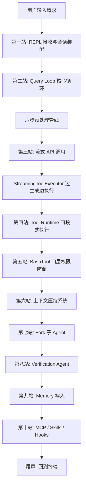
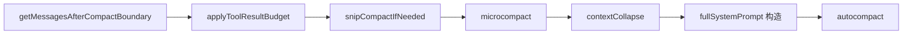
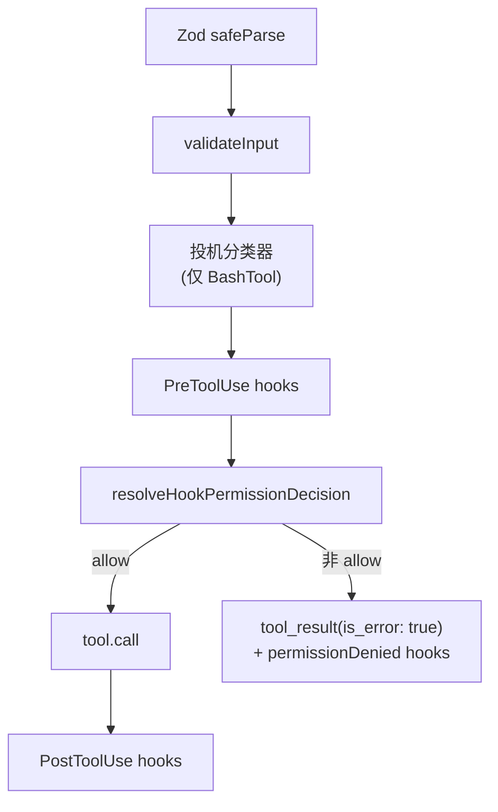
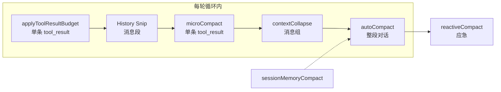
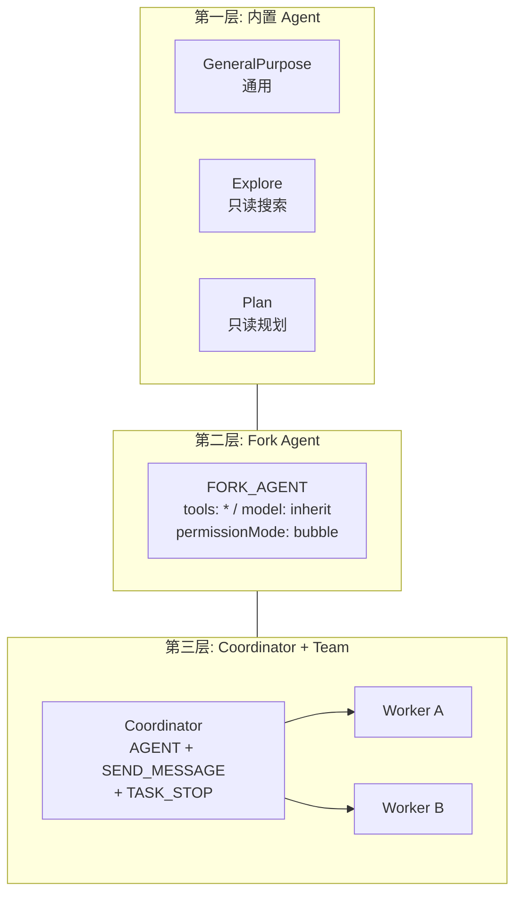

# Claude Code 源码导读：跟着一条请求走完 51 万行代码

> 2026 年 3 月 31 日，Anthropic 发布到 npm 的 Claude Code 包里附带了一个 `.map` 文件，指向了未混淆的 TypeScript 源码。1902 个源文件，512,685 行代码。本文不做目录导览，也不搞"带你读源码"——而是选一个足够复杂的真实任务，跟着它在系统内部的流转，一站一站地拆解 Claude Code 的核心工程。

下面是这条请求将要走过的完整旅程：



假设你在终端里输入了这样一条指令：

```
把 UserService 模块从回调风格重构为 async/await，修改相关的单元测试，确保测试通过
```

这个任务会触发 Claude Code 几乎所有核心能力：读代码理解依赖关系、编辑多个文件、执行 `npm test` 跑测试、可能 fork 子 Agent 并行工作、对话超长时压缩上下文、完成后提取记忆。

接下来，我们跟着这条请求，走完它在 51 万行代码里的完整旅程。

---

## 技术栈速览

在出发之前，先看一眼地图：

| 类别 | 技术选型 |
|------|---------|
| 运行时 | Bun |
| 语言 | TypeScript（~51 万行） |
| 终端 UI | React + Ink（140+ 组件） |
| CLI 框架 | Commander.js |
| Schema 校验 | Zod v4 |
| API SDK | `@anthropic-ai/sdk`（Beta messages + streaming） |
| 协议层 | MCP SDK + LSP |
| 遥测 | OpenTelemetry + gRPC（懒加载） |
| 特性开关 | GrowthBook + `bun:bundle` 编译期 `feature()` |

代码量分布极不均匀：`utils/` 占 180K 行（总量的 1/3，藏着权限系统、bash 安全检查、模型管理等核心业务逻辑）、`components/` 81K 行、`services/` 53K 行、`tools/` 50K 行、`commands/` 26K 行。

---

## 第一站：请求进入系统 — 启动与 REPL

### 启动：三段式分流

用户敲下回车之前，Claude Code 已经完成了一套精心设计的启动流程。

**第一段：入口分流**。真正的进程入口是 `src/entrypoints/cli.tsx`。它不急着把整个运行时拉起来，而是先做一系列 fast-path 判断——`--version` 直接打印后 return，零模块加载；`--daemon-worker`、`remote-control` 等子命令各自 `dynamic import` 后 return。只有默认路径才会动态加载主模块：

```typescript
// cli.tsx 第 33-41 行
async function main(): Promise<void> {
  const args = process.argv.slice(2);
  // Fast-path：--version 零模块加载
  if (args.length === 1 && (args[0] === '--version' || args[0] === '-v')) {
    console.log(`${MACRO.VERSION} (Claude Code)`);
    return;
  }
  // ... 各种子命令 fast-path ...
  // 默认路径：动态加载主模块
  const { main: cliMain } = await import('../main.js');
  await cliMain();
}
```

**第二段：进程初始化**。`main.tsx` 文件最前面有一组同步副作用——`profileCheckpoint`、`startMdmRawRead`、`startKeychainPrefetch`——在模块加载时就并行启动 prefetch，不等到函数被调用。然后 `run()` 用 Commander 构建 `program`，在 `preAction` hook 里完成配置加载、遥测初始化、迁移等。这一层只回答"进程能不能跑"，**刻意不碰当前会话语义**。

**第三段：会话准备**。Commander 的默认 `.action(...)` 确定工作目录、会话身份、工具面、权限模式、MCP 连接、插件加载，最后选择由交互式 REPL 还是无界面引擎承载。

这里有一个关键的架构决策：**进程状态和交互状态分开管理**。`cwd`、`sessionId`、`telemetry` 等沉在 `bootstrap/state` 里；`tasks`、`MCP clients`、`permission context` 等进入 `AppState`。分层让不同宿主（REPL、headless、远程、后台）共享同一套核心 runtime。

### REPL：不只是消息展示器

用户看到的是一个简洁的终端对话框。但 `screens/REPL.tsx` 的 import 列表透露了它的真实身份——它 import 了 `handlePromptSubmit`、`processUserInput`、`query`、`getSystemContext`/`getUserContext`、`getMemoryFiles`。这不是一个 view 组件，而是 **runtime 的控制台**。

用户敲下回车后，请求的精确路径是：

```
onSubmit → handlePromptSubmit → processUserInput（含 hooks）→ onQuery → query()
```

`handlePromptSubmit`（`utils/handlePromptSubmit.ts`）先 `queryGuard.reserve()` 防止并发提交，再调用 `processUserInput`。`processUserInput`（`utils/processUserInput/processUserInput.ts`）是一条小型管线：

```typescript
// processUserInput 内部管线：
// 1. 图像归一化（resize、格式转换）
// 2. bash 模式：直接转 bash 命令
// 3. slash 命令：/commit, /compact 等走独立分支
// 4. 普通文本：processTextPrompt 生成 UserMessage
// 5. UserPromptSubmit hooks 执行
```

如果输入不是 slash 命令且 `shouldQuery === true`，`handlePromptSubmit` 最终调用 `onQuery`，在这里面加载 `getUserContext()`（包含 CLAUDE.md 内容和当前日期）和 `getSystemContext()`（包含 git status 快照），然后进入核心循环：`query()`。

我们的重构请求是普通文本，所以它走 `processTextPrompt` 生成一条 `UserMessage`，带上 CLAUDE.md 中的项目规则和 git status，进入了 `query()`。

---

## 第二站：Query Loop — 核心循环与预处理

`query.ts` 是整个系统的心脏。1700+ 行代码，一个 `AsyncGenerator` 驱动的 `while(true)` 循环。

### 循环状态机

这不是一个简单的"调一次模型"。它维护一组**跨迭代的可变状态**：

```typescript
// query.ts 第 204-217 行
type State = {
  messages: Message[]                    // 当前对话历史
  toolUseContext: ToolUseContext          // 工具、模型、abort 等运行时上下文
  autoCompactTracking: AutoCompactTrackingState | undefined  // 自动压缩状态追踪
  maxOutputTokensRecoveryCount: number   // max_output_tokens 恢复尝试计数
  hasAttemptedReactiveCompact: boolean   // 是否已尝试响应式压缩
  maxOutputTokensOverride: number | undefined  // token 上限覆盖
  pendingToolUseSummary: Promise<ToolUseSummaryMessage | null> | undefined
  stopHookActive: boolean | undefined    // stop hook 是否在阻塞中
  turnCount: number                      // 轮数计数
  transition: Continue | undefined       // 上一轮为什么 continue
}
```

`autoCompactTracking`、`maxOutputTokensRecoveryCount`、`hasAttemptedReactiveCompact`——这些字段的存在说明系统承认了一件事：**一次 agent turn 不是线性的 API 调用，而是一段会被压缩、恢复、工具回灌、预算中断反复改写的运行**。

### 预处理管线：六步，不是五步

每轮循环在调用 API 之前，要经过一条六步预处理管线。源码里的精确顺序是（`query.ts` 第 365-468 行）：

```
getMessagesAfterCompactBoundary
    → applyToolResultBudget
        → snip
            → microcompact
                → contextCollapse
                    → fullSystemPrompt 构造
                        → autocompact
```



**第一步：取 compact 边界之后的消息**（365 行）。如果之前发生过 compact，只取边界之后的消息作为本次请求的上下文。

**第二步：applyToolResultBudget**（369-394 行）。对聚合的工具结果执行大小预算。源码注释特意强调"Runs BEFORE microcompact"——它按 `tool_use_id` 操作，和后续的微压缩正交，两者可以叠加。这种正交设计让每一层都可以独立演进。

**第三步：History Snip**（396-410 行，`feature('HISTORY_SNIP')`）。裁剪历史中被标记为可剪切的部分。关键细节：裁掉的 token 数 `snipTokensFreed` 会传递给后面的 autocompact，让阈值判断更准确——因为 `tokenCountWithEstimation` 从最新 assistant 的 usage 字段读取，看不到 snip 剪掉的部分。

**第四步：Microcompact（微压缩）**（412-426 行）。最细粒度的压缩。工具调用返回过长结果后就地缩减——让模型读一个 5000 行文件，微压缩可能只保留和当前任务相关的片段。

**第五步：Context Collapse（上下文折叠）**（440-447 行，`feature('CONTEXT_COLLAPSE')`）。源码注释说得非常清楚为什么放在 autocompact 之前：

```typescript
// query.ts 第 428-431 行
// Runs BEFORE autocompact so that if collapse gets us under the
// autocompact threshold, autocompact is a no-op and we keep granular
// context instead of a single summary.
```

如果折叠就能让 token 降到阈值以下，autocompact 就不会触发，保留了更细粒度的上下文。

**第六步：Autocompact（自动压缩）**（453-468 行）。这是最重量级的压缩——把整段对话摘要成一条简短的 summary。触发阈值不是简单的百分比，而是 `上下文窗口 - 20K - 13K`。20K 预留给摘要输出（p99.99 的摘要输出是 17,387 token），13K 是缓冲区。它接收 `CacheSafeParams` 和 `snipTokensFreed`，前者用于和父 agent 共享 prompt cache，后者用于修正阈值判断。

### Memory Prefetch：把未来的工作藏在当下

在循环开始时，系统还做了两件预取操作：

```typescript
// query.ts 第 301-304 行
using pendingMemoryPrefetch = startRelevantMemoryPrefetch(
  state.messages,
  state.toolUseContext,
)
```

`using` 是 TC39 的显式资源管理语法——生成器无论正常结束、抛异常还是被 `.return()` 关闭，都会自动清理。Memory prefetch 每 user turn 只做一次（prompt 在循环内不变），在流式输出和工具执行的间隙里静默完成。

Skill 发现也是同样思路——每轮迭代开头启动 `startSkillDiscoveryPrefetch`，与流式输出并发，轮末 `collectSkillDiscoveryPrefetch` 收割结果。

回到我们的重构请求：第一轮循环，对话历史很短，六步预处理大部分是 no-op。管线走完，系统构造好 `fullSystemPrompt`，准备调用 API。

---

## 第三站：流式 API 调用与工具触发

### API 层：Raw Stream 与 Watchdog

`services/api/claude.ts` 中的 `queryModelWithStreaming` 包装了真正的 API 调用。它使用 Anthropic SDK 的 Beta API 创建流式请求：

```typescript
anthropic.beta.messages.create({ ...params, stream: true })
```

两个关键工程决策：

1. **使用 raw stream** 而不是 SDK 封装的 `BetaMessageStream`——注释解释原因是避免后者的 O(n^2) JSON 增量解析。
2. **streaming idle watchdog**——可选的超时守卫（`CLAUDE_ENABLE_STREAM_WATCHDOG`），防止流式输出无限卡住。

### StreamingToolExecutor：边生成边执行

模型开始流式输出。对于我们的重构请求，它很可能先决定用 `GrepTool` 搜索 UserService 的代码，然后用 `FileReadTool` 读取具体文件。

传统做法是等模型输出完整的 `tool_use` block 再执行。Claude Code 有一个关键优化——**StreamingToolExecutor**（`services/tools/StreamingToolExecutor.ts`）：

**`addTool`**（76-124 行）：模型流式输出中每产生一个 `tool_use` block，就解析工具定义、`safeParse` 输入、判断 `isConcurrencySafe`、入队、触发 `processQueue`。也就是说，模型还在输出下一个工具调用的参数时，上一个工具可能已经在执行了。

**`processQueue`**（140-151 行）：从队列前端开始处理——如果当前工具是并发安全的就启动执行；如果是**非并发安全的**就 **break**，保证串行。这个顺序保证很重要：一个写文件的操作必须等前面的写操作完成。

**`getCompletedResults`**（412-440 行）：在流式过程中被主循环调用，取出已完成的结果。同样有严格的顺序保证——遇到一个正在执行的非并发安全工具就 break，后面的结果即使已经完成也不会提前吐出。

**`getRemainingResults`**（453-489 行）：流式结束后调用，用 `Promise.race` 收齐所有剩余结果。

还有一个精巧的容错机制：**sibling AbortController**。如果一个 Bash 命令执行出错，`siblingAbortController.abort('sibling_error')` 会连坐取消其它并行运行的 Bash 子进程——防止一个命令失败后其它命令继续在错误的状态下运行。

### Fallback、Tombstone 与恢复

如果主模型在流式输出过程中失败，系统会切换到 fallback model 重试。但主模型可能已经输出了一部分内容——包括带签名验证的 thinking blocks。这些"孤儿消息"必须被清理：

```typescript
// query.ts 第 712-718 行：流内 fallback 处理
// 对已输出的 assistantMessages 逐条 yield tombstone
for (const msg of assistantMessages) {
  yield { type: 'tombstone', message: msg }
}
// 清空数组，executor discard() + 重建
```

**tombstone** 消息标记这些残留内容——因为 partial thinking block 会导致后续 API 调用报签名错误。

对于 `max_output_tokens` 错误，处理更精妙：

1. 先**扣留**错误（`isWithheldMaxOutputTokens`），不立即 yield 给上层
2. 尝试 **escalation**——把 token 上限提升到 `ESCALATED_MAX_TOKENS`
3. 如果 escalation 无效，注入一条恢复消息让模型继续输出（最多 **3 次**）
4. 3 次都失败才放出错误

```typescript
// query.ts 第 164 行
const MAX_OUTPUT_TOKENS_RECOVERY_LIMIT = 3
```

用户中断的处理也不简单。当用户按 Ctrl+C 时，系统要为**每一个还没有返回结果的 `tool_use` block** 补一条 `is_error: true` 的 `tool_result`，否则 API 会因为消息协议不完整而拒绝下一次请求。这不是 Ctrl+C 那么简单——要在保持协议一致性的前提下，安全中断一个可能正在并行执行多个工具的 Agent。

回到我们的请求：模型流式输出了一个 `GrepTool` 调用来搜索 UserService 的代码。StreamingToolExecutor 在模型还在输出时就开始执行搜索了。搜索完成，结果被主循环收集。下一步，模型要读取具体文件。

---

## 第四站：Tool Runtime — 工具怎么被安全执行

### 工具不是函数，是受控执行单元

`Tool.ts` 定义的工具模型远不止一个函数签名。它是带完整运行时语义的对象：

```typescript
// Tool 的核心接口字段（概念性展示）
interface Tool {
  name: string
  inputSchema: ZodSchema        // Zod v4 schema，运行时校验模型输出
  aliases?: string[]             // 别名
  isConcurrencySafe(input): boolean  // 是否可并行（根据具体输入判断）
  isReadOnly(): boolean
  prompt(): string              // 给模型看的工具描述
  validateInput?(input): ValidationResult  // 自定义输入验证
  checkPermissions(ctx): PermissionResult
  call(input, ctx): Promise<ToolResult>
  mapToolResultToToolResultBlockParam(result, id): ToolResultBlockParam
}
```

差别不在 TypeScript 写法，而在系统观。`type Tool = (input: unknown) => Promise<string>` 只是"模型能调一个函数"；Claude Code 的设计是"运行时知道这个动作该怎么被约束、观测、并发和回灌"。

### 四段式执行链

单工具执行在 `toolExecution.ts` 中实现。`runToolUse` 函数（337-488 行）是入口：

**第一段：解析与兜底**。`findToolByName` 在当前工具列表中查找；找不到时尝试 `getAllBaseTools()` 的 aliases。完全找不到就返回一条 `tool_result(is_error: true)`——注意，**错误也是协议内的结构化结果**，主循环可以继续工作。

**第二段：abort 检查**。如果 `abortController.signal.aborted`，返回 `CANCEL_MESSAGE` 包装的 `tool_result`。

**第三段：`streamedCheckPermissionsAndCallTool`**（492-570 行）。它用一个 `Stream<MessageUpdateLazy>()` 把进度通知和最终结果合成一个 async iterable——内部异步执行 `checkPermissionsAndCallTool`，执行过程中的 progress 通过 `stream.enqueue` 实时推送。

**第四段：`checkPermissionsAndCallTool`**（599-1745 行），这是真正的执行核心，又分为多个子步骤：

```
Zod safeParse → validateInput → 投机分类器(仅Bash) → PreToolUse hooks
    → resolveHookPermissionDecision → 非allow直接return → tool.call → PostToolUse hooks
```



展开看每一步：

1. **Zod `safeParse`**（614-680 行）：用工具定义的 Zod schema 校验模型输出的参数。模型生成合法参数的能力并不完美——注释直说 "surprisingly, the model is not great at generating valid input"。校验失败时还会检查是否是 deferred tool（`buildSchemaNotSentHint`），提示模型先调用 `ToolSearchTool` 加载完整 schema。

2. **`validateInput`**（682-732 行）：工具自定义的语义校验。比如 `FileEditTool` 可以检查 `old_string` 是否真的存在于目标文件中。

3. **投机分类器**（734-751 行，仅 BashTool）：在权限检查之前就启动 AI 分类器——后面第五站详细讲。

4. **PreToolUse hooks**（800-862 行）：用户定义的 shell 命令钩子。可以返回 `hookPermissionResult`（允许/拒绝）、`hookUpdatedInput`（修改输入）、`preventContinuation`（阻止后续轮次）、或 `stop`（直接终止）。

5. **`resolveHookPermissionDecision`**（921-929 行）：合并 hook 的权限决策和系统权限规则，得出最终的 `permissionDecision`。

6. **非 allow → 拒绝路径**（995-1103 行）：构造 `tool_result(is_error: true)` + `executePermissionDeniedHooks` → **return**。关键设计：**被拒绝这件事也被包装成标准 tool_result 回到主循环**。主循环不需要区分"执行成功"和"权限拒绝"，它只看到"一份结构化结果，可以继续推理了"。

7. **allow → `tool.call`**（1206-1222 行）→ PostToolUse hooks / 失败 hooks。

### 并发策略：不由模型决定，由工具语义决定

`toolOrchestration.ts` 中的 `partitionToolCalls`（91-116 行）实现了一套精密的批分策略：

```typescript
// toolOrchestration.ts 第 91-116 行
function partitionToolCalls(toolUseMessages, toolUseContext): Batch[] {
  return toolUseMessages.reduce((acc, toolUse) => {
    const tool = findToolByName(toolUseContext.options.tools, toolUse.name)
    const parsedInput = tool?.inputSchema.safeParse(toolUse.input)
    const isConcurrencySafe = parsedInput?.success
      ? (() => {
          try { return Boolean(tool?.isConcurrencySafe(parsedInput.data)) }
          catch { return false }  // 解析失败则保守串行
        })()
      : false
    // 连续并发安全的合并为一批，否则新开一批
    if (isConcurrencySafe && acc[acc.length - 1]?.isConcurrencySafe) {
      acc[acc.length - 1]!.blocks.push(toolUse)
    } else {
      acc.push({ isConcurrencySafe, blocks: [toolUse] })
    }
    return acc
  }, [])
}
```

并发安全的工具（如 GrepTool、FileReadTool）被合并为一批，用 `all()` 限流器并发执行（上限默认 10，`CLAUDE_CODE_MAX_TOOL_USE_CONCURRENCY`）。有副作用的工具（如 FileEditTool、BashTool）总是单独成批、严格串行。`isConcurrencySafe` 不是静态标记——它接收具体输入，因为同一个 BashTool 执行 `ls` 是只读的，执行 `rm` 就不是。

回到我们的请求：GrepTool 搜索完成，FileReadTool 读取了 UserService 相关文件。模型分析完代码后，开始用 FileEditTool 重构代码。然后它要跑 `npm test`——BashTool 登场了。

---

## 第五站：BashTool 登场 — 四层权限纵深防御

BashTool 是整个系统里最危险的工具——它能执行任意 Shell 命令。Claude Code 围绕它构建了四层纵深防御体系，共 9300 行安全代码。

### 第一层：静态安全检查（bashSecurity.ts）

在命令执行之前，先过 23 种模式匹配检查。纯文本层面的危险模式检测：

- **Zsh `=cmd` 扩展**：`=curl` 会被展开成 `/usr/bin/curl`，绕过命令名检查
- **`zmodload`**：可加载 `zsh/system`（文件 I/O）、`zsh/zpty`（伪终端执行）、`zsh/net/tcp`（网络连接）——源码不只拦截 `zmodload`，还拦截这些模块提供的所有命令（`sysopen`、`ztcp`、`zsocket`...）
- **Unicode 零宽空格**：伪装命令，让安全检查看到的和实际执行的不一样
- **修改 `IFS`**：改变 shell 解析方式，让无害命令变危险

这一层的哲学是**宁可误杀，不可漏放**。

### 第二层：语义分析（bashPermissions.ts）

用 tree-sitter 解析命令的 AST，理解实际意图：读哪些文件、写哪些路径、是否在工作目录范围内。`readOnlyValidation.ts` 维护安全命令白名单，且**特定 flag 被排除**——比如 `fd` 命令的 `-x/--exec` 和 `-X/--exec-batch`，因为它们可以对搜索结果执行任意命令。

### 第三层：AI 分类器（yoloClassifier.ts）

Auto mode 的核心。用**独立的 LLM 调用**判断当前命令是否安全。输出是 Zod schema 校验的结构化 JSON，不是简单的 yes/no。超时或失败时 fallback 策略是 `ask`——无法证明安全就弹窗询问。

### 第四层：用户确认

前三层都通过后，如果命令仍不在白名单内，最后才弹窗。用户选择可被记住（`alwaysAllow` / `alwaysDeny`），减少后续弹窗。

### 投机性预取：把等待藏起来

`bashPermissions.ts` 第 1497-1527 行实现了一个精妙的优化：

```typescript
// bashPermissions.ts 第 1497-1527 行
export function startSpeculativeClassifierCheck(
  command: string,
  toolPermissionContext: ToolPermissionContext,
  signal: AbortSignal,
  isNonInteractiveSession: boolean,
): boolean {
  // ... 前置条件检查 ...
  const promise = classifyBashCommand(command, cwd, allowDescriptions, ...)
  promise.catch(() => {})  // 防止 unhandled rejection
  speculativeChecks.set(command, promise)
  return true
}
```

在 Zod 校验和 `validateInput` 通过后、PreToolUse hooks 之前（`toolExecution.ts` 734-751 行），系统就把分类器启动了。分类器结果存入 `speculativeChecks: Map<string, Promise<ClassifierResult>>`。后续权限决策时 `consumeSpeculativeClassifierCheck` 直接取出复用——**从 Map 中 delete 并 await 同一个 Promise**，避免重复等待。

回到我们的请求：模型要跑 `npm test`。静态检查通过（`npm` 不在危险命令列表里），语义分析识别为测试命令，AI 分类器判定安全（或者之前用户已经 `alwaysAllow` 了 npm），BashTool 执行 `npm test`。

测试结果返回到主循环。模型可能发现测试有失败的用例，需要修改测试代码，再次编辑文件、再次跑测试。每一轮都走完整的 `while(true)` 循环。经过几轮后，对话变长了——上下文告急。

---

## 第六站：上下文告急 — 压缩系统全面介入

### 六种压缩策略从细到粗



Claude Code 的上下文管理不是一种策略，而是**六种策略的编排**：

| 策略 | 粒度 | 触发时机 | 实现方式 |
|------|------|---------|---------|
| `applyToolResultBudget` | 单条 tool_result | 每轮循环 | 按 tool_use_id 裁剪大结果 |
| `History Snip` | 消息段 | 每轮循环 | 剪切被标记的历史片段 |
| `microCompact` | 单条 tool_result | 每轮循环 | 就地缩减长结果 |
| `contextCollapse` | 消息组 | 每轮循环（实验性） | 读时投影，折叠旧消息 |
| `autoCompact` | 整段对话 | token 接近窗口时 | fork agent 生成摘要 |
| `reactiveCompact` | 整段对话 | prompt_too_long 错误时 | 应急压缩 |

还有一个特殊的 `sessionMemoryCompact`——在 autocompact 之后保留跨压缩边界的关键信息。

### autoCompact 的工程细节

`services/compact/autoCompact.ts` 里有几个值得细看的数字：

```typescript
// autoCompact.ts 第 29-30 行
// p99.99 的 compact summary 输出是 17,387 token
const MAX_OUTPUT_TOKENS_FOR_SUMMARY = 20_000

// autoCompact.ts 第 62 行
export const AUTOCOMPACT_BUFFER_TOKENS = 13_000

// 阈值 = 上下文窗口 - 20K预留 - 13K缓冲
```

还有一个 **circuit breaker**（熔断器）：

```typescript
// autoCompact.ts 第 67-70 行
// BQ 2026-03-10: 1,279 sessions had 50+ consecutive failures (up to 3,272)
// in a single session, wasting ~250K API calls/day globally.
const MAX_CONSECUTIVE_AUTOCOMPACT_FAILURES = 3
```

连续失败 3 次就停止重试。这个数字背后是真实数据——1,279 个 session 曾有 50+ 次连续失败（最高 3,272 次），全球每天浪费约 25 万次 API 调用。

### autoCompact 如何共享 Prompt Cache

`compact.ts` 第 1178-1200 行透露了一个精巧的设计：autocompact 使用 `runForkedAgent` 执行摘要——而不是简单地调用模型。原因是**共享 prompt cache**：

```typescript
// compact.ts 第 1178-1200 行
if (promptCacheSharingEnabled) {
  // DO NOT set maxOutputTokens here. The fork piggybacks on the main thread's
  // prompt cache by sending identical cache-key params (system, tools, model,
  // messages prefix, thinking config). Setting maxOutputTokens would clamp
  // budget_tokens via Math.min(budget, maxOutputTokens-1) in claude.ts,
  // creating a thinking config mismatch that invalidates the cache.
  const result = await runForkedAgent({
    promptMessages: [summaryRequest],
    cacheSafeParams,
    querySource: 'compact',
    maxTurns: 1,
    skipCacheWrite: true,
    overrides: { abortController: context.abortController },
  })
}
```

注释反复强调**不能设 `maxOutputTokens`**——因为它会改变 `thinking config`，导致 cache 失效。这种对 cache 一致性的执念贯穿了整个多 Agent 设计。

### CLAUDE.md：唯一不可压缩的上下文

CLAUDE.md 有四层加载层级（`utils/claudemd.ts` 第 1-16 行）：

```
1. Managed（/etc/claude-code/CLAUDE.md）— 组织级全局指令
2. User（~/.claude/CLAUDE.md）— 用户级私有指令
3. Project（CLAUDE.md, .claude/CLAUDE.md, .claude/rules/*.md）— 项目级规则
4. Local（CLAUDE.local.md）— 本地私有规则
```

通过 `getUserContext()` → `getMemoryFiles()` → `getClaudeMds()` 注入每次 API 请求，**不受任何压缩影响**。这是架构约束——"把持久规则放在 CLAUDE.md 里"不是偏好，是因为它是唯一不会被压缩吞掉的上下文。

回到我们的请求：经过多轮工具调用，token 逼近上下文窗口。autocompact 触发，fork 出一个子 agent 生成摘要，摘要替换掉之前的对话历史。模型继续工作，但上下文已经大幅精简。

---

## 第七站：任务太复杂 — Fork 子 Agent

模型判断重构工作和测试修改可以拆分——它决定 fork 一个子 Agent 处理测试部分，自己继续处理重构。

### CacheSafeParams：Cache 共享的关键

`utils/forkedAgent.ts` 第 57-68 行定义了 `CacheSafeParams`：

```typescript
export type CacheSafeParams = {
  systemPrompt: SystemPrompt         // 必须与父级一致
  userContext: { [k: string]: string }  // 前置到消息
  systemContext: { [k: string]: string } // 追加到 system prompt
  toolUseContext: ToolUseContext        // 包含工具、模型、thinking config
  forkContextMessages: Message[]       // 父级上下文消息
}
```

注释解释了为什么这些参数必须完全一致：**Anthropic API 的 cache key 由 system prompt、tools、model、消息前缀和 thinking config 共同决定**。任何一个不匹配，cache 就作废。这也是为什么 fork 的 `model` 总是 `'inherit'`——换模型意味着前缀变了。

模块还维护了一个全局槽位：

```typescript
// forkedAgent.ts 第 70-81 行
let lastCacheSafeParams: CacheSafeParams | null = null
export function saveCacheSafeParams(params: CacheSafeParams | null): void { ... }
export function getLastCacheSafeParams(): CacheSafeParams | null { ... }
```

由 `handleStopHooks` 在每次 turn 后写入，供后续的 post-turn fork（promptSuggestion、postTurnSummary 等）复用——避免每个调用方都要层层传参。

### createSubagentContext：隔离清单

`createSubagentContext`（345-462 行）是子 Agent 隔离的核心。逐字段看它怎么做隔离：

| 字段 | 隔离方式 | 原因 |
|------|---------|------|
| `readFileState` | `cloneFileStateCache` | 文件缓存互不干扰 |
| `abortController` | `createChildAbortController(parent)` | 父 abort 传播到子，子不影响父 |
| `getAppState` | 包装 `shouldAvoidPermissionPrompts: true` | 后台 agent 不弹权限 UI |
| `setAppState` | no-op（除非 shareSetAppState） | UI 状态不互相污染 |
| `setAppStateForTasks` | **始终指向根** | 否则后台 bash 任务无法注册，变僵尸进程 |
| `localDenialTracking` | 新建 | 拒绝计数器独立累积 |
| `queryTracking` | 新 chainId，depth+1 | 独立的查询链追踪 |
| `contentReplacementState` | 克隆 | 与父消息里的替换决策一致 → wire 前缀一致 → cache hit |
| UI 回调 | 全部 undefined | 子 agent 不控制父 UI |

特别值得注意的是 `contentReplacementState` 的注释：

```typescript
// forkedAgent.ts 第 404-412 行
// Clone by default (not fresh): cache-sharing forks process parent
// messages containing parent tool_use_ids. A fresh state would see
// them as unseen and make divergent replacement decisions → wire
// prefix differs → cache miss. A clone makes identical decisions →
// cache hit.
```

为了保证 cache hit，连工具结果的替换决策都要保持一致。

### 三层 Agent 架构



Claude Code 的 Agent 系统有三层：

**第一层：内置 Agent**。`getBuiltInAgents()` 返回 `GENERAL_PURPOSE_AGENT`、`EXPLORE`（只读搜索）、`PLAN`（只读规划）等。它们通过 `disallowedTools` 做硬约束——不是靠 prompt 告诉模型"你不能编辑文件"，而是在工具注册层面直接移除写操作工具。模型根本**看不到**这些工具。

**第二层：Fork**。`FORK_AGENT`（`tools/AgentTool/forkSubagent.ts` 第 60-71 行）不注册在 builtInAgents 里，仅在 fork 实验开启时触发：

```typescript
export const FORK_AGENT = {
  agentType: FORK_SUBAGENT_TYPE,
  tools: ['*'],           // 继承父 Agent 完全相同的工具集
  model: 'inherit',       // 共享 prompt cache
  permissionMode: 'bubble', // 权限冒泡到父级
  maxTurns: 200,
  source: 'built-in',
  baseDir: 'built-in',
  getSystemPrompt: () => '',  // 被父级已渲染的 system prompt 覆盖
} satisfies BuiltInAgentDefinition
```

`tools: ['*']` + `useExactTools` 确保 API 请求的前缀字节**完全一致**，最大化 cache 命中。

Fork 有三条硬约束：
1. **不能偷看**：Fork 的工具调用结果写在 `output_file` 里，主 Agent 收到的只是完成通知。如果去 Read 这个文件，fork 的全部输出就会涌入主上下文——违背 fork 的隔离目的。
2. **不能换模型**：`model: 'inherit'`，换模型 = cache 作废。
3. **异步通知，不阻塞**：Fork 完成后通过 user-role message 通知主 Agent。

**第三层：Coordinator + Team**。`coordinator/coordinatorMode.ts` 让多个 Agent 通过 `SendMessageTool` 互相通信。协调器的工具集被严格限制（`COORDINATOR_MODE_ALLOWED_TOOLS`）：只有 `AGENT`、`TASK_STOP`、`SEND_MESSAGE`、`SYNTHETIC_OUTPUT`——它只管调度，不直接干活。

### 任务抽象：不是 Promise\<string\>

多 Agent 真正难的不是 prompt 分工，而是系统里出现多个执行体后，状态怎么管。Claude Code 用统一的 Task 抽象表达：

```typescript
type LocalAgentTaskState = {
  agentId: string
  prompt: string
  progress?: AgentProgress
  error?: string
  result?: AgentToolResult
  messages?: Message[]
  isBackgrounded: boolean     // 前后台切换是正式语义
  pendingMessages: string[]   // 子 Agent 带邮箱
  retain: boolean             // UI 是否还握着它
  diskLoaded: boolean         // 磁盘记录是否已回灌
  evictAfter?: number         // 回收时机
}
```

`pendingMessages` 说明子 Agent 不是一次性调用，而是**带邮箱的执行体**；`isBackgrounded` 让前后台切换成为正式语义；`retain`、`diskLoaded`、`evictAfter` 处理长期运行才会出现的回收问题。

---

## 第八站：验证结果 — Verification Agent

主任务完成后，Verification Agent 在后台异步验证代码变更。

`built-in/verificationAgent.ts` 的定义展示了代码层面的对抗性设计：

- **`background: true`**——不阻塞主 Agent 的执行流。验证是"不影响主流程"的旁路检查。
- **`disallowedTools`**——`AGENT_TOOL_NAME`（不能再生成子 Agent）、`FILE_EDIT_TOOL_NAME`、`FILE_WRITE_TOOL_NAME`、`NOTEBOOK_EDIT_TOOL_NAME`、`EXIT_PLAN_MODE_TOOL_NAME`。这是在工具注册层面的硬约束，比 prompt 可靠得多——prompt 可以被 jailbreak，工具列表不行。
- **`criticalSystemReminder_EXPERIMENTAL`**——在每次 user turn 都重新注入的短消息。普通 system prompt 在长对话中可能被压缩掉，但这个 reminder 每轮都出现。
- **`model: 'inherit'`**——共享 prompt cache。
- **注册条件**：`feature('VERIFICATION_AGENT') && tengu_hive_evidence`——双重门控，编译期 + 运行时。

输出格式是精确的 `VERDICT: PASS` / `VERDICT: FAIL` / `VERDICT: PARTIAL`——给代码消费的，不只是给人看的。

---

## 第九站：经验沉淀 — Memory 写入

任务完成了。但 Claude Code 的工作还没结束——系统后台提取本次对话的关键经验，写入记忆。

### Session Memory 提取

`services/SessionMemory/sessionMemory.ts` 实现了自动记忆提取：

- **注册为 post-sampling hook**，仅 `querySource === 'repl_main_thread'` 时执行（子 Agent 不触发）
- **使用 `runForkedAgent` + `createSubagentContext`** 在后台运行
- **`createMemoryFileCanUseTool`** 严格限制工具权限：只允许对精确的 `memoryPath`（MEMORY.md）执行 `Edit`——不能读源码，不能跑命令
- **触发条件**组合多个信号：初始化 token 门槛、`hasMetUpdateThreshold`、工具调用次数、`hasToolCallsInLastAssistantTurn`

记忆提取 Agent 的 prompt 里有一条效率指导：

> You have a limited turn budget. The efficient strategy is: turn 1 — issue all FileRead calls in parallel; turn 2 — issue all FileWrite/FileEdit calls in parallel.

连记忆提取 Agent 的 turn 数都要优化——每一次 API 调用都有成本。

### MEMORY.md 的双重截断

Auto memory 的 `MEMORY.md` 有双重截断——200 行和 25KB，取先到者。源码注释记录了为什么需要字节限制：

> ~125 chars/line at 200 lines. At p97 today; catches long-line indexes that slip past the line cap (p100 observed: 197KB under 200 lines).

有人在 200 行以内塞了 197KB——大概是把整个索引压成了超长的单行。字节限制是被真实使用数据逼出来的兜底。

### autoDream 与团队记忆

`src/services/autoDream/` 包含 consolidation prompt 和 lock 机制——某种后台整理和巩固记忆的系统。`src/services/teamMemorySync/` 负责团队记忆同步，内含 `secretScanner.ts` 在同步时扫描敏感信息。

这些功能指向一个方向：**记忆不只是"存下来"，还需要整理、巩固、共享、脱敏**。

---

## 第十站：扩展能力 — MCP / Skills / Hooks

在整个旅程中，MCP 工具、Skill、Hook 在各个环节注入能力。最后一站把它们串起来。

### MCP：外部工具怎么变成内部 Tool

`services/mcp/client.ts` 第 1743-1871 行展示了 MCP 工具的转换过程：

```typescript
// client.ts 第 1743-1871 行（概念性展示）
export const fetchToolsForClient = memoizeWithLRU(
  async (client: MCPServerConnection): Promise<Tool[]> => {
    const result = await client.client.request(
      { method: 'tools/list' },
      ListToolsResultSchema,
    )
    return result.tools.map((tool): Tool => {
      const fullyQualifiedName = buildMcpToolName(client.name, tool.name)
      return {
        ...MCPTool,                // 基于 MCPTool 模板展开
        name: fullyQualifiedName,  // 覆盖 name
        mcpInfo: { serverName: client.name, toolName: tool.name },
        isMcp: true,
        // 覆盖 call：实际走 callMCPToolWithUrlElicitationRetry
        async call(args, context, _canUseTool, parentMessage, onProgress?) {
          const connectedClient = await ensureConnectedClient(client)
          return callMCPToolWithUrlElicitationRetry({ ... })
        },
      }
    })
  },
)
```

核心设计：**不是把 MCP 原生对象直接塞进系统，而是翻译成已有的 `Tool` 运行时模型**。这样 UI、permission、query loop 都只需要理解 `Tool` 接口，不需要为 MCP 写专门逻辑。

连接管理通过 `MCPServerConnection` 联合类型建模——`Connected | Failed | NeedsAuth | Pending | Disabled`，每种状态有明确的处理路径。

### Skills：不是 Prompt 片段

源码里**不存在 `SkillDescriptor` 类型**——这是需要修正的。Skill 以 `Command`（`type: 'prompt'`）建模，通过 `createSkillCommand`（`skills/loadSkillsDir.ts` 第 270-401 行）创建。但它远不止一段提示词：

```typescript
// createSkillCommand 可以配置的维度
{
  type: 'prompt',
  name: skillName,
  description,
  allowedTools,           // 约束工具权限
  whenToUse,              // 触发条件
  model,                  // 模型偏好
  effort,                 // 推理力度
  hooks,                  // 钩子
  executionContext: 'fork', // 是否 fork 执行
  agent,                  // 代理身份
  getPromptForCommand(args, toolUseContext) {
    // ${CLAUDE_SKILL_DIR}, ${CLAUDE_SESSION_ID} 变量替换
    // shell 执行嵌入
  },
}
```

来源多样——`LoadedFrom = 'skills' | 'plugin' | 'managed' | 'bundled' | 'mcp'`——但最终都收敛为 `Command` 对象。

### Hooks：用户定义的生命周期钩子

`utils/hooks.ts` 约 5000 行，实现了完整的 hook 系统。Hooks 是用户定义的 shell 命令，在 Claude Code 生命周期各阶段执行。

关键事件包括：`PreToolUse`、`PostToolUse`、`PostToolUseFailure`、`UserPromptSubmit`、`SessionStart/End`、`SubagentStart/Stop`、`PreCompact/PostCompact`、`PermissionRequest/Denied` 等。

其中 `PreToolUse` hook 最强大——可以返回 `permissionDecision`（允许/拒绝）、`updatedInput`（修改工具输入）、`preventContinuation`（阻止后续轮次）。这让用户在不修改 Claude Code 源码的情况下就能注入自定义的安全策略。

超时设置很有意思：工具 hook 超时 10 分钟（`TOOL_HOOK_EXECUTION_TIMEOUT_MS`），但 SessionEnd hook 只有 1.5 秒——进程退出时不能久等。

### Plugins：能力组合包

`utils/plugins/pluginLoader.ts` 的 `loadAllPlugins` → `assemblePluginLoadResult` 合并三种来源的插件：市场插件、session 内联插件、内置插件。一个 plugin 可以带 agent 定义、hooks、MCP 服务器连接——它是能力组合包，不只是几个命令。

整个扩展层的核心原则：**外部来源可以多样，内部对象必须尽量少**。MCP prompt 变 Command，MCP tool 变 Tool，Skill 变 Command，Plugin 分解为 agents + hooks + MCP servers——最终主系统只需要理解 Tool、Command、Hook 这几种对象。

---

## 尾声：回到终端

让我们回到示例，看一眼完整的链路图：

```
用户输入 "重构 UserService..."
    │
    ▼
[REPL] onSubmit → handlePromptSubmit → processUserInput
    │  - 图像归一化、slash 命令检查
    │  - UserPromptSubmit hooks
    │  - getUserContext(CLAUDE.md) + getSystemContext(git status)
    ▼
[Query Loop] while(true)
    │  预处理管线：
    │  applyToolResultBudget → snip → microcompact
    │  → contextCollapse → fullSystemPrompt → autocompact
    │  Memory/Skill prefetch 并发启动
    ▼
[流式 API] queryModelWithStreaming (raw stream)
    │  StreamingToolExecutor 边生成边执行
    │  Fallback/Tombstone/Recovery 容错
    ▼
[Tool Runtime] 模型调用 GrepTool → FileReadTool → FileEditTool
    │  四段式执行：解析 → 校验 → 权限 → 执行
    │  并发策略：只读并发，副作用串行
    ▼
[BashTool] npm test
    │  四层防御：静态检查 → AST 语义 → AI 分类器 → 用户确认
    │  投机性分类器预取
    ▼
[上下文压缩] token 接近窗口
    │  autocompact fork agent 生成摘要
    │  共享 prompt cache
    ▼
[Fork Agent] 拆分子任务
    │  CacheSafeParams 保证 cache 一致
    │  createSubagentContext 隔离状态
    ▼
[Verification Agent] 后台异步验证
    │  disallowedTools 硬约束
    │  background: true
    ▼
[Memory] 经验写入 MEMORY.md
    │  post-sampling hook
    │  runForkedAgent 后台执行
    ▼
用户看到：重构完成，测试通过 ✓
```

整个过程中，MCP 工具、Skill、Hook 在各个环节注入能力，但最终都被收敛为系统内部的少数几种对象。

### 冰山之下

和 LLM 直接交互的核心代码（`query.ts` + `QueryEngine.ts` + `claude.ts`）加起来约 **6,400 行**。安全相关代码约 **9,300 行**。剩下的 **50 多万行**，全是让 Agent 安全、高效、可靠运行的工程基础设施。

6,400 行 AI 交互代码，50 万行工程基础设施——这就是 Agent Engineering 的真相。

---

## 附录：隐藏彩蛋

翻完源码，还有一些有意思的发现：

- **Capybara**：内部下一代模型代号。注释透露 v8 的虚假声明率 29-30%，v4 只有 16.7%。`maskModelCodename` 函数专门遮蔽代号。
- **Tengu（天狗）**：Claude Code 的内部项目代号，出现 1498 次。所有 analytics event 以 `tengu_` 为前缀。
- **Undercover Mode**：Anthropic 员工给外部项目提交代码时自动启用——剥离归属信息、隐藏模型身份、拦截内部信息。安全默认值是"开"。
- **KAIROS**：长期运行助手模式，关联 75 个文件。包含 `SleepTool`（Agent 休眠等待唤醒）、`autoDream`（记忆巩固）、`proactive` 模块（无需用户输入自主行动）。
- **Buddy System**：虚拟宠物系统。18 物种、5 稀有度。因为 capybara 物种名与模型代号冲突，所有物种名用 `String.fromCharCode` 编码绕过泄露检测。
- **Anti-Distillation**：`ANTI_DISTILLATION_CC` flag 开启后注入 `fake_tools`，防止竞品蒸馏训练。
