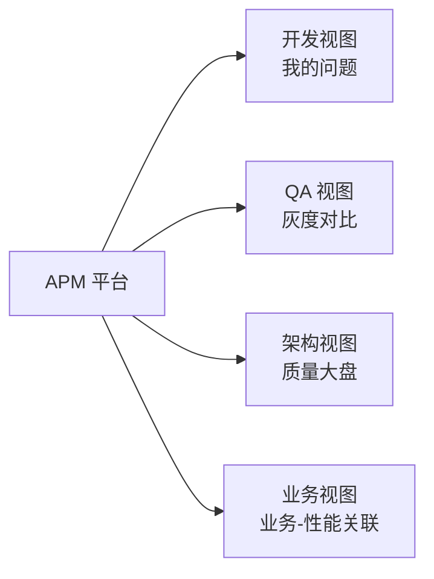
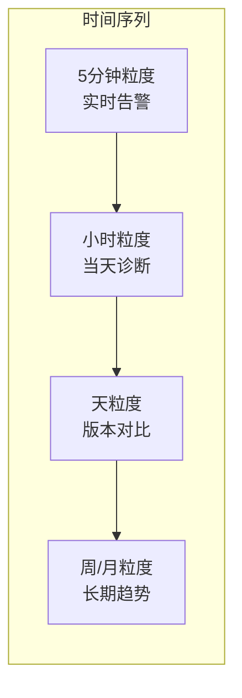
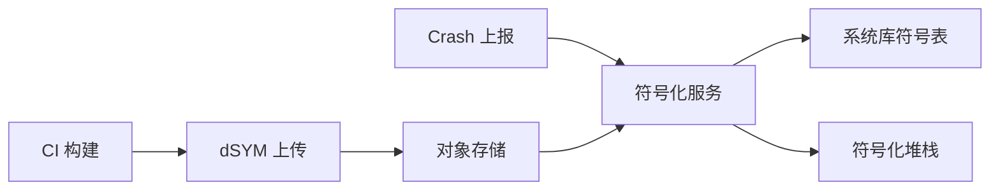
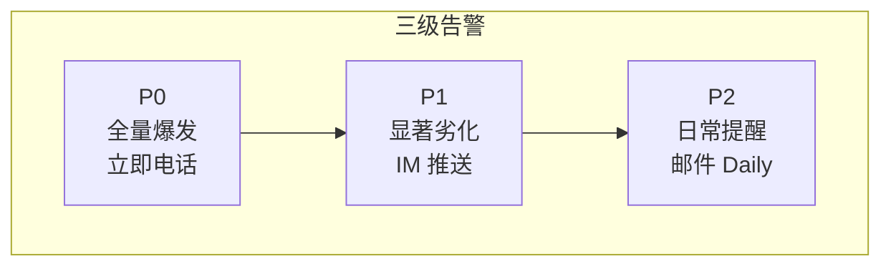
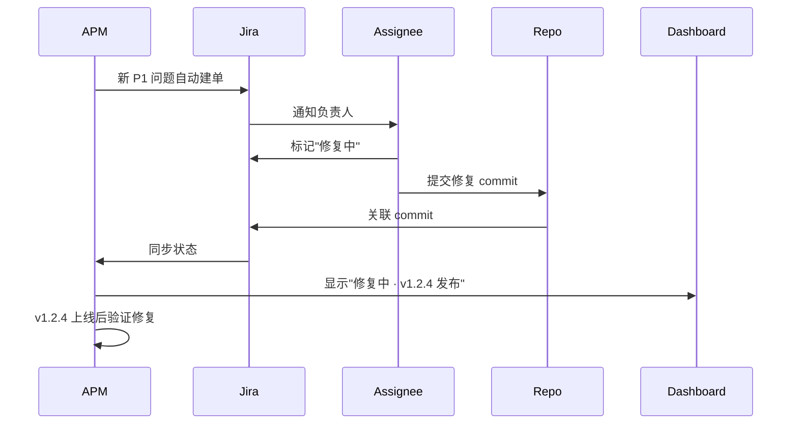
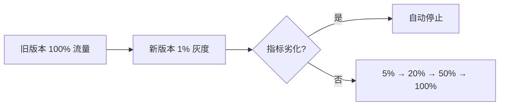
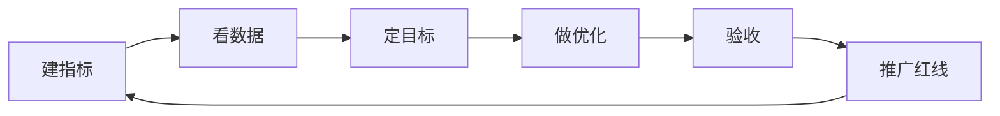
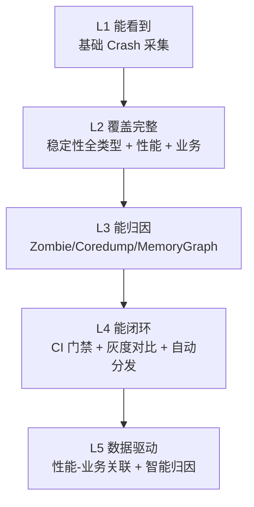

# APM-可视化与告警

"数据采得再全，看不见就等于没采"。本文聚焦 APM 平台侧的产品化设计——大盘、归因、告警、分发、防劣化，帮助团队把 APM 从"技术项目"变成"生产力工具"。

---

## 一、平台定位

APM 平台要同时服务四类角色：

| 角色 | 核心诉求 |
|-----|---------|
| 研发 | 看我负责的模块有没有问题、怎么修 |
| 测试 | 发现灰度/回归期间的性能劣化 |
| 技术负责人 | 跨模块质量对比、趋势 |
| 业务负责人 | 性能与业务指标的关联 |

不同角色看不同视图：



---

## 二、大盘设计

### 2.1 一级大盘（全局质量）

核心 8 个指标：

```
┌─────────────────────────────────────────────────────────────┐
│  今日质量概览 · v1.2.3 · 所有机型                            │
├─────────────────────────┬───────────────────────────────────┤
│ Crash 率: 0.08%         │  ▼ 0.02%  vs 上周                  │
│ Watchdog 率: 0.12%      │  ▲ 0.03%  vs 上周  ⚠️              │
│ FOOM 率: 0.25%          │  → 持平                            │
│ 启动 P90: 1240ms        │  ▼ 85ms   vs 上周                  │
│ FPS 平均: 58.3          │  → 持平                            │
│ 首屏秒开率: 76%         │  ▲ 3%     vs 上周                  │
│ 网络错误率: 1.2%        │  ▲ 0.3%   vs 上周  ⚠️              │
│ 内存峰值 P90: 480MB     │  ▲ 35MB   vs 上周  ⚠️              │
└─────────────────────────┴───────────────────────────────────┘
```

**设计要点**：

- 每个指标带"vs 上周"的 delta，让趋势一目了然
- 异常变化用 emoji 标记（不要用颜色做唯一信号，色盲用户）
- 指标可点击下钻到详情页

### 2.2 二级大盘（按维度切片）

必备切片维度：

- **按版本**：新版本与老版本对比
- **按机型**：看高端机 vs 低端机差异
- **按 OS**：iOS 15/16/17/18 分布
- **按渠道**：正式版 vs TestFlight vs 内测
- **按地域**：国内 vs 海外、不同省份
- **按网络**：WiFi / 4G / 5G / 弱网
- **按业务**：首页 / 详情页 / 下单页

### 2.3 时序图



**存储建议**：ClickHouse 物化视图预聚合，不同粒度分别查。

---

## 三、问题详情页

### 3.1 Crash 详情页

```
┌──────────────────────────────────────────────────────────┐
│ Issue #12345 · EXC_BAD_ACCESS in UIViewController.dealloc │
│ Status: Open · Owner: @dev · First Seen: 2026-04-20       │
├──────────────────────────────────────────────────────────┤
│ 影响: 1.2k 用户 / 4.8k 次 · 趋势: 过去 24h ↗ 35%           │
│                                                            │
│ [堆栈]                                                     │
│ 0  MyApp         -[PayViewController dealloc]    (PayVC:45)│
│ 1  UIKit         -[UIViewController .cxx_destruct]        │
│ ...                                                        │
│                                                            │
│ [设备分布]  iPhone 15:35%  iPhone 14:28%  ...              │
│ [版本分布]  1.2.3:95%  1.2.2:5%                            │
│ [归因提示]  🤖 此问题可能与 MRC 下的 KVO 解注册有关         │
│                                                            │
│ [现场日志]  用户最后操作: 支付页 → 确认按钮                  │
│ [用户轨迹]  Home → Detail → Cart → Pay                     │
└──────────────────────────────────────────────────────────┘
```

### 3.2 堆栈聚合

按 Top N 栈帧 hash 分组，展示：

- 同类问题所有 report 的数量
- 最具代表性的一个堆栈（按栈帧相似度投票）
- 影响设备、版本、地区分布
- 首次出现版本 / 最近出现版本

### 3.3 相似问题

用 Locality-Sensitive Hashing 找相似度 > 80% 的其他 Issue，辅助判断是否是同一根因。

### 3.4 归因建议（AI 加持）

结合大模型给出归因建议：

```
堆栈分析:
- 你的代码帧: PayVC.dealloc
- 系统帧: UIViewController.cxx_destruct
- 崩溃原因: 在 dealloc 中访问了已释放对象
可能的原因:
1. KVO 未在 dealloc 前移除
2. 定时器 target 强引用自己
3. block 捕获 self 强引用
建议:
- 使用 @Observable（iOS 17+）或 SwiftUI 替代 KVO
- Timer 使用 weak self 方案
```

---

## 四、归因工具链

### 4.1 符号化

平台必备能力：



系统库符号：

- 按 `iOS 版本 × 设备架构` 组织
- 来源：`~/Library/Developer/Xcode/iOS DeviceSupport/` 或从崩溃设备导出 .ips 反推

### 4.2 Coredump 调试

服务端提供 lldb 交互：

```
$ apm debug --issue=12345
Loading coredump...
(lldb) bt all
(lldb) frame variable
(lldb) memory read 0x100001000
(lldb) register read x0
```

### 4.3 MemoryGraph 可视化

- 类列表：对象数 + 内存占用
- 引用关系图：对象 → 引用者 / 被引用者
- 同名对象的共性分析（所有 ImageIO 对象是否都被同一对象引用）

参见 [APM-业界方案](APM-业界方案.md) 中"Slardar MemoryGraph"案例。

### 4.4 火焰图

CPU 异常、启动耗时、卡顿堆栈都适合用火焰图展示：

- 横轴：占用时长
- 纵轴：调用栈深度
- 颜色：按模块（自己代码 / 系统 / 三方）

---

## 五、告警设计

### 5.1 告警层级



| 级别 | 触发条件 | 通知方式 | SLA |
|-----|---------|---------|-----|
| P0 | Crash 率绝对值 > 0.5% | 电话 + IM + 短信 | 15 分钟响应 |
| P1 | Crash 率环比翻倍，绝对值 > 0.1% | IM + 邮件 | 2 小时响应 |
| P2 | 单 Issue 影响 > 100 用户 | 邮件 + Dashboard | 当日响应 |

### 5.2 告警规则类型

- **阈值告警**：绝对值超过阈值
- **环比告警**：与上小时/昨天/上周同期比
- **趋势告警**：近 N 小时持续上升
- **同比告警**：同功能版本间对比
- **变点告警**：时序算法检测突变

### 5.3 避免告警疲劳

以下策略缺一不可：

1. **去重**：同一 Issue 24h 内只告一次
2. **合并**：相关告警合并成一条（同类 Crash、同机型、同版本）
3. **静默窗口**：下班后只告 P0
4. **升级**：未响应自动升级给上级
5. **反馈**：告警接收人可标记"误报"，训练规则

### 5.4 灰度自动拦截

APM 能力打通发布平台，新版灰度时自动对比：

```python
if 新版 Crash率 > 老版 × 1.5:
    stop_rollout()
    alert("灰度劣化，自动停止")
```

---

## 六、分发与工作流

### 6.1 自动分发

问题生成后自动分配 owner：

1. **堆栈 owner**：从栈帧符号反查 `OWNERS` 文件
2. **模块 owner**：根据代码目录 map
3. **业务 owner**：按业务 tag

### 6.2 与 Jira / 飞书集成



### 6.3 修复验证

Issue 标记"已修复 in v1.2.4"后，APM 自动在 v1.2.4 上线 3 天后：

- 对比新版同一堆栈出现次数
- 下降 95%+ 自动标记"已验证"
- 未下降自动打开并升级

---

## 七、防劣化闭环

### 7.1 CI 门禁

```yaml
apm:
  thresholds:
    - metric: launch_p90
      max: 1500ms
      fail_on: regression_10_percent
    - metric: memory_peak_p90
      max: 500MB
      fail_on: regression_5_percent
    - metric: binary_size
      max: 200MB
      fail_on: regression_1_percent
```

每个 PR 走自动化性能测试（启动、内存、核心路径），超阈值阻止合并。

### 7.2 灰度对比



每一档灰度放开前，APM 自动验证:

- 无新增 P0 Crash
- 核心指标无显著劣化
- 用户反馈无异常

### 7.3 代码规范

部分问题可以从源头阻止：

- SwiftLint / Periphery 检查未使用代码
- 自定义规则：禁止在 `dealloc` 访问 self 的属性（iOS Swift 无此问题，OC 有）
- 禁止主线程同步网络请求
- `NSOperationQueue` 必须设置 `maxConcurrentOperationCount`
- 图片 `imageNamed:` 替换为 `imageWithContentsOfFile:` 避免缓存

### 7.4 线下复现

对于难复现的问题，APM 应提供"现场一键复现"：

- 导入用户路径（一串页面名 + 动作）
- 导入用户设备画像（机型 + 系统 + 内存水位）
- 用 UI 自动化回放

---

## 八、性能测试工作台

除了线上监控，APM 还要覆盖"研发期"：

### 8.1 性能实验室

每日自动化跑：

- 启动耗时（冷/温/热）
- 内存（闲置/高峰）
- FPS（列表滚动/动画）
- 包体积

硬件：接入多款机型 Rack，MacMini 集群做无人值守。

### 8.2 PR 性能体检

PR 打开时自动触发：

1. 拉取该分支 + master 两份构建
2. 在同一台设备上跑相同脚本
3. 生成对比报告评论回 PR

### 8.3 PR 机器人留言示例

```
🤖 APM Bot:
启动耗时: 1240ms → 1320ms (+6.5% ⚠️)
内存峰值: 420MB → 425MB (+1.2%)
包体积: 180MB → 180.3MB
首页秒开率: 98% → 98% (持平)

⚠️ 启动耗时劣化，建议检查:
- 新增的 +load 方法
- didFinishLaunching 中的同步初始化

详情: https://apm.example.com/pr/1234
```

---

## 九、数据驱动的指标治理

### 9.1 指标演进的节奏

APM 指标不是一蹴而就：



### 9.2 业务联动

APM 指标要与业务指标关联：

- **启动时间每降 100ms，DAU +X%**
- **秒开率每升 1 个百分点，转化率 +Y%**
- **Crash 率每降 0.01%，次日留存 +Z%**

这些结论需要长期埋点数据 + AB 实验得出。有了数据，APM 才能说服业务投入资源优化性能。

### 9.3 OKR 对齐

质量 OKR 示例：

```
O: 打造行业领先的移动端体验
  KR1: 异常崩溃率 < 0.1%（目前 0.25%）
  KR2: 启动 P90 < 1500ms（目前 2100ms）
  KR3: 首屏秒开率 > 80%（目前 65%）
  KR4: 建立全生命周期防劣化体系
```

---

## 十、成熟度自评



| 级别 | 特征 | 参考对标 |
|-----|------|---------|
| L1 | 只采 Crash，人工看 | 初创团队 |
| L2 | 覆盖 4 大指标族，有大盘 | 中大 App 基础配置 |
| L3 | 疑难问题可归因 | 头部 App |
| L4 | 研发流程闭环 | 字节/微信/阿里 |
| L5 | 数据驱动决策 | 行业标杆 |

---

## 十一、常见陷阱

1. **只看均值不看分位数**：覆盖不了长尾用户
2. **大盘太多指标**：注意力分散，应聚焦 8~10 个核心
3. **告警过多**：团队会屏蔽整个告警群
4. **指标没 owner**：劣化时无人负责
5. **没有修复验证**：以为修了其实没修
6. **只有监控，没有治理**：数据躺在后台，不能转化为质量提升
7. **APM SDK 带病上线**：SDK 自己 Crash 导致更大事故
8. **平台不支持多 App**：重复建设
9. **没有 AB 能力**：无法验证优化真实收益

---

## 十二、总结

APM 的可视化与告警是把"数据"转化为"决策"的关键一环。一个优秀的 APM 平台应该做到：

1. **看得见**：大盘一屏看全貌，详情一点看根因
2. **找得到**：自动归因、自动聚类、自动分发
3. **叫得醒**：分级告警、防疲劳、自动升级
4. **防得住**：CI 门禁、灰度对比、修复验证
5. **对得上**：性能指标与业务指标关联，量化优化收益

至此，APM 系列六篇全部完成：

| 文章 | 核心收获 |
|-----|---------|
| [APM](APM.md) | 体系设计与演进路线 |
| [APM-指标体系](APM-指标体系.md) | 每个指标的定义、计算、目标 |
| [APM-数据采集](APM-数据采集.md) | 每种指标的具体采集技术 |
| [APM-数据上报](APM-数据上报.md) | 采样、聚合、上报、合规 |
| [APM-业界方案](APM-业界方案.md) | 七大主流方案深度剖析 |
| [APM-可视化与告警](APM-可视化与告警.md) | 大盘、归因、告警、防劣化 |

**与现有文章的联动**：稳定性系列（[崩溃-治理](../崩溃/崩溃-治理.md) 等）提供了 Crash 原理深度；[卡顿-检测](../卡顿/卡顿-检测.md) 提供了卡顿代码细节；[启动优化](../启动优化/启动优化.md) 提供了启动阶段拆解；[耗电-治理](../耗电/耗电-治理.md) 提供了能耗细节；[Instruments详解](../Instruments详解.md) 提供了线下工具参考；[线上故障预防](../线上故障预防.md) 提供了治理哲学。APM 系列则把这些散落的点串成完整体系。
