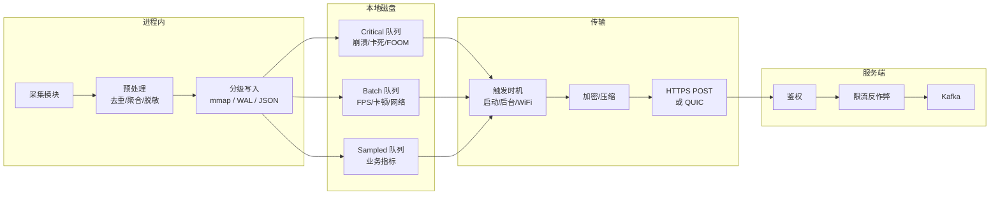
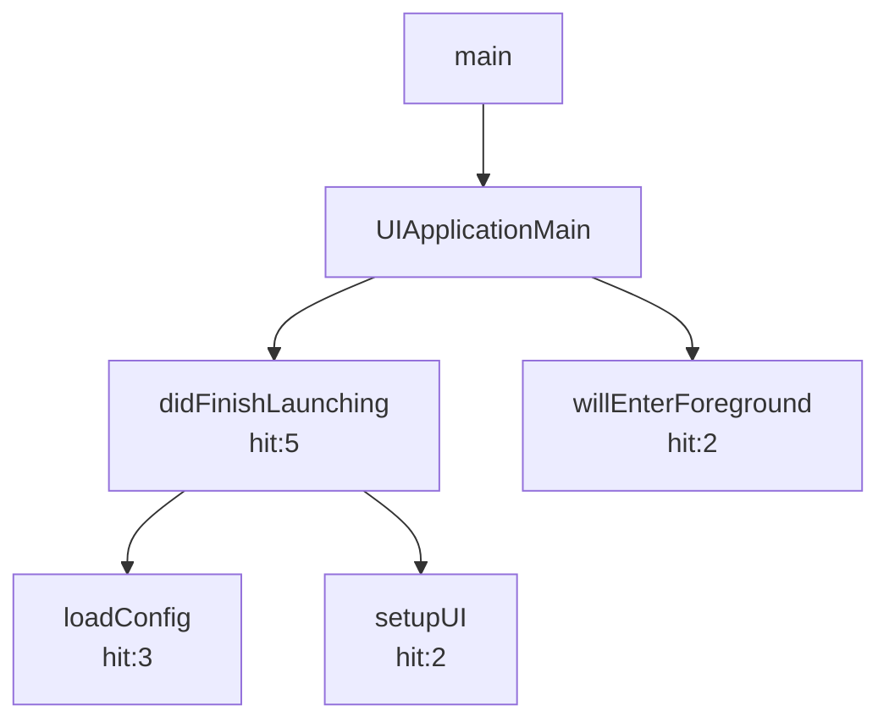
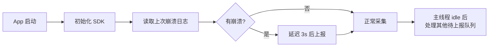

# APM-数据上报

采集只是拿到数据，"如何把数据送到服务端、且送对数据"是 APM 工程化的难点。本文讨论 SDK 层的落盘、聚合、采样、上报、合规、鲁棒性六大问题。

---

## 一、上报模型总览



---

## 二、数据分级

不是所有数据同等重要，按**丢失成本**分三级：

| 级别 | 代表数据 | 存储策略 | 上报时机 |
|-----|---------|---------|---------|
| Critical | Crash / Watchdog / FOOM / 致命业务错误 | 同步 fsync 落盘 | 下次启动立即上报 |
| Important | 启动时间、页面加载、网络错误 | WAL 异步刷盘 | App 进入后台 / 每 30s 打包 |
| Sampled | FPS 时序、CPU 时序、业务埋点 | 纯内存 ring buffer | WiFi + 每 5min 一批 |

---

## 三、崩溃现场的异常环境

Crash handler 中**不能**做的事：

| ❌ | 原因 |
|---|-----|
| `malloc` | 可能加锁导致死锁 |
| `NSLog` | 依赖 os_log，非 async-signal-safe |
| 走完整上报流程 | 链路长，极易二次崩溃 |
| 符号化 | 符号化依赖 dlsym，非安全 |

**正确做法**：

```c
void crash_handler(int sig, siginfo_t *info, void *ucontext) {
    static char buffer[65536];
    int fd = open("/path/to/crash.log", O_WRONLY | O_CREAT | O_TRUNC, 0644);

    write_header(fd, buffer, sig, info);
    write_thread_states(fd);
    write_backtraces(fd);
    write_image_info(fd);

    fsync(fd);
    close(fd);

    raise(sig); // 让默认 handler 继续生成系统 .ips
}
```

关键点：

- 使用 async-signal-safe 的 `write`/`open`/`fsync`
- 内存完全预分配（static buffer）
- `fsync` 保证数据真的落盘
- 最后 `raise(sig)` 保留系统行为（Xcode Organizer 仍能看到）

下次启动时读取 `crash.log`，完整处理（符号化、聚合、上报）。

---

## 四、本地存储方案

### 4.1 mmap 环形缓冲

高频数据（FPS、CPU、日志）首选 mmap：

```c
int fd = open(path, O_RDWR | O_CREAT, 0644);
ftruncate(fd, BUFFER_SIZE);
void *buffer = mmap(NULL, BUFFER_SIZE, PROT_READ | PROT_WRITE, MAP_SHARED, fd, 0);
```

优点：

- write 只写页表，内核懒刷盘
- 进程崩溃时内核会保证已 dirty 页写入磁盘（除非机器断电）
- 相比 NSUserDefaults / 直接 write()，开销低 10 倍以上

缺点：

- 需要自己实现 ring buffer 指针管理
- 读取格式要兼容写入中的"半条"数据

### 4.2 WAL（Write-Ahead Log）

稳定性数据的二次保险：

```
[header: magic, version, write_offset, read_offset]
[record 1: len, data, checksum]
[record 2: len, data, checksum]
...
```

上报成功后更新 `read_offset`，可保证"至少上报一次"。

### 4.3 数据库（SQLite / WCDB）

- 适合有字段查询需求的场景（如用户轨迹）
- 记得开 WAL 模式、配置 `auto_vacuum`
- 不推荐单条高频写入，会导致磁盘 IO 异常

---

## 五、采样策略

### 5.1 全量 vs 采样

| 类型 | 建议 |
|-----|-----|
| Crash / Watchdog / FOOM | 100% 全量 |
| 卡顿（堆栈）| 1~10%（按设备 + 版本差异化）|
| 页面耗时 | 10~50% |
| FPS 时序 | 1% |
| 业务埋点 | 按业务重要性 |

### 5.2 分层采样

```swift
func shouldSample(key: String, rate: Double) -> Bool {
    let hash = deviceId + key + dateString()
    let value = hash.md5.prefix(8).hexToUInt64
    return Double(value) / Double(UInt64.max) < rate
}
```

**按 deviceId 采样**：保证"一个用户要么全采、要么全不采"，避免同一用户只上报部分堆栈导致聚合失真。

### 5.3 Reservoir Sampling（蓄水池采样）

当某堆栈在同一会话中出现 N 次，只保留等概率的 k 条：

```swift
class Reservoir<T> {
    let capacity: Int
    var buffer: [T] = []
    var count: Int = 0

    func add(_ item: T) {
        count += 1
        if buffer.count < capacity {
            buffer.append(item)
        } else {
            let idx = Int.random(in: 0..<count)
            if idx < capacity { buffer[idx] = item }
        }
    }
}
```

卡顿堆栈特别适用——同一连续卡顿可能采到几百次，只保留 10 个有代表性的即可。

### 5.4 退火采样（微信 Matrix）

相同堆栈重复出现时按斐波那契延长间隔：

```
第 1 次相同：下次采样间隔 = 1 秒
第 2 次：= 2 秒
第 3 次：= 3 秒
第 4 次：= 5 秒
第 5 次：= 8 秒
...
```

---

## 六、聚合与压缩

### 6.1 堆栈聚合

同一类问题可能有千万条堆栈上报。Client 端做两次聚合：

**堆栈去重**（hash）：

```swift
func stackHash(_ frames: [UInt64]) -> String {
    let top = frames.prefix(5).map { String(format: "%x", $0) }.joined(separator: "-")
    return top.md5
}
```

只上报 hash + 若干采样，服务端再做全量聚合。

**二叉树聚合**（美团 Hertz）：

多组堆栈存为二叉树，共用前缀节省 50%+ 存储：



### 6.2 压缩

- gzip：通用，压缩比 70%+
- zstd：更快，压缩比更高
- protobuf + varint：整数字段密集场景
- brotli：文本日志最优

实测：10KB 堆栈 JSON → gzip 2KB → zstd 1.5KB。

---

## 七、上报时机

### 7.1 触发点

| 时机 | 适合数据 | 注意 |
|-----|---------|-----|
| App 启动（+1~3s） | 上次 Crash / FOOM 包 | 别挤占启动主线程 |
| 进入后台 | 累积批次 | `beginBackgroundTask` 限时 30s |
| WiFi 空闲 | 大包 / MemoryGraph | `BGTaskScheduler` |
| 达到阈值（条数/大小） | 业务埋点 | 避免瞬时爆发 |
| 手动触发 | 测试/灰度 | 调试面板 |

### 7.2 后台任务

```swift
let id = UIApplication.shared.beginBackgroundTask(withName: "apm-upload") {
    UIApplication.shared.endBackgroundTask(id)
}

uploadQueue.async {
    self.uploadBatch { success in
        UIApplication.shared.endBackgroundTask(id)
    }
}
```

长任务用 BGTaskScheduler：

```swift
BGTaskScheduler.shared.register(forTaskWithIdentifier: "com.app.apm.upload", using: nil) { task in
    handleUpload(task: task as! BGProcessingTask)
}

let req = BGProcessingTaskRequest(identifier: "com.app.apm.upload")
req.requiresNetworkConnectivity = true
req.requiresExternalPower = false
try? BGTaskScheduler.shared.submit(req)
```

### 7.3 启动采集与上报的先后



**严禁在 `didFinishLaunching` 中做同步上传**——会直接拖慢启动、降低秒开率。

---

## 八、重试与可靠性

### 8.1 指数退避

```swift
func retry(_ task: @escaping () async throws -> Void) async {
    var delay: Double = 1
    let maxDelay: Double = 300
    for attempt in 0..<5 {
        do {
            try await task()
            return
        } catch {
            try? await Task.sleep(nanoseconds: UInt64(delay * 1_000_000_000))
            delay = min(delay * 2, maxDelay)
        }
    }
}
```

**jitter**：在 `delay` 上加随机 ±20%，避免所有设备同时重试。

### 8.2 丢包阈值

不能无限重试：

- 单条数据重试 < 5 次
- 本地队列 > 10MB 时，丢弃低优先级
- 整体失败率 > 50% 触发降级采样

### 8.3 Exactly-once

服务端通过 `request_id` 去重。客户端生成：

```swift
let requestId = "\(deviceId)-\(timestamp)-\(counter)"
```

---

## 九、隐私与合规

### 9.1 Apple 要求

- **IDFA**：需 ATT 授权，APM 一律不用
- **IDFV**：同一 Vendor 下唯一，卸载重装变化，作为设备 ID 够用
- **精准定位**：禁止采集
- **通讯录、照片、麦克风**：禁止

### 9.2 GDPR / 个保法

- 所有采集必须在隐私政策明示
- 关键日志要脱敏（token、手机号、身份证、地址）
- 提供"拒绝采集"开关
- 数据保留期限（通常 90~180 天）
- 用户可导出、可删除自己的数据

### 9.3 脱敏规则

```swift
let patterns: [NSRegularExpression] = [
    try! NSRegularExpression(pattern: "1\\d{10}"),                  // 手机
    try! NSRegularExpression(pattern: "\\d{17}[\\dXx]"),            // 身份证
    try! NSRegularExpression(pattern: "\\b[\\w.-]+@[\\w.-]+\\b"),   // 邮箱
    try! NSRegularExpression(pattern: "(?:bearer|token)[^\\s]+", options: .caseInsensitive),
]

func sanitize(_ text: String) -> String {
    var result = text
    for p in patterns {
        let range = NSRange(location: 0, length: result.utf16.count)
        result = p.stringByReplacingMatches(in: result, range: range, withTemplate: "***")
    }
    return result
}
```

### 9.4 境外数据合规

- 欧盟用户数据必须存欧盟
- 中国用户数据不能出境（个保法）
- APM SaaS（Sentry/Firebase）在中国慎用

---

## 十、传输层

### 10.1 协议选择

| 协议 | 适用 |
|-----|-----|
| HTTPS | 默认方案，兼容性最好 |
| QUIC / HTTP/3 | 弱网场景 30%+ 耗时降低 |
| WebSocket | 实时双向（APM 不需要）|

### 10.2 Header 设计

```
POST /apm/v1/ingest
Content-Type: application/octet-stream
Content-Encoding: zstd
X-APM-App-Id: com.example.app
X-APM-App-Version: 1.2.3
X-APM-SDK-Version: 2.0.0
X-APM-Device-Id: 5f3e...
X-APM-Request-Id: abc-123
X-APM-Sign: HMAC-SHA256(...)
```

### 10.3 鉴权

- 静态 AppKey + HMAC 签名，防止 URL 被抓包重放
- 服务端按 `(app_id, version, sdk_version)` 限流
- 异常 UA/异常 SDK 版本进入隔离桶

### 10.4 网络连通性

- 检测 `NWPathMonitor`，WiFi 下优先上报大包
- 蜂窝下只传 Critical，其余等 WiFi
- 允许用户设置"仅 WiFi 上传 MemoryGraph"

---

## 十一、反作弊与灰度

### 11.1 服务端限流

APM 数据容易被攻击放大：

- 单 device_id 每秒上限 10 条
- 单 app_id 每秒上限按 DAU 动态调整
- 超限进入丢弃 / 采样桶

### 11.2 SDK 自熔断

服务端可以返回"降级指令"：

```json
{
    "ok": true,
    "config": {
        "sample_rate": 0.1,
        "upload_interval": 600,
        "disabled_modules": ["memorygraph"]
    }
}
```

客户端拉取远程配置（`Orion`、`Firebase Remote Config` 等），动态调采样。

### 11.3 版本黑名单

某版本爆 Crash 时，服务端可把该版本加入黑名单，让 SDK 自动只上报 Summary 不上堆栈。

---

## 十二、鲁棒性

### 12.1 防 SDK 反杀 App

- 所有线程都要 `@try`/C++ try 包裹（但不要吞 SIGSEGV）
- 内存申请失败不能让 App 崩
- 初始化失败要有 fallback（禁用该模块而非 crash）

### 12.2 时钟漂移

- 手机系统时间可以被用户改
- 上报时带 `mach_absolute_time`（单调时钟）+ `wall_clock_time`
- 服务端用 `server_time - wall_clock_time` 计算偏差修正

### 12.3 进程复活

在 iOS 上，Crash 后进程直接死，没有"重启"逻辑。通过"上次未正常退出"判定下次启动时补发。

---

## 十三、典型数据包结构

上报包的二进制/JSON 字段建议：

```json
{
  "session_id": "uuid",
  "device": {
    "id": "idfv-based",
    "model": "iPhone15,2",
    "os": "iOS 18.1",
    "lang": "zh-CN",
    "tz": "Asia/Shanghai",
    "memory_total": 6442450944,
    "disk_free": 123456789
  },
  "app": {
    "id": "com.example.app",
    "version": "1.2.3",
    "build": "12300",
    "channel": "appstore"
  },
  "sdk": {
    "name": "apm",
    "version": "2.1.0"
  },
  "events": [
    {
      "type": "crash",
      "timestamp": 1716000000000,
      "mach_time": 123456789,
      "signal": "SIGSEGV",
      "thread": 0,
      "backtraces": [{"thread_id": 0, "frames": [...]}],
      "images": [{"name": "...", "uuid": "...", "slide": "..."}],
      "attrs": {
        "page": "HomeViewController",
        "network": "WiFi",
        "thermal": "nominal"
      }
    }
  ]
}
```

---

## 十四、上报性能自测

发布前做一轮 APM SDK 自己的性能测试：

| 场景 | 目标 |
|-----|-----|
| SDK 启动增量 | < 30ms |
| 空载 CPU | < 0.5% |
| 滚动列表 CPU 增量 | < 3% |
| Crash 落盘延迟 | < 100ms |
| 日均磁盘写入 | < 500KB |
| 日均上行流量 | < 200KB |

测试工具：Xcode Instruments Time Profiler、Allocations、Network。
