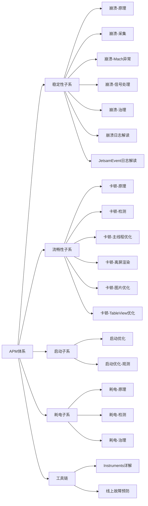
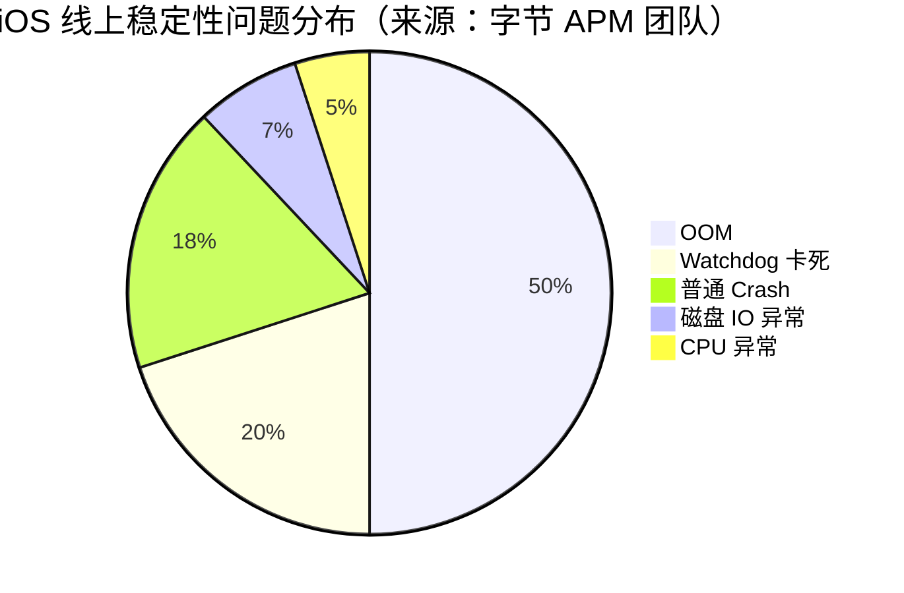
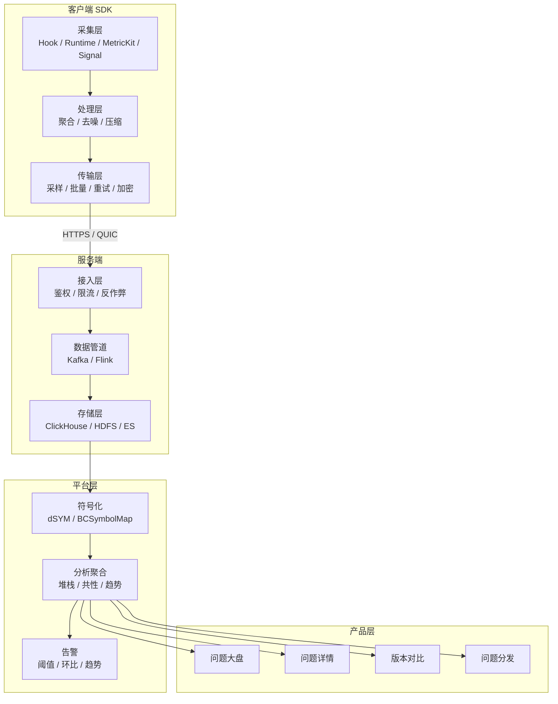
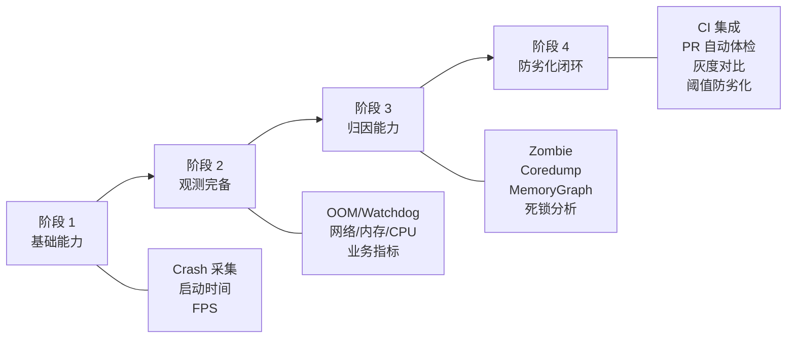

# APM 概述与体系建设

APM（Application Performance Monitoring / Management，应用性能监控）是面向线上真实用户的性能稳定性观测体系。它不同于开发期的 Instruments、Xcode Organizer 等调试工具——APM 的核心诉求是：**在不影响用户体验的前提下，以极低的开销持续采集端侧运行指标，将问题"可发现、可归因、可治理"**。

本文作为 APM 系列的总览，先从"是什么、为什么、建什么、怎么建"四个维度讲清楚建设思路，再给出各子模块的拆分，后续文章逐一展开。

---

## 系列结构

| 文章 | 定位 |
|-----|------|
| [APM](APM.md)（本文） | 体系总览：目标、架构、选型、演进路线 |
| [APM-指标体系](APM-指标体系.md) | 稳定性/流畅性/资源/业务四大指标族 |
| [APM-数据采集](APM-数据采集.md) | Hook/Runtime/MetricKit/Backtrace 等采集技术 |
| [APM-数据上报](APM-数据上报.md) | 采样、聚合、批量、重试、隐私合规 |
| [APM-业界方案](APM-业界方案.md) | MetricKit/Sentry/Firebase/Matrix/Slardar/Hertz 剖析 |
| [APM-可视化与告警](APM-可视化与告警.md) | 大盘、归因、告警与防劣化 |

与现有文章的联动关系：

---

## 一、为什么要建 APM

### 1.1 线下工具的局限

Xcode/Instruments/MemoryGraph/LLDB 等工具在研发期非常强大，但面对线上存在三大盲区：

| 问题 | 线下工具 | 线上 APM |
|-----|---------|---------|
| 真实机型覆盖 | 开发者有限的几台 | 千万级设备、iOS 所有活跃版本 |
| 真实业务场景 | 人工复现、难以覆盖长尾 | 真实用户路径、真实网络、真实数据 |
| 数据完备性 | 单次运行快照 | 全量时序、跨版本对比 |
| 无侵入性 | 需连接 Xcode | 无感采集 |

### 1.2 用户视角的损失

| 症状 | 用户感知 | 业务后果 |
|-----|---------|---------|
| Crash | 闪退、无法继续使用 | 20% 用户最无法忍受的问题，1/3 流失用户转投竞品 |
| Watchdog 卡死 | 启动/操作后长时间白屏、被系统杀掉 | 量级通常是普通 Crash 的 2~3 倍 |
| OOM | 后台回前台重启、长使用后崩溃 | 量级通常是普通 Crash 的 3~5 倍，重度用户重灾区 |
| 卡顿/掉帧 | 列表抖动、按钮无响应 | 留存下降、差评 |
| 慢加载/白屏 | 秒开率低、转圈加载 | 转化率下降 |
| 网络慢/错 | 请求失败、超时 | GMV 直接下降 |
| 耗电异常 | 设备发烫、电量快速下降 | App 被用户卸载 |

> 字节跳动公开分享的数据：通过 APM 体系化治理，抖音/头条/飞书等 App 异常崩溃率过去两年下降 30% 以上，部分指标优化超 80%。

### 1.3 iOS 稳定性问题占比（典型分布）

这组数据给了 APM 建设的三个关键启示：

1. **OOM 是大头**：仅靠崩溃堆栈无法覆盖，必须有独立的内存监控、FOOM 判定与 MemoryGraph 工具。详见 `崩溃-治理` 与本系列 `APM-指标体系` 的内存一节。
2. **Watchdog 是第二大头**：比普通 Crash 更多，需要独立的卡死监控链路，不能与卡顿监控共用简单阈值。
3. **纯系统栈的 Crash 占比高**：字节内部 80% 长期未修 Crash 中，90% 以上是 Mach/Signal 异常，需要 Zombie、Coredump 等高级归因工具。

---

## 二、APM 的核心目标

建设 APM 不是"把所有指标都采起来"，而是围绕四个目标做取舍：

### 2.1 完备性（Coverage）

指标必须覆盖稳定性、流畅性、资源、业务四大族，缺一不可：

- **稳定性**：Crash / Watchdog / OOM / ANR / 异常退出
- **流畅性**：FPS / 卡顿 / 掉帧 / 主线程耗时
- **资源**：启动 / 内存 / CPU / 磁盘 IO / 电量 / 网络流量
- **业务**：秒开率 / 首屏 / 白屏 / TTI / 关键路径转化

### 2.2 准确性（Accuracy）

采集的数据必须能真实反映用户侧情况，典型陷阱：

- 只统计前台 Crash，漏掉后台被杀 → 需结合 `Jetsam`/系统退出原因
- 用固定阈值判定卡死 → 误报率高，应结合主线程连续采样
- FPS 从 CADisplayLink 算帧率 → 120Hz 自适应刷新场景失真，需改用 `preferredFrameRateRange`
- 启动时间从 `main()` 开始算 → 漏掉 dyld/`+load`，需用 `DYLD_PRINT_STATISTICS` 或 `ProcessInfo.systemUptime - kern.proc.pid.start`

### 2.3 低开销（Overhead）

APM 自己不能成为性能问题来源。业界经验：

| 维度 | 可接受上限 |
|-----|-----------|
| 启动时间增加 | < 50ms |
| CPU 常驻占用 | < 1%（静态）、< 5%（采集瞬时） |
| 内存常驻 | < 10MB |
| 磁盘写入 | < 1MB/h |
| 网络上行 | < 100KB/DAU |
| 电量影响 | MetricKit `displayMetrics` 不可见增长 |

### 2.4 可归因（Root-cause）

采到数据只是第一步，最终必须能"看图说话"定位到根因。典型归因能力：

- **Crash 归因**：Zombie、Coredump、堆栈去噪、共性特征聚类
- **卡死归因**：多次主线程采样、线程状态、死锁检测
- **OOM 归因**：在线 MemoryGraph、大对象 TopN、引用路径
- **启动归因**：阶段划分（pre-main / main→didFinishLaunching / didFinishLaunching→首屏可交互）、火焰图
- **网络归因**：DNS/TCP/SSL/首包/下载 分段耗时

---

## 三、APM 整体架构

一个完整的 APM 系统通常分为五层：

### 3.1 客户端 SDK

**职责**：采集、去重、压缩、落盘、上报。

关键设计原则：

1. **模块解耦**：每个子能力（Crash、Hang、OOM、FPS、Network、Launch）独立插件化，方便按 App 开启。
2. **采集优先级**：Crash 这类单次写入、高价值数据必须保证落盘；FPS 这类时序数据可丢弃。
3. **崩溃隔离**：SDK 自身的 Crash 绝不能触发用户 Crash，所有 hook 都要有回退路径。
4. **低延迟采集 + 延时上报**：写入本地 ring buffer/mmap，App 冷热启动或 WiFi 空闲时打包上报。

### 3.2 服务端

**职责**：鉴权、防刷、解码、存储、索引。

- **接入层**：对 APM SDK 上行做协议校验、反向限流（某版本异常爆发时只收样本）。
- **管道**：Kafka 做削峰，Flink 做实时聚合（比如 5 分钟窗口 Crash 率）。
- **存储**：稳定性明细（冷查）放 HDFS/OSS；聚合结果（热查）放 ClickHouse/Doris。

### 3.3 符号化

iOS 的堆栈地址必须通过 dSYM 还原为 `Module + Symbol + Line`。建设点：

- dSYM 与 App 构建强绑定，CI 自动归档（含 BCSymbolMap 以还原 Bitcode）。
- 服务端异步符号化，支持按 UUID + slide 查找。
- 系统库符号必须按 iOS 版本 × 设备架构预先导入。

### 3.4 分析聚合

- **堆栈归并**：同类 Crash 合并为一个 Issue，算法常见"Top N 栈帧 hash"。
- **共性提取**：按设备、版本、地域、网络、机型等切片找规律。
- **趋势对比**：新版本与老版本、本周与上周、小时粒度。

### 3.5 产品层

- **大盘**：Crash 率、Watchdog 率、OOM 率、启动 P50/P90、FPS 分布。
- **问题详情**：堆栈、现场日志、用户轨迹、设备画像、自动归因建议。
- **分发**：按模块 owner 自动指派，与 Jira/飞书/钉钉打通。

---

## 四、选型与演进路线

### 4.1 自研 vs 第三方

| 维度 | 第三方 SaaS（Sentry/Firebase/Bugly） | 自研平台（Matrix/Slardar/Hertz） |
|-----|-----|-----|
| 接入成本 | 低，开箱即用 | 高，需要后端、平台、符号化服务 |
| 数据主权 | 数据出境、合规风险 | 完全自控 |
| 深度定制 | 受限，只能用官方 SDK 能力 | 任意扩展 |
| 成本 | 按量付费，规模大时贵 | 一次性投入，长期边际低 |
| 初创团队 | ✅ 推荐 | ❌ 不划算 |
| 超大 App | ❌ 成本与合规问题 | ✅ 推荐 |

业界常见组合：

- **MetricKit + Xcode Organizer**：Apple 官方方案，0 侵入，作为基线。
- **MetricKit + 第三方**：Sentry/Firebase 自动消费 MetricKit 报告做增强。
- **MetricKit + 自研 SDK**：字节、腾讯、美团、阿里的路线，系统库能力 + 自研深度采集。

> 详细对比见 `APM-业界方案`。

### 4.2 演进路线（4 个阶段）

| 阶段 | 目标 | 典型能力 |
|-----|------|---------|
| 1 | 能看到问题 | KSCrash/PLCrashReporter + 启动埋点 + FPS |
| 2 | 覆盖所有稳定性类型 | FOOM 判定、Watchdog 监控、MetricKit 接入、网络指标 |
| 3 | 能定位疑难问题 | Zombie、Coredump、线上 MemoryGraph、死锁检测 |
| 4 | 能阻止劣化 | CI 体检、灰度指标对比、代码仓库红线 |

### 4.3 建设原则

借鉴字节 APM 团队的总结：

> 1. **控制新增，治理存量**。新增问题容易爆发、影响严重；存量问题疑难居多，分长期治理。
> 2. **先急后缓，先易后难**。优先修复爆发问题与容易修复的问题。
> 3. **治理贯穿全生命周期**。需求 → 研发 → 测试 → 集成 → 灰度 → 上线 → 问题反馈。

---

## 五、iOS 平台特性与 APM 设计

iOS 的几个系统特性决定了 APM 方案与 Android 差异巨大：

### 5.1 不能 Fork、不能写入系统进程

Android APM 可以用 `Debug.dumpHprofData()` 直接 dump heap、用 `fork()` 做异步崩溃快照。iOS 全部不允许：

- 堆栈抓取只能在进程内完成
- Crash 时要立即落盘，不能 fork 子进程慢慢写
- 内存快照要在进程里通过 `malloc_zone`/`malloc_logger` 采集

### 5.2 Jetsam 机制

iOS 内存紧张时会按优先级 kill 进程（Jetsam），这与"经典 OOM"不同：

- 前台进程也会被 kill（前台高优、但临近硬上限）
- 用户看到"App 打开是白屏 → 重启"——这是 FOOM
- 没有 Crash 信号，只能用"启动时判断上次没有正常退出"这种排除法判定

> 参见 `崩溃/JetsamEvent日志解读.md`。

### 5.3 系统审查

- **符号化**：Bitcode 要 BCSymbolMap；iOS 14 起的 `.ips` JSON 格式需要新的解析链。
- **隐私**：IDFA 受限，建议用 IDFV + 自建 deviceId；日志里严禁出现 Cookie / Token / 位置 / 通讯录。
- **后台时间**：`UIApplication.beginBackgroundTask` 只有 ~30s，长上报任务要用 `BGTaskScheduler`。

### 5.4 多进程场景

WKWebView 是多进程，H5 监控不能走客户端 NSURLProtocol 拦截，必须在 WebView 内部注入 JS SDK（详见 `APM-数据采集`）。

### 5.5 iOS 的关键系统 API

下表是 APM 必用的苹果官方 API，按采集维度组织：

| 维度 | 关键 API | 最低版本 |
|-----|---------|---------|
| 崩溃诊断 | `MXCrashDiagnostic`、`NSException`、`signal(6)` | iOS 14 |
| CPU 异常 | `MXCPUExceptionDiagnostic` | iOS 14 |
| 磁盘写入异常 | `MXDiskWriteExceptionDiagnostic` | iOS 14 |
| 卡死诊断 | `MXHangDiagnostic` | iOS 14 |
| 性能指标 | `MXMetricPayload`（cpu/gpu/display/network/application） | iOS 13 |
| 启动性能 | `MXAppLaunchMetric` | iOS 13 |
| 耗电 | `MXMetricPayload.applicationTimeMetrics` | iOS 13 |
| 渲染 | `MXAnimationMetric`、`MXAppResponsivenessMetric` | iOS 14 |
| 网络 | `URLSessionTaskTransactionMetrics` | iOS 10 |
| 日志 | `OSLog`、`os_signpost`、`Logger` | iOS 14 |
| 退出原因 | `ProcessInfo.processInfo` + Jetsam `.ips` | 持续演进 |

---

## 六、一张表看懂 iOS APM 采集技术

下表给出每个指标的典型采集手段，详细原理与代码见 `APM-数据采集`：

| 指标 | 采集方式 | 触发时机 |
|-----|---------|---------|
| Mach 异常 | `mach_msg` 注册异常端口 | 进程内异常 |
| Signal 崩溃 | `signal()` / `sigaction` | 信号中断 |
| NSException | `NSSetUncaughtExceptionHandler` | OC 层抛异常 |
| Watchdog 卡死 | RunLoop Observer + 子线程 ping + 多次抓栈 | 启动/前后台切换/主动捕获 |
| OOM (FOOM) | 上次启动异常退出标志 + 内存/电量/版本排除 | App 冷启动时判定 |
| 内存 Graph | `malloc_logger` hook + 伸展树记录 | 内存水位超阈值时 dump |
| FPS | CADisplayLink + 低端机阈值自适应 | 页面停留期间 |
| 卡顿 | RunLoop 前后边界 + 子线程 1s 轮询 + 退火算法 | 主线程耗时 > 阈值 |
| 启动耗时 | `ProcessInfo.systemUptime` - `kern.proc.pid.start` | `applicationDidFinishLaunching` / 首屏渲染完成 |
| 网络 | `URLProtocol` + `URLSessionTaskMetrics` + NSURLSessionDelegate | 请求完成时 |
| CPU | `task_threads` + `thread_info` | 定时采样 |
| 磁盘 IO | `MXDiskIOMetric` + `getrusage` | MetricKit 回调 |
| 电量 | `MXMetricPayload.displayMetrics` + `batteryLevel` 变化 | 系统报告 |
| 页面耗时 | VC 生命周期 hook + 首次有效绘制 | `viewDidAppear` + CADisplayLink 检测关键视图出现 |
| 白屏 | 渲染树采样 + 像素色值比对 | 页面稳定时检测 |

---

## 七、常见认知误区

1. **"FPS 低 = 卡顿"**：不一定。静止页面 FPS 也低，判卡顿应看**掉帧幅度**与**主线程耗时**。
2. **"Crash 率就是质量"**：忽略了 OOM / Watchdog / Jetsam 这些"不会进 Crash 统计"的问题。
3. **"接 Sentry 就够了"**：Sentry 能看 Crash 和粗粒度性能，但看不到 FOOM 根因、看不到在线 MemoryGraph、看不到业务秒开。
4. **"MetricKit 数据足够"**：MetricKit 按天聚合，没有个体现场；Diagnostic 在 iOS 15+ 才是事件触发、之前全按天。适合打底，不适合单点归因。
5. **"采越多越好"**：上报量过大会被反作弊拦截、本地磁盘打满、用户流量抱怨。必须分级采样。
6. **"Release 版本不需要埋 os_signpost"**：事实上 os_signpost 在 Release 也可用，且可配合 `subsystem` 动态开启，是低开销 tracing 的首选。

---

## 八、开源项目导航

下面这些开源项目是自研 APM 的最佳"轮子仓库"：

| 项目 | 维护方 | 能力 |
|-----|------|------|
| [KSCrash](https://github.com/kstenerud/KSCrash) | 社区 | Mach/Signal/NSException 全覆盖的崩溃采集 |
| [PLCrashReporter](https://github.com/microsoft/plcrashreporter) | 微软（原 Plausible） | Crash 采集，Sentry/HockeyApp 同款基座 |
| [Matrix](https://github.com/Tencent/matrix) | 腾讯微信 | 卡顿监控、FOOM 监控、资源检查 |
| [MLeaksFinder](https://github.com/Tencent/MLeaksFinder) | 腾讯 | 线下内存泄漏检测 |
| [FLEX](https://github.com/FLEXTool/FLEX) | 社区 | 线下调试面板，网络/数据库/内存快照 |
| [SentrySDK](https://github.com/getsentry/sentry-cocoa) | Sentry | 商业级 APM 客户端参考 |
| [fishhook](https://github.com/facebook/fishhook) | Facebook | C 函数符号重绑，网络/内存 hook 基础 |

---

## 九、本系列后续内容速览

| 下一步想了解 | 跳转 |
|-----|-----|
| 每个指标到底怎么定义？目标值多少？ | [APM-指标体系](APM-指标体系.md) |
| 每个指标代码怎么写？有什么坑？ | [APM-数据采集](APM-数据采集.md) |
| SDK 怎么决定"什么时候上报"？ | [APM-数据上报](APM-数据上报.md) |
| Matrix/Slardar/Sentry/Firebase 到底哪个好？ | [APM-业界方案](APM-业界方案.md) |
| 怎么设计大盘和告警？ | [APM-可视化与告警](APM-可视化与告警.md) |

**相关文章（已在本知识库）**：

- 崩溃体系：[崩溃-原理](../崩溃/崩溃-原理.md) · [崩溃-采集](../崩溃/崩溃-采集.md) · [崩溃-Mach异常](../崩溃/崩溃-Mach异常.md) · [崩溃-信号处理](../崩溃/崩溃-信号处理.md) · [崩溃-治理](../崩溃/崩溃-治理.md) · [崩溃日志解读](../崩溃/崩溃日志解读.md) · [JetsamEvent日志解读](../崩溃/JetsamEvent日志解读.md)
- 卡顿体系：[卡顿-原理](../卡顿/卡顿-原理.md) · [卡顿-检测](../卡顿/卡顿-检测.md) · [卡顿-主线程优化](../卡顿/卡顿-主线程优化.md)
- 启动体系：[启动优化](../启动优化/启动优化.md) · [启动优化-观测](../启动优化/启动优化-观测.md)
- 耗电体系：[耗电-原理](../耗电/耗电-原理.md) · [耗电-检测](../耗电/耗电-检测.md) · [耗电-治理](../耗电/耗电-治理.md)
- 工具：[Instruments详解](../Instruments详解.md) · [线上故障预防](../线上故障预防.md)
