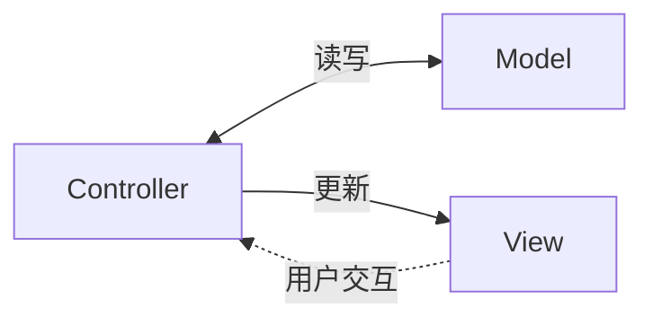
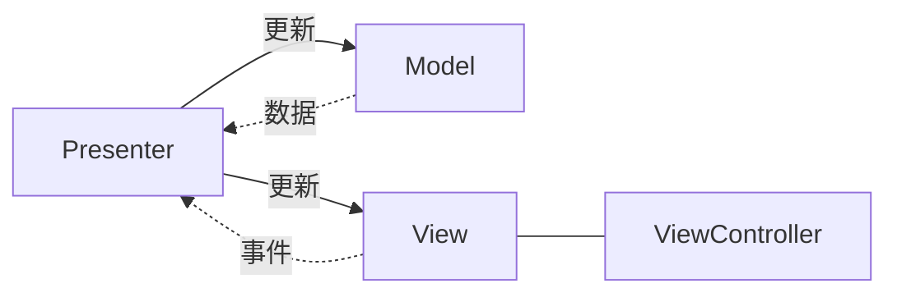
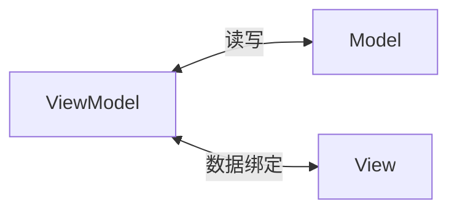
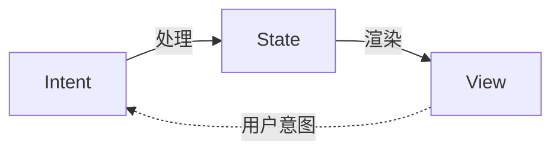
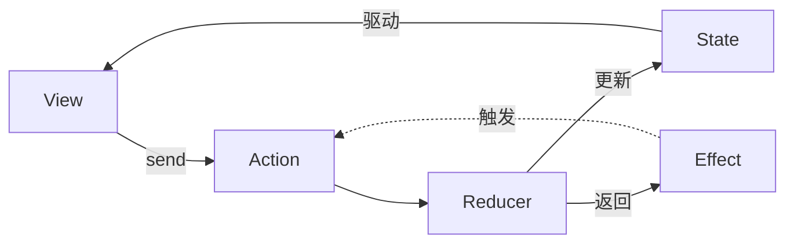
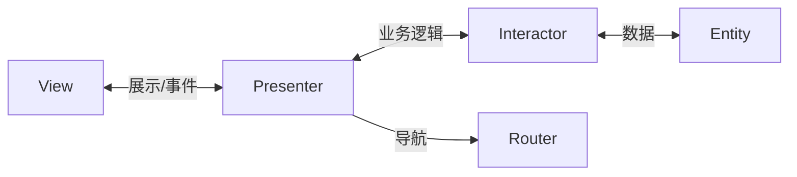
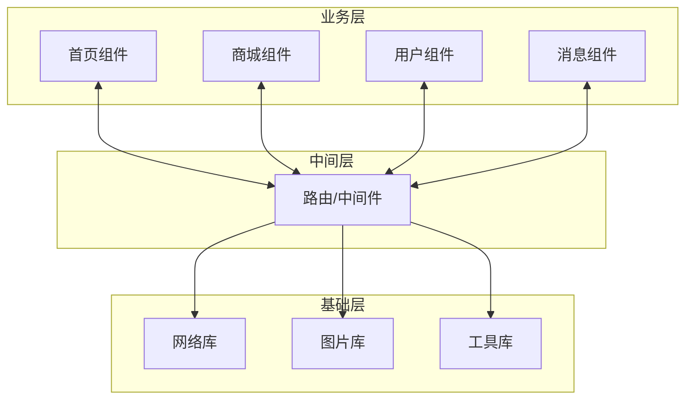
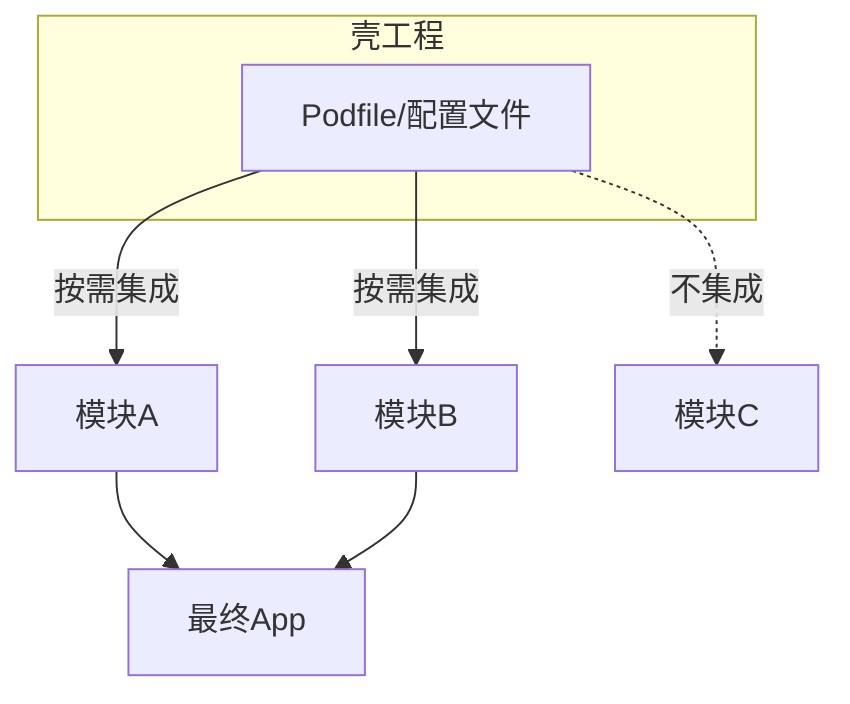
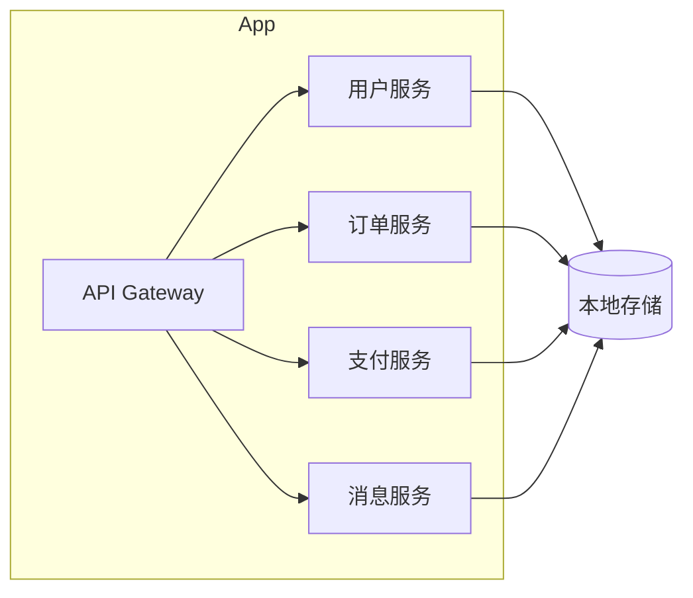

# iOS架构概述

## 什么是架构

软件架构是指软件系统的高层结构，定义了系统的各个组成部分及其之间的关系。一个好的架构能够帮助我们：

- **职责分离**：将不同的功能模块分开，降低耦合度
- **可测试性**：使代码更容易进行单元测试
- **可维护性**：便于理解和修改代码
- **可扩展性**：方便添加新功能
- **团队协作**：不同开发者可以并行开发不同模块

## 架构的两个层次

在讨论iOS架构时，需要区分两种不同层次的架构：

| 类型 | 关注点 | 代表模式 |
|------|--------|----------|
| 页面架构 | 单个页面内的代码组织 | MVC、MVP、MVVM、MVI、TCA、VIPER |
| 工程架构 | 整个App的模块划分与通信 | 组件化、插件化、微服务化 |

两者并不冲突，大型项目通常会同时采用：工程层面使用组件化拆分业务，每个组件内部使用MVVM等页面架构。

## 页面架构模式

### MVC (Model-View-Controller)

MVC是Apple官方推荐的架构模式，也是iOS开发中最基础的架构。

**特点**：
- Controller作为中介者连接Model和View
- View和Model不直接通信
- 在iOS中，ViewController往往承担了过多职责

### MVP (Model-View-Presenter)

MVP是MVC的演进版本，将业务逻辑从Controller中抽离到Presenter。

**特点**：
- Presenter持有View的引用（通常是协议）
- View变得非常"被动"，只负责展示
- 便于单元测试

### MVVM (Model-View-ViewModel)

MVVM通过数据绑定实现View和ViewModel的同步更新。

**特点**：
- ViewModel不持有View的引用
- 通过数据绑定（KVO、Combine、RxSwift）实现双向通信
- ViewModel更容易测试

### MVI (Model-View-Intent)

MVI是一种单向数据流架构，强调状态的不可变性。

**特点**：
- 单向数据流，状态变化可预测
- State是不可变的
- 便于调试和追踪状态变化

### TCA (The Composable Architecture)

TCA是Point-Free团队开发的MVI风格架构框架，提供了完整的状态管理解决方案。

**特点**：
- 基于MVI思想，单向数据流
- 内置依赖注入系统
- 强大的组合能力，可将多个Feature组合
- 内置TestStore，测试支持完善
- 副作用（Effect）管理清晰

### VIPER (View-Interactor-Presenter-Entity-Router)

VIPER是一种更加细粒度的架构模式，将职责拆分得更细。

**特点**：
- 职责划分非常清晰
- 每个模块都可以独立测试
- 代码量较大，适合大型项目

## 页面架构模式对比

| 特性 | MVC | MVP | MVVM | MVI | TCA | VIPER |
|------|-----|-----|------|-----|-----|-------|
| 复杂度 | 低 | 中 | 中 | 中高 | 高 | 高 |
| 可测试性 | 低 | 高 | 高 | 高 | 很高 | 很高 |
| 代码量 | 少 | 中 | 中 | 中 | 中 | 多 |
| 学习曲线 | 低 | 中 | 中 | 中高 | 高 | 高 |
| 框架依赖 | 无 | 无 | 可选 | 无 | 必须 | 无 |
| 适用场景 | 小型项目 | 中型项目 | 中大型项目 | 复杂状态管理 | 中大型项目 | 大型项目 |

## 工程架构模式

### 组件化架构

组件化是一种工程架构思想，将App拆分为多个独立的业务组件，通过中间件进行通信。

**特点**：
- 业务模块独立，可单独开发、测试、编译
- 通过路由或协议实现模块间解耦通信
- 适合多团队协作的大型项目
- 支持模块的动态化和热修复

**常见实现方案**：
- **URL Router**：通过URL注册和调用服务（如MGJRouter）
- **Target-Action**：通过runtime调用（如CTMediator）
- **Protocol-Class**：通过协议注册和获取服务（如BeeHive）
- **依赖注入（DI）**：通过DI容器管理依赖关系（如Swinject、Resolver、Needle）

> Protocol-Class可以看作是DI的简化形式，而完整的DI框架还提供依赖树自动解析、生命周期管理（单例/瞬态）、作用域控制等高级能力。

### 插件化架构

通过壳工程配置，在编译期决定集成哪些功能模块。这是组件化的一种工程实践形态。

**特点**：
- 通过配置文件（如Podfile）决定集成哪些模块
- 不同的壳工程可以产出不同功能组合的App
- 支持模块的独立开发和二进制化，提升编译效率
- 本质上是编译期的"按需装配"

### 微服务化架构

微服务化是将后端微服务的思想应用到客户端，将App内部按业务域拆分为多个独立服务。

**特点**：
- 每个服务有独立的数据存储和业务逻辑
- 服务间通过定义良好的接口通信
- 便于团队按业务域独立开发
- 强调服务的自治性和边界清晰

**与组件化的区别**：
- 组件化侧重于代码的物理隔离和编译解耦
- 微服务化侧重于业务域的逻辑划分和运行时隔离
- 实践中两者常结合使用：组件是载体，服务是抽象

## 选择架构的考量因素

### 1. 项目规模

- **小型项目**：MVC足够，避免过度设计
- **中型项目**：MVP或MVVM是不错的选择
- **大型项目**：MVVM、MVI或VIPER更适合

### 2. 团队经验

- 如果团队对响应式编程熟悉，MVVM配合RxSwift/Combine是好选择
- 如果团队偏好传统方式，MVP可能更容易上手

### 3. 测试需求

- 如果需要高测试覆盖率，避免使用原生MVC
- MVP、MVVM、MVI、VIPER都能提供较好的可测试性

### 4. 状态管理复杂度

- 如果应用状态复杂且需要可预测的状态变化，考虑MVI
- 简单的表单页面不需要复杂的状态管理

## 架构不是银弹

需要注意的是，没有完美的架构，每种架构都有其适用场景和局限性：

1. **不要过度设计**：简单的页面不需要复杂的架构
2. **可以混合使用**：不同模块可以使用不同的架构
3. **架构是演进的**：随着项目发展，架构可能需要调整
4. **一致性很重要**：团队内部应该对架构有统一的理解

## 相关文章

- [MVC架构详解](MVC.md)
- [MVP架构详解](MVP.md)
- [MVVM架构详解](MVVM.md)
- [MVI架构详解](MVI.md)
- [TCA架构详解](TCA.md)
- [VIPER架构详解](VIPER.md)
- [组件化架构详解](组件化.md)
- [插件化架构详解](插件化.md)
- [微服务化架构详解](微服务化.md)
