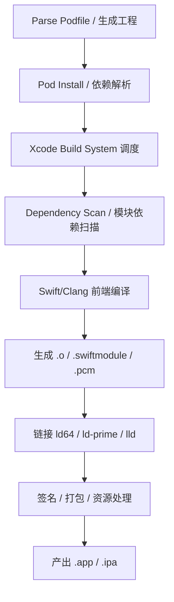
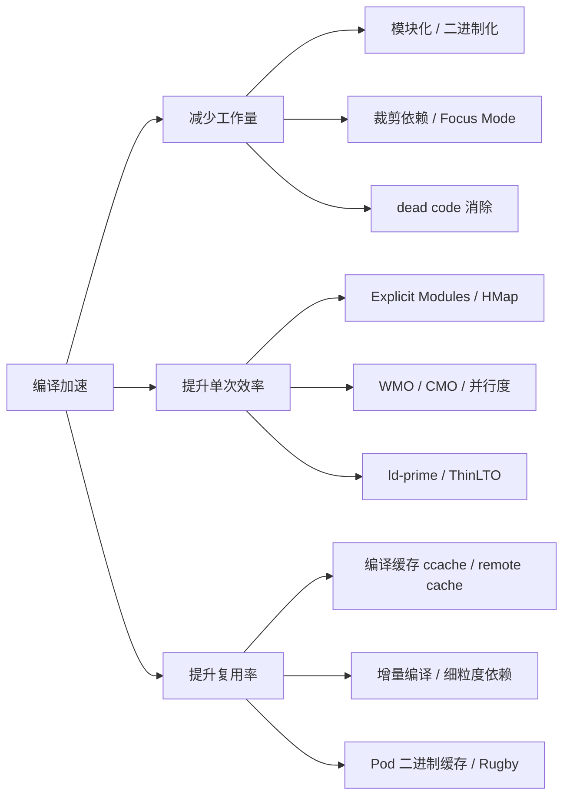

# 编译优化

大型 iOS 工程的编译耗时往往是研发效能最突出的瓶颈之一。以抖音、今日头条、美团为代表的一线团队，工程代码量通常在数百万到千万行级，本地全量编译耗时 10 分钟以上、CI 上半小时起步已是常态。编译等待不仅直接压缩研发时间，还会打断心流、降低人均产出。

本系列文章从 iOS 编译系统的原理出发，结合社区最新实践（Xcode 16/17 Explicit Modules、rules_xcodeproj、seer-optimize、cocoapods-hmap-prebuilt、Rugby 等），系统性介绍编译优化的各类手段与背后的原理。

---

## 编译流程概述

理解[iOS编译原理](../../ios-basics/iOS编译原理.md)是编译优化的前提。一次典型的 iOS 编译流程可以划分为以下阶段：

| 阶段 | 主要工作 | 常见瓶颈 |
|-----|---------|---------|
| 依赖管理 | Pod Install、SPM 解析 | Source 更新慢、Specification 解析重复、沙盒拷贝 |
| 工程生成 | 生成 Pods.xcodeproj、xcconfig、hmap | Target 数量多、pbxproj 膨胀 |
| 构建调度 | Build System 解析任务图、并行调度 | 依赖粒度过粗、并行度不足 |
| 模块扫描 | Clang/Swift 依赖扫描 | 隐式模块重复编译 |
| 源码编译 | Swift/Clang 前端、类型检查、SIL/IR 生成 | 类型推导爆炸、WMO 关闭、PCH 失效 |
| 链接 | 符号解析、LTO、dead-strip | 链接参数过长、ThinLTO 串行 |
| 收尾 | 签名、资源拷贝、dSYM | 串行脚本阻塞 |

---

## 优化思路全景

编译优化的核心思路只有三条：**减少需要做的工作**、**让必须做的工作更快**、**让做过的工作可复用**。所有社区实践都可以归入这三类。

---

## 文章导航

本系列包含以下文章，建议按顺序阅读：

### 1. 观测与诊断

优化之前必须能量化，否则无法验证收益。

- [编译优化-观测](./编译优化-观测.md)
  - Build With Timing Summary、-debug-time-compilation
  - -driver-show-incremental、-driver-show-job-lifecycle
  - -warn-long-expression-type-checking、-warn-long-function-bodies
  - Xcode Build Timeline、xcodebuild -showBuildTimingSummary
  - 自研 Profiler 与数据上报（CocoaPods Profiler / XCLogParser）

### 2. 构建系统

理解 Xcode 构建系统才能针对性优化。

- [编译优化-Xcode构建系统](./编译优化-Xcode构建系统.md)
  - llbuild、XCBBuildService、SwiftDriver 架构
  - 任务图、并行度与关键路径
  - 增量编译原理、swift-driver 的 incremental build
  - Xcode 17 细粒度依赖追踪
  - XCBBuildServiceProxy 与大厂自定义构建

### 3. 模块化与 Explicit Modules

Xcode 16/17 最重要的构建变革。

- [编译优化-Explicit Modules](./编译优化-Explicit Modules.md)
  - Clang/Swift Module 基础
  - Implicit vs Explicit Module Build
  - Scan → Build Module → Compile Source 三阶段
  - 模块变体（variant）爆炸与消减
  - 对 CI 冷启动 / 本地增量的不同影响

### 4. 头文件与 HMap

针对 Objective-C / 混编工程的头文件查找优化。

- [编译优化-头文件与HMap](./编译优化-头文件与HMap.md)
  - HEADER_SEARCH_PATHS 的 IO 开销
  - HMap 二进制映射表格式
  - 美团 cocoapods-hmap-prebuilt 原理
  - VFS Overlay 与 Bazel 的 header layering

### 5. Swift 代码层优化

源码层能做到的加速。

- [编译优化-Swift编译优化](./编译优化-Swift编译优化.md)
  - 类型推导与 "expression too complex" 的根因
  - Whole Module Optimization (WMO)
  - Cross Module Optimization (CMO)
  - 访问控制（private/internal/public）对增量编译的影响
  - 泛型特化、@inlinable、@_optimize

### 6. 链接优化

链接阶段的大块耗时优化。

- [编译优化-链接优化](./编译优化-链接优化.md)
  - ld64 / ld-prime（Xcode 15+） / lld 对比
  - ThinLTO 原理与参数调优
  - filelist 方式解决 Arguments Too Long
  - dead_strip / -dead_strip_dylibs
  - 符号导出控制与 -exported_symbols_list

### 7. 二进制化

把源码编译换成产物链接。

- [编译优化-二进制化](./编译优化-二进制化.md)
  - 静态库、动态库、Framework、XCFramework
  - BUILD_LIBRARY_FOR_DISTRIBUTION 与 ABI 稳定
  - CocoaPods 二进制化方案（cocoapods-bin、imy-bin）
  - Rugby 的 Remote Cache / Prebuild 原理
  - 源码回切调试（美团 zsource）

### 8. CocoaPods 优化

依赖管理阶段的加速。

- [编译优化-CocoaPods优化](./编译优化-CocoaPods优化.md)
  - Pod Install 六阶段耗时分析
  - 按需更新 Source / 文件锁同步
  - Specification / FileAccessors / SandboxAnalyzer 缓存
  - 增量安装、单 Target/Configuration 安装
  - 抖音 seer-optimize 的整体方案

### 9. 编译缓存

做过的工作不再重复做。

- [编译优化-编译缓存](./编译优化-编译缓存.md)
  - ccache 的 direct / preprocessor 模式
  - Clang modules cache / Swift module cache
  - XCRemoteCache（Spotify）：Xcode 原生兼容的 Target 级远程缓存
  - 远程缓存（Bazel Remote Cache、sccache）
  - 缓存命中率的关键影响因素

### 10. Bazel 方案

Monorepo 与下一代构建系统。

- [编译优化-Bazel方案](./编译优化-Bazel方案.md)
  - Bazel 核心概念与 sandbox/remote execution
  - rules_apple / rules_swift / rules_xcodeproj
  - 字节 BitSky、Bilibili、Airbnb 实践
  - Bazel vs Xcode 的 trade-off
  - 混合构建（Build with Proxy）

---

## 决策建议

不同规模的工程适用不同的优化组合：

| 工程规模 | 推荐优化组合 |
|---------|-------------|
| 小型（< 50 Pod） | Explicit Modules、WMO、DEBUG 关闭 LTO |
| 中型（50–200 Pod） | 上述 + HMap、Pod 二进制化、Rugby / cocoapods-bin |
| 大型（200+ Pod） | 上述 + seer-optimize 级别的 CocoaPods 定制、编译缓存、Focus Mode |
| 超大型 / Monorepo | Bazel + rules_xcodeproj + 远程缓存 + 远程执行 |

每次引入新的优化都应通过[编译优化-观测](./编译优化-观测.md)提供的量化手段验证实际收益，避免盲目跟随社区方案带来的复杂度失控。
