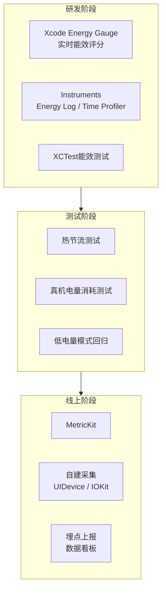
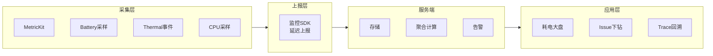

# 耗电-检测

本文介绍iOS耗电问题的检测手段，从开发阶段的本地工具，到线上的监控体系，帮助团队形成一套完整的耗电可观测能力。

---

## 检测手段全景



---

## 一、Xcode Energy Gauge

Xcode在真机调试时，"Debug Navigator → Energy Impact"提供了实时能效评估。

### 能效评分（Energy Impact）

Xcode将功耗分为5档：

| 等级                | 含义          | 典型值        |
| ----------------- | ----------- | ---------- |
| Very Low / Low    | 正常使用        | 0~3 / 4~8  |
| High              | 偏高，需要关注     | 9~16       |
| Very High         | 严重，必须优化     | 17~20      |

评分由以下几个因素构成：

- **CPU**：平均CPU使用率。
- **Network**：网络活跃时间与流量。
- **Location**：定位活跃时间与精度。
- **GPU**：GPU活跃时间。
- **Background**：后台活跃时间。
- **Overhead**：系统唤醒代价。

### 典型使用流程

1. Xcode连接真机（模拟器的数据不准确）。
2. 运行App，选择Debug Navigator → Energy Impact。
3. 进行典型操作（刷Feed、看视频、聊天等），观察评分。
4. 如果出现High/Very High，使用Instruments进一步定位。

---

## 二、Instruments Energy Log

Instruments中有多个和能效相关的工具：

- **Energy Log**（仅Mac Catalyst/macOS，iOS已弃用，但仍可作为参考）。
- **Time Profiler**：找出CPU热点。
- **Network**：查看网络请求时序。
- **Location**：查看定位调用时间线。
- **Activity Monitor**：看整机能效。

### 推荐组合：Time Profiler + Network + Points of Interest

```
xcrun xctrace record --template 'Time Profiler' --attach <bundleId>
```

在Instruments中可以同时查看：

- **CPU时间线**：哪些方法占用CPU最多，是否存在不该运行时仍在跑的线程。
- **Network时间线**：是否有高频小请求、尾能耗（Tail Energy）。
- **Points of Interest**：业务侧打的标签，关联业务场景。

### 热点定位三问

在Instruments中看到一段高CPU占用时，要问自己：

1. **是否必要？** 是不是在后台或不可见页面仍在跑。
2. **是否高效？** 有没有低效算法、重复计算。
3. **是否频繁？** 是不是高频Timer或轮询触发。

---

## 三、MetricKit：线上功耗数据的黄金源

从iOS 13开始，苹果提供 `MetricKit` 框架，让开发者可以直接获取设备上报的功耗指标。这是最 **官方、最准确** 的线上功耗数据来源。

### 接入方式

```swift
import MetricKit

class EnergyMetricReporter: NSObject, MXMetricManagerSubscriber {
    
    static let shared = EnergyMetricReporter()
    
    func start() {
        MXMetricManager.shared.add(self)
    }
    
    func didReceive(_ payloads: [MXMetricPayload]) {
        for payload in payloads {
            reportEnergy(payload)
        }
    }
    
    private func reportEnergy(_ payload: MXMetricPayload) {
        // 核心能效指标
        let cpuTime = payload.cpuMetrics.cumulativeCPUTime
        let fgTime = payload.applicationTimeMetrics?.cumulativeForegroundTime
        let bgTime = payload.applicationTimeMetrics?.cumulativeBackgroundTime
        let cellDown = payload.networkTransferMetrics?.cumulativeCellularDownload
        let cellUp = payload.networkTransferMetrics?.cumulativeCellularUpload
        let locTime = payload.locationActivityMetrics?.cumulativeBestAccuracyTime
        let pixelLum = payload.displayMetrics?.averagePixelLuminance?.averageMeasurement
        
        Analytics.report(name: "metric_energy", params: [
            "cpu_time_ms": cpuTime.converted(to: .milliseconds).value,
            "fg_time_s": fgTime?.converted(to: .seconds).value ?? 0,
            "bg_time_s": bgTime?.converted(to: .seconds).value ?? 0,
            "cellular_down_mb": cellDown?.converted(to: .megabytes).value ?? 0,
            "cellular_up_mb": cellUp?.converted(to: .megabytes).value ?? 0,
            "loc_best_time_s": locTime?.converted(to: .seconds).value ?? 0,
            "pixel_luminance": pixelLum?.value ?? 0,
        ])
    }
}
```

### MetricKit核心功耗指标

| 分组                         | 字段                                    | 含义             |
| -------------------------- | ------------------------------------- | -------------- |
| cpuMetrics                 | cumulativeCPUTime                     | 累计CPU时间        |
|                            | cumulativeCPUInstructions (iOS 14+)   | CPU指令数         |
| gpuMetrics                 | cumulativeGPUTime                     | 累计GPU时间        |
| applicationTimeMetrics     | cumulativeForegroundTime              | 前台时长           |
|                            | cumulativeBackgroundTime              | 后台活跃时长         |
|                            | cumulativeBackgroundAudioTime         | 后台音频时长         |
|                            | cumulativeBackgroundLocationTime      | 后台定位时长         |
| networkTransferMetrics     | cumulativeCellularDownload/Upload     | 蜂窝流量           |
|                            | cumulativeWifiDownload/Upload         | WiFi流量         |
| locationActivityMetrics    | cumulativeBestAccuracyTime            | 最高精度定位时长       |
|                            | cumulativeHundredMetersAccuracyTime   | 百米级精度定位时长      |
| displayMetrics             | averagePixelLuminance                 | 平均像素亮度（OLED机型） |
| cellularConditionMetrics   | cellConditionTime                     | 信号质量分布         |

### 诊断数据（MXDiagnosticPayload）

iOS 14+提供诊断数据，其中与耗电强相关的是：

- **MXCPUExceptionDiagnostic**：CPU超限异常（App使用CPU时间超过系统阈值）。
- **MXHangDiagnostic**：主线程挂起（间接导致唤醒开销）。
- **MXDiskWriteExceptionDiagnostic**：磁盘写入超限。

### 特点与限制

- 数据每24小时聚合一次，第二天启动时下发。
- 仅限真机。
- 指标是 **累计值**（对应24小时窗口）。
- 业务需要在服务端再做Per-UDID Per-Day的聚合。

---

## 四、UIDevice电量采样

对于 `MetricKit` 无法满足实时性的场景，可以使用 `UIDevice` 主动采样电量：

```swift
class BatteryMonitor {
    
    static let shared = BatteryMonitor()
    private var timer: Timer?
    private var startLevel: Float = 0
    private var startTime: Date = Date()
    
    func start(interval: TimeInterval = 60) {
        UIDevice.current.isBatteryMonitoringEnabled = true
        
        startLevel = UIDevice.current.batteryLevel
        startTime = Date()
        
        timer = Timer.scheduledTimer(withTimeInterval: interval, repeats: true) { [weak self] _ in
            self?.sample()
        }
    }
    
    private func sample() {
        let state = UIDevice.current.batteryState
        // 充电中的数据不参与统计
        guard state == .unplugged else { return }
        
        let level = UIDevice.current.batteryLevel
        let drop = startLevel - level   // 电量下降百分比
        let duration = Date().timeIntervalSince(startTime)
        // 单位时间掉电速率（%/min）
        let rate = drop / Float(duration / 60)
        
        Analytics.report(name: "battery_drain", params: [
            "drop_percent": drop * 100,
            "duration_min": duration / 60,
            "rate_per_min": rate * 100,
            "scene": CurrentScene.name
        ])
    }
}
```

### 注意事项

- `batteryLevel` 精度只有1%（0.05步长在部分机型上也能看到）。
- 充电中（`.charging` / `.full`）的数据没有参考价值。
- 系统对电量的更新是粗粒度的，短时间窗口内可能采不到变化。
- 必须设置 `isBatteryMonitoringEnabled = true` 才能获取到真实数据。

---

## 五、ThermalState监控

设备的热状态是能效压力的滞后指标——热起来说明之前一段时间能耗高。

```swift
class ThermalMonitor {
    
    init() {
        NotificationCenter.default.addObserver(
            self,
            selector: #selector(thermalStateChanged),
            name: ProcessInfo.thermalStateDidChangeNotification,
            object: nil
        )
    }
    
    @objc private func thermalStateChanged() {
        let state = ProcessInfo.processInfo.thermalState
        Analytics.report(name: "thermal_state_change", params: [
            "state": stateName(state),
            "scene": CurrentScene.name,
            "battery_level": UIDevice.current.batteryLevel
        ])
    }
    
    private func stateName(_ state: ProcessInfo.ThermalState) -> String {
        switch state {
        case .nominal: return "nominal"
        case .fair: return "fair"
        case .serious: return "serious"
        case .critical: return "critical"
        @unknown default: return "unknown"
        }
    }
}
```

上报到服务端后，可以分析 **进入serious/critical的页面分布**，这往往是耗电问题的"案发现场"。

---

## 六、自建CPU采样

对于需要精细到业务场景的耗电诊断，可以自建CPU使用率采样。

### 读取进程CPU使用率

```objc
#import <mach/mach.h>

CGFloat app_cpu_usage(void) {
    kern_return_t kr;
    thread_array_t thread_list;
    mach_msg_type_number_t thread_count;
    
    kr = task_threads(mach_task_self(), &thread_list, &thread_count);
    if (kr != KERN_SUCCESS) return -1;
    
    float tot_cpu = 0;
    for (int i = 0; i < thread_count; i++) {
        thread_info_data_t thinfo;
        mach_msg_type_number_t thread_info_count = THREAD_INFO_MAX;
        kr = thread_info(thread_list[i], THREAD_BASIC_INFO,
                         (thread_info_t)thinfo, &thread_info_count);
        if (kr != KERN_SUCCESS) continue;
        
        thread_basic_info_t basic_info_th = (thread_basic_info_t)thinfo;
        if (!(basic_info_th->flags & TH_FLAGS_IDLE)) {
            tot_cpu += basic_info_th->cpu_usage / (float)TH_USAGE_SCALE * 100.0;
        }
    }
    vm_deallocate(mach_task_self(), (vm_offset_t)thread_list,
                  thread_count * sizeof(thread_t));
    return tot_cpu;
}
```

### CPU高占用预警

```swift
class CPUWatchdog {
    private var timer: DispatchSourceTimer?
    private var highCPUStart: Date?
    
    func start(threshold: CGFloat = 80, duration: TimeInterval = 3) {
        let t = DispatchSource.makeTimerSource(queue: DispatchQueue.global(qos: .utility))
        t.schedule(deadline: .now(), repeating: 1)
        t.setEventHandler { [weak self] in
            let usage = CGFloat(app_cpu_usage())
            if usage > threshold {
                if self?.highCPUStart == nil {
                    self?.highCPUStart = Date()
                } else if Date().timeIntervalSince(self!.highCPUStart!) > duration {
                    // 抓一份主线程堆栈 + 业务上下文
                    self?.reportHighCPU(usage: usage)
                    self?.highCPUStart = nil
                }
            } else {
                self?.highCPUStart = nil
            }
        }
        t.resume()
        self.timer = t
    }
    
    private func reportHighCPU(usage: CGFloat) {
        let stack = StackCapture.captureMainThread()
        Analytics.report(name: "cpu_high", params: [
            "usage": usage,
            "stack": stack,
            "scene": CurrentScene.name
        ])
    }
}
```

这个方案可以抓到"明明在后台却仍在高CPU"这类典型耗电问题。

---

## 七、IOKit电池私有API（仅供分析）

`IOKit` 的电池接口可以读到更细的数据，但属于私有API，**不能上架AppStore**，仅用于内部分析。

```objc
#import <dlfcn.h>

void *IOKit = dlopen("/System/Library/Frameworks/IOKit.framework/IOKit", RTLD_LAZY);
typedef mach_port_t (*IORegistryEntryFromPathFunc)(mach_port_t, const io_string_t);
// ... IOPSCopyPowerSourcesInfo / IOPSGetPowerSourceDescription ...
```

可以读出：

- 当前电压（mV）
- 当前电流（mA，充电为正、放电为负）
- 设计容量与实际容量
- 循环次数
- 温度

适合做真机对比测试，比如"开启A功能 vs 关闭A功能的电流差异"。

---

## 八、XCTest能效测试

从Xcode 11开始支持能效相关的性能指标：

```swift
func testFeedScrollEnergy() {
    let app = XCUIApplication()
    app.launch()
    
    measure(metrics: [
        XCTCPUMetric(),
        XCTMemoryMetric(),
        XCTStorageMetric(),
        XCTClockMetric()
    ]) {
        let feed = app.tables["FeedList"]
        for _ in 0..<10 {
            feed.swipeUp(velocity: .fast)
        }
    }
}
```

可以把关键业务场景做成能效基线，接入CI流水线，回归时自动检测劣化。

---

## 九、线上耗电监控体系

一个完整的线上耗电监控体系通常包含：



### 推荐的大盘指标

| 层级   | 指标                                                      |
| ---- | ------------------------------------------------------- |
| App级 | 人均日耗电（%/day）、CPU时长、后台时长、蜂窝流量、定位时长                      |
| 版本级  | 版本对比（新版本 vs 旧版本）、趋势图                                    |
| 场景级  | 每个核心页面/功能的耗电贡献                                          |
| 机型级  | 分机型/系统版本的耗电对比                                           |
| 异常级  | CPU Exception次数、Hang次数、Thermal升级次数                      |

### 告警策略

- **版本级告警**：新版本灰度期间，人均耗电指标劣化>X%触发告警。
- **场景级告警**：某个页面的CPU时长P95突增。
- **异常级告警**：MXCPUExceptionDiagnostic数突增。

---

## 小结

| 阶段   | 工具                                    | 适用场景               |
| ---- | ------------------------------------- | ------------------ |
| 研发   | Xcode Energy Gauge、Instruments、XCTest | 实时观察、热点定位、回归测试     |
| 测试   | 真机电量测试、Thermal监控                      | 端到端评估、极端场景验证       |
| 线上   | MetricKit、UIDevice、自建CPU采样            | 全量数据、长期趋势、分版本/场景分析 |

检测只是手段，下一步需要对症下药。接下来进入 [耗电-CPU与后台优化](./耗电-CPU与后台优化.md)，以及后续的网络、定位、屏幕等优化篇。
