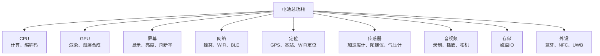

# 耗电

耗电（Energy Consumption）是移动应用质量的重要指标之一。一款耗电过快的App会直接影响用户的续航体验，轻则被用户吐槽，重则被系统标记为"耗电大户"（在iOS的"设置 → 电池"中显示），最终被用户卸载。

本系列文章从iOS功耗模型入手，系统性地介绍耗电问题的原理、检测、优化与治理。

---

## 为什么要关注耗电

iOS设备的电池容量有限（iPhone通常在3000~5000mAh），而应用的功耗会直接影响续航时间。苹果在iOS 8之后提供了"电池用量"统计入口，用户可以清楚地看到每个App消耗的电量比例。

常见的耗电投诉场景：

| 场景                  | 用户感知          | 典型原因                     |
| ------------------- | ------------- | ------------------------ |
| 后台待机一晚电量掉20%        | 手机放着不用也掉电     | 后台定位、后台音频、后台Fetch未合理释放 |
| App使用1小时电量掉30%      | 使用过程电量下降过快    | CPU长时间高占用、高频网络请求、GPU密集渲染 |
| 手机发烫                | 设备温度异常升高      | CPU/GPU长期满载、持续定位、频繁屏幕唤醒 |
| 被系统标记为"后台活动"过高      | 系统提示"此App正在消耗大量电池" | 后台任务未合理调度，违反能效规则       |

苹果对"耗电"非常敏感——从iOS 9开始引入低电量模式（Low Power Mode），从iOS 13开始加强后台任务的能效审查（BackgroundTasks框架），从iOS 15开始通过MetricKit将功耗数据开放给开发者。

---

## iOS功耗模型概述

iOS设备的功耗来源可以分为以下几大类：

不同硬件模块的功耗量级差异很大。参考苹果WWDC的数据，定位和蜂窝数据通常是"耗电大户"，屏幕是"持续耗电大户"，而CPU/GPU在计算密集时瞬时功耗最高。

| 模块     | 典型功耗等级 | 特点              |
| ------ | ------ | --------------- |
| 屏幕     | 持续高    | 只要亮屏就持续耗电       |
| 蜂窝数据   | 高      | 搜索基站、维持连接都耗电    |
| GPS定位  | 高      | 冷启动搜星耗电特别明显     |
| CPU/GPU | 中~高    | 计算量决定功耗          |
| WiFi   | 中      | 比蜂窝省电            |
| 蓝牙（BLE）| 低      | 低功耗蓝牙专为续航优化     |
| 传感器    | 低~中    | 高频采样会显著增加功耗     |

---

## 耗电问题的本质

耗电问题的本质可以用一个简单的公式表示：

\[ Energy = Power \times Time \]

即 **功耗 = 瞬时功率 × 持续时间**。治理耗电的核心思路只有两条：

1. **降低瞬时功率**：减少CPU/GPU的工作量、降低网络带宽、降低采样频率。
2. **缩短工作时间**：合并任务、批量处理、及时释放资源、避免长驻后台。

苹果把这两个原则具体化为三个能效准则：

1. **Race to Sleep**（赶紧睡觉）：让硬件尽快完成任务并进入低功耗状态，避免长时间"半吊子"运行。
2. **Coalesce Work**（合并任务）：把多个小任务合并成一次执行，减少硬件被唤醒的次数。
3. **Defer and Batch**（延后与批量）：非紧急的任务延后执行，并在合适的时机批量处理。

---

## 文章导航

本系列包含以下文章，建议按顺序阅读：

### 1. 原理篇

- [耗电-原理](./耗电-原理.md)
  - iOS功耗模型
  - CPU/GPU的P-State与C-State
  - 网络模块的能效状态机
  - 屏幕与硬件的功耗特性
  - 系统的能效调度机制

### 2. 检测篇

- [耗电-检测](./耗电-检测.md)
  - Xcode Energy Gauge
  - Instruments Energy Log
  - MetricKit线上功耗数据
  - IOKit私有API采集电量
  - 自建线上耗电监控体系

### 3. 优化篇

#### 3.1 CPU与后台优化

- [耗电-CPU与后台优化](./耗电-CPU与后台优化.md)
  - 减少CPU空转与轮询
  - Timer与RunLoop优化
  - GCD QoS合理使用
  - BackgroundTasks框架
  - 后台音频、后台定位的正确姿势

#### 3.2 网络优化

- [耗电-网络优化](./耗电-网络优化.md)
  - 无线电能效状态机
  - 请求合并与延后
  - 后台下载与NSURLSession
  - 长连接心跳策略
  - 弱网与重试策略

#### 3.3 定位与传感器优化

- [耗电-定位与传感器优化](./耗电-定位与传感器优化.md)
  - CLLocationManager精度与频率
  - SignificantLocationChange与Region Monitoring
  - 传感器采样频率控制
  - 屏幕亮度与ProMotion
  - 低电量模式适配

### 4. 治理篇

- [耗电-治理](./耗电-治理.md)
  - 研发阶段的能效规范
  - 线上耗电监控指标体系
  - 常见耗电问题排查手册
  - 低电量模式下的降级策略
  - 能效性能卡口与CI集成

---

## 关键指标

在开始治理前，需要先明确业务可观测的耗电指标：

| 指标                           | 含义                                                     | 来源                         |
| ---------------------------- | ------------------------------------------------------ | -------------------------- |
| cumulativeCPUTime            | 累计CPU时间                                                | MetricKit                  |
| cumulativeBackgroundTime     | 累计后台活跃时间                                               | MetricKit                  |
| cumulativeForegroundTime     | 累计前台时间                                                 | MetricKit                  |
| cumulativeCellularDownload/Upload | 累计蜂窝流量                                             | MetricKit                  |
| cumulativeWifiDownload/Upload     | 累计WiFi流量                                            | MetricKit                  |
| cumulativeBestAccuracyTime   | 最高精度定位累计时长                                             | MetricKit                  |
| averagePixelLuminance        | 平均像素亮度（间接反映屏幕功耗）                                        | MetricKit (OLED)           |
| 电池消耗速率                       | 单位时间内电量下降百分比                                           | 自建监控（UIDevice + 采样）        |
| 能效评分                         | 综合CPU/网络/定位等的线上评分                                       | 自建（参考WWDC能效公式）             |

这些指标是后续"检测篇"和"治理篇"的基础。

---

## 小结

| 要点           | 说明                               |
| ------------ | -------------------------------- |
| 核心公式         | Energy = Power × Time            |
| 能效三原则        | Race to Sleep、Coalesce、Defer & Batch |
| 主要耗电模块       | 屏幕、蜂窝、定位、CPU/GPU                 |
| 主要优化方向       | 减少轮询、合并请求、降低频率、及时释放、适配低电量模式      |
| 官方检测工具       | Energy Gauge、Instruments、MetricKit |

后续文章会分模块展开具体的优化与治理手段。
