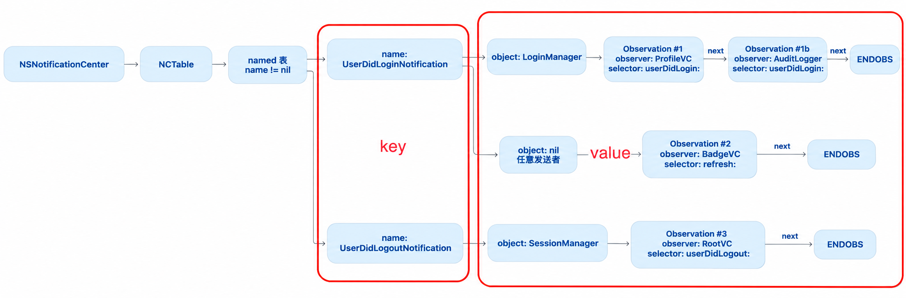
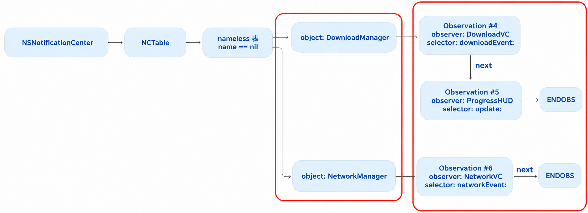
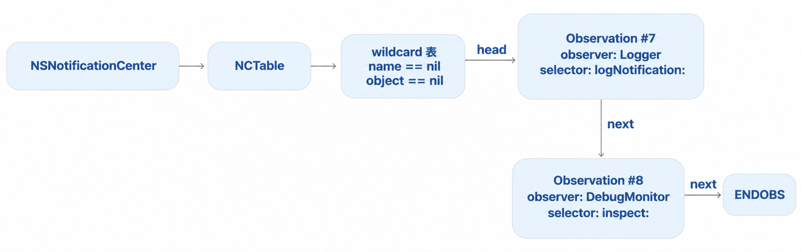

# NSNotificationCenter底层原理

[toc]

NSNotificationCenter 是 Foundation 提供的进程内消息广播机制，对象可以向通知中心注册自己感兴趣的通知，当其他对象发布匹配的通知时，通知中心会把消息分发给所有观察者。

它本质上是一种发布-订阅模式，也可以看作观察者模式的一种实现：

发布者和观察者不需要互相持有，也不需要知道对方的具体类型，因此可以降低模块之间的耦合。

需要注意，NSNotificationCenter 只负责当前进程内的通信，它不是远程推送，也不是系统通知栏；远程推送和本地通知应使用 UserNotifications 框架。

## 基本使用

~~~objc
// 添加通知观察者
- (void)addObserver:(id)observer selector:(SEL)aSelector name:(nullable NSNotificationName)aName object:(nullable id)anObject;
- (id <NSObject>)addObserverForName:(nullable NSNotificationName)name object:(nullable id)obj queue:(nullable NSOperationQueue *)queue usingBlock:(void (^)(NSNotification *note))block;

// 发出通知
- (void)postNotification:(NSNotification *)notification;
- (void)postNotificationName:(NSNotificationName)aName object:(nullable id)anObject;
- (void)postNotificationName:(NSNotificationName)aName object:(nullable id)anObject userInfo:(nullable NSDictionary *)aUserInfo;

// 移除通知观察者
- (void)removeObserver:(id)observer;
- (void)removeObserver:(id)observer name:(nullable NSNotificationName)aName object:(nullable id)anObject;
~~~

这其中主要涉及以下两种类

- `NSNotificationCenter` 用来管理通知的单例类，将观察者注册到 `NSNotificatinonCenter` 的通知调度表中，然后发送通知时利用标识符 `name` 和 `object` 识别出调度表中的观察者，然后调用相应的观察者的方法

- `NSNotification` 是方便 `NSNotificationCenter` 广播到其他对象时的封装对象，简单讲即通知中心对通知调度表中的对象广播时发送 `NSNotification` 对象

## NSNotification 的底层原理

```objc
@interface NSNotification : NSObject <NSCopying, NSCoding>

@property (readonly, copy) NSNotificationName name;    // 通知名称
@property (nullable, readonly, retain) id object;    // 通知发送者
@property (nullable, readonly, copy) NSDictionary *userInfo;  // 通知的附加信息

// NSNotification 指定初始化方法
- (instancetype)initWithName:(NSNotificationName)name object:(nullable id)object userInfo:(nullable NSDictionary *)userInfo API_AVAILABLE(macos(10.6), ios(4.0), watchos(2.0), tvos(9.0)) NS_DESIGNATED_INITIALIZER;
- (nullable instancetype)initWithCoder:(NSCoder *)coder NS_DESIGNATED_INITIALIZER;

@end
```

对于初始化方法，还可以使用 `NSNotification(NSNotificationCreation)` 分类中定义的初始化方法

```objc
@interface NSNotification (NSNotificationCreation)

+ (instancetype)notificationWithName:(NSNotificationName)aName object:(nullable id)anObject;
+ (instancetype)notificationWithName:(NSNotificationName)aName object:(nullable id)anObject userInfo:(nullable NSDictionary *)aUserInfo;

- (instancetype)init /*API_UNAVAILABLE(macos, ios, watchos, tvos)*/;    /* do not invoke; not a valid initializer for this class */
// 无参数 init 无法构造出一个合法的通知对象，禁用 init 初始化
@end
```

不过一般都直接使用 `NSNotificationCenter` 间接创建 `NSNotification` 并发送通知

## NSNotificationCenter 的底层实现原理

Apple 没有公开 Foundation 中 `NSNotificationCenter` 的完整源码，因此无法直接断言 Apple 内部使用了某个具体的数据结构；下面的分析基于公开 API 行为、GNUstep 的参考实现以及通知中心的基本工作流程。

整体上，通知中心需要完成三件事：

1. 保存观察者信息
2. 根据 name 和 object 找到匹配的观察者
3. 调用观察者的 selector 或 block

通知中心定义了两个结构体来存储通知信息和观察者信息：

`NSNotificationCenter` 持有一个 `NCTable` 类型的 `_table` 用于管理观察者注册关系及相关内存

```objc
typedef struct NCTbl {
  Observation       *wildcard;  // 链表结构，保存既没有 name 也没有 object 的通知
  GSIMapTable       nameless;   // 存储无 name 、有 object 的通知
  GSIMapTable       named;      // 存储有 name 的通知，不限制 object
  // ...
} NCTable;   // 根容器，NSNotificationCenter 持有
```

其中基本的存储单元 Observation 定义如下：

```objc
typedef struct Obs {
    id        observer;       // 保存接受消息的对象
    SEL       selector;       // 保存注册通知时传入的 SEL
    struct Obs    *next;      // 同一注册条件链表中的下一条 Observation
    struct NCTbl  *link;      // 保存该 Observation 的 NCTable
    // ...
} Observation;
```

这里的存储结构主要涉及三张表：named 表，nameless 表，wildcard 表

### named 表

named 表是两层映射：外层的 Key 是通知名称 name，Value 是一个以 object 为 Key 的子表，子表的 Value 才是 Observation 链表

该表用于 name 参数不为 `nil` 的场景



在实际开发中 object 参数经常传 `nil`，GNUstep 的映射表使用空指针 key 表示不限制发送者

### nameless 表

nameless 表没有 `NotificationName`，即没有了 named 最外层一层键值对的约束，剩下 `object` 和 `Observation` 所对应的键值对结构

该表用于 name 参数为 `nil`，object 参数不为 `nil` 的场景



### wildcard 表

这个表剥去了 `NotificationName` 和 `object` ，在 nameless 基础上少了一层键值对，只剩下链表结构

该表用于 name 参数为 `nil`，object 参数也为 `nil` 的场景



注意这三张表只是看起来是上一个一层一层剥开后的结构，在存储的时候就是单纯的独立的三张表，没有包含关系

## 添加观察者流程

### addObserver:selector:name:object: 方法的实现

~~~objc
- (void) addObserver: (id)observer selector: (SEL)selector name: (NSString*)name object: (id)object {
	Observation *list;
	Observation *o;
	GSIMapTable m;
	GSIMapNode n;
  .....  // observer，selector 为空，observer不能响应selector时的报错
    // 给表上锁
  lockNCTable(TABLE);
// 创建一个 observation 对象，保存观察者引用和 SEL，下面进行的所有逻辑就是为了存储它
	o = obsNew(TABLE, selector, observer);
// 如果 name 存在
	if (name) {
    // 从 named 表中获取对应的 mapTable
		n = GSIMapNodeForKey(NAMED, (GSIMapKey)(id)name);
		if (n == 0) {
    // 不存在，则创建 
			m = mapNew(TABLE);
			GSIMapAddPair(NAMED, (GSIMapKey)(id)name, (GSIMapVal)(void*)m);
			...
		}
	  else {
    // 存在则把值取出来 赋值给m
      m = (GSIMapTable)n->value.ptr;
    }
    // 以 object 为 key，从字典 m 中取出对应的 GSIMapNode 类型的 value
    n = GSIMapNodeForSimpleKey(m, (GSIMapKey)object);
    if (n == 0) {
        // 不存在，则创建 
       o->next = ENDOBS;
       GSIMapAddPair(m, (GSIMapKey)object, (GSIMapVal)o);
    }
    else {
       list = (Observation*)n->value.ptr;
       o->next = list->next;
       list->next = o;
    }
  }
// 如果 name 为空，但 object 不为空
  else if (object) {
   // 从 nameless 字典中取出对应的 value
    n = GSIMapNodeForSimpleKey(NAMELESS, (GSIMapKey)object);
   // 不存在则新建链表，并存到map中
    if (n == 0) {
       o->next = ENDOBS;
       GSIMapAddPair(NAMELESS, (GSIMapKey)object, (GSIMapVal)o);
    }
    else {
    // 存在 则把值接到链表的节点上
      ...
    }
  }
// 如果 name 和 object 都为空 则存储到 wildcard 链表中
  else {
    o->next = WILDCARD;
    WILDCARD = o;
  }
// 解锁
 unlockNCTable(TABLE);
}
~~~

可以看出最终的通知信息（接收通知的对象，回调的方法）都存储在 Observation 这个结构体并保存为链表结构中，而三张表只是通过 name，object 对通知信息进行筛选分类

`addObserver:selector:name:object: ` 的核心流程就是存储 Observation 的过程

- 如果 `name` 存在：
  - 则向 `named` 表中插入元素，`key` 为 `name`，`value` 为 `GSIMaptable`
  - `GSIMaptable` 中 `key` 为 `object`，`value` 为 `Observation`
- 如果 `name` 不存在，但是 `object` 存在：
  - 则向 `nameless` 表中插入元素，`key` 为 `object`，`value` 为 `Observation`
- 如果 `name` 和 `object` 都不存在：
  - 则把这个 `Observation` 添加 `wildcard` 链表中

### addObserverForName:object:queue:usingBlock: 方法的实现

正常情况下回调函数所在线程和发送通知的线程一致，如果遇到子线程发出通知，但是想在主线程调用回调函数的情况，我们除了可以在回调函数中切换线程外，还可以使用 `addObserverForName:object:queue:usingBlock:` 方法实现，该方法可以指定一个收到通知的 `block` 在哪个队列执行，我们可以通过指定主队列来实现

```objc
- (id)addObserverForName:(NSString *)name object:(id)object queue:(NSOperationQueue *)queue usingBlock:(GSNotificationBlock)block {
    // 创建一个内部观察者对象，由它保存 queue 和 block
    GSNotificationObserver *observer = [[GSNotificationObserver alloc] initWithQueue:queue block:block];
    // 将内部对象注册到通知中心
    // 注意：这里实际走的是 selector 监听方式
    [self addObserver:observer selector:@selector(didReceiveNotification:) name:name object:object];
    // 返回内部观察者对象作为 token
    return observer;
}
```

这里的返回值其实是 `id<NSObject>`，后续需要通过这个 token 移除观察 `[[NSNotificationCenter defaultCenter] removeObserver:observerToken];`

这里的内部观察对象如下：

```objc
@interface GSNotificationObserver : NSObject

@property (nonatomic, strong) NSOperationQueue *queue;
@property (nonatomic, copy) void (^block)(NSNotification *notification);

@end
@implementation GSNotificationObserver
// 通知处理方法
- (void)didReceiveNotification:(NSNotification *)notification {
    if (self.queue == nil) {
        // queue 为 nil，直接在发布通知的线程执行
        self.block(notification);
    } else {
        // 将 block 放入指定的操作队列
        [self.queue addOperationWithBlock:^{
            self.block(notification);
        }];
    }
}

@end
```

相当于 `NSNotificationCenter` 调用 `GSNotificationObserver` 的 `didReceiveNotification:` 判断 queue 是否为空决定直接执行 block，或提交到 `NSOperationQueue`

## 发送通知流程

### postNotificationName: 方法的实现

```objc
- (void) postNotification: (NSNotification*)notification {
	if (notification == nil) {
			[NSException raise: NSInvalidArgumentException format: @"Tried to post a nil notification."];
	}
	[self _postAndRelease: RETAIN(notification)];
}
- (void) postNotificationName: (NSString*)name object: (id)object {
  [self postNotificationName: name object: object userInfo: nil];
}
- (void) postNotificationName: (NSString*)name object: (id)object userInfo: (NSDictionary*)info {
// 构造一个 GSNotification 对象， GSNotification 继承了 NSNotification
	GSNotification *notification;
	notification = (id)NSAllocateObject(concrete, 0, NSDefaultMallocZone());
	notification->_name = [name copyWithZone: [self zone]];
	notification->_object = [object retain];
	notification->_info = [info retain];
// 进行发送操作
  [self _postAndRelease: notification];
}
```

`postNotification:` 接收已有的 NSNotification 对象；两个 `postNotificationName:...` 便利方法负责构造通知对象，最后进入 GNUstep 的 `_postAndRelease:` 方法，那我们就直接来看一下这个函数的实现

```objc
- (void) _postAndRelease: (NSNotification*)notification {
// 从 named、nameless、wildcard 表中查找对应的通知
   ...
// 调用 performSelector 执行响应方法
	[o->observer performSelector: o->selector withObject: notification];
// 释放资源
	RELEASE(notification);
}
```

该函数主要做了三件事：查找通知、发送、释放资源

在查找的过程中，会依次在 named、nameless、wildcard 表中找到所以接受该通知的 Observation 记录，放入本次发送的临时集合 observerArray 数组

最后取出每一个 observer 节点,然后通过 `performSelector：` 逐一调用 SEL

### enqueueNotification:postingStyle:coalesceMask:forModes: 方法的实现

用于异步发送消息，这个异步并不是开启线程，而是把通知存到队列里面，等待某个时机触发时调用 `NSNotificationCenter` 的发送接口进行通知的发送

其中 `NSNotificationQueue` 是 `NSNotificationCenter` 的通知缓冲和调度层，`NSNotificationCenter` 负责立即分发，`NSNotificationQueue` 负责延迟、排队和合并后等待合适时机再交给 NSNotificationCenter 分发

`NSPostASAP` 和 `NSPostWhenIdle` 的延迟投递依赖所属线程的 RunLoop 运行，并进入允许的 mode；否则通知可能持续留在队列中。`NSPostNow` 走立即投递路径

`NSNotificationQueue` 中定义的属性与方法如下：

```objc
// 获取线程默认的 NSNotificationQueue
@property (class, readonly, strong) NSNotificationQueue *defaultQueue;

// 创建新的 NSNotificationQueue 并指定 NSNotificationCenter
- (instancetype)initWithNotificationCenter:(NSNotificationCenter *)notificationCenter;

// 向队列中添加通知
- (void)enqueueNotification:(NSNotification *)notification postingStyle:(NSPostingStyle)postingStyle;
- (void)enqueueNotification:(NSNotification *)notification postingStyle:(NSPostingStyle)postingStyle coalesceMask:(NSNotificationCoalescing)coalesceMask forModes:(nullable NSArray<NSRunLoopMode> *)modes;

// 从队列中移除通知
- (void)dequeueNotificationsMatching:(NSNotification *)notification coalesceMask:(NSUInteger)coalesceMask;
```

其主要参数含义如下：
`postingStyle：`用于配置通知什么时候发送

- `NSPostASAP`：尽快发送，但不会立刻执行，通常会等待当前 RunLoop 周期结束后再发送
- `NSPostWhenIdle`：等当前 RunLoop 空闲时再发送，适合不需要立即响应的刷新任务
- `NSPostNow`：立即发送，效果接近 `[[NSNotificationCenter defaultCenter] postNotification:notification];`

`coalesceMask`：用于配置如何合并通知，即移除重复的通知

- `NSNotificationNoCoalescing`：不合并通知
- `NSNotificationCoalescingOnName`：按照通知名字合并通知
- `NSNotificationCoalescingOnSender`：按照传入的 `object` 合并通知

`modes`：指定通知在哪些 RunLoop 模式下发送

接下来我们来看它底层是如何发送的

```objc
// 将通知加入通知队列
- (void)enqueueNotification:(NSNotification *)notification postingStyle:(NSPostingStyle)postingStyle coalesceMask:(NSUInteger)coalesceMask forModes:(NSArray *)modes{
    // 如果允许合并通知，先从待发送队列中移除，与当前通知匹配的旧通知
    if (coalesceMask != NSNotificationNoCoalescing) {
        [self dequeueNotificationsMatching:notification coalesceMask:coalesceMask];
    }
  // 判断发送时机
    switch (postingStyle) {
        case NSPostNow: {
            [_center postNotification:notification];
            break;
        }
        case NSPostASAP: {
            // 加入 ASAP 队列，等待当前 RunLoop，在合适的时机发送通知
            add_to_queue(_asapQueue, notification, modes, _zone);
            break;
        }
        case NSPostWhenIdle: {
            //加入空闲队列，等 RunLoop 进入空闲状态时再发送通知
            add_to_queue(_idleQueue, notification, modes, _zone);
            break;
        }
    }
}
// 发送通知
// 发送 ASAP 队列中的通知
void GSPrivateNotifyASAP(NSString *mode) {
    notify(item->queue->_center, item->queue->_asapQueue, mode, item->queue->_zone);
}

// 发送空闲队列中的通知
void GSPrivateNotifyIdle(NSString *mode) {
    notify(item->queue->_center, item->queue->_idleQueue, mode, item->queue->_zone);
}

// 从指定的通知队列中取出当前 RunLoop Mode 下，到达发送时机的通知，并交给 NSNotificationCenter 分发
static void notify(NSNotificationCenter *center, NSNotificationQueueList *list, NSString *mode, NSZone *zone){
    // 取出当前 mode 下需要发送的通知
    // 这里省略了队列筛选和数组构建过程
    ...
    // 逐个发送通知
    for (NSUInteger pos = 0; pos < len; pos++) {
        NSNotification *notification = (NSNotification *)ptr[pos];
        // 将通知交给通知中心，通知中心会根据 name 和 object，查找并回调匹配的观察者
        [center postNotification:notification];
        RELEASE(notification); // 当前通知已经完成发送，释放队列持有的引用
    }
    ...
}
```

核心流程为将通知加入通知队列后，等 RunLoop 到达合适时机，调用 `GSPrivateNotifyASAP` 和 `GSPrivateNotifyIdle` 方法，他们又调用 `notify` 方法从对应队列中取出通知执行`NSNotificationCenter postNotification:` 匹配并回调观察者

## 移除通知流程

### removeObserver:name:object: 方法的实现

注意这里传入的 `name == nil` 的含义不是“只删无名通知”，而是“不限制通知名称”

在 `addObserver:` 中用的是 `if ... else if ... else` 的三选一互斥分支；但在 `removeObserver:name:object:` 中，是在按条件搜索并批量销毁记录，这里的 `name` 和 `object` 是删除时的筛选条件

```objc
- (void)removeObserver:(id)observer {
    if (observer == nil) {
        return;
    }
    // name 和 object 都传 nil，表示删除该 observer 的全部注册
    [self removeObserver:observer name:nil object:nil];
}
- (void)removeObserver:(id)observer name:(NSString *)name object:(id)object {
    // 三个参数同时为空时，不执行任何清理操作
    if (name == nil && object == nil && observer == nil) {
        return;
    }
    // 后续会修改通知中心内部的多个表，因此先加锁
    lockNCTable(TABLE);
    // name 和 object 都为空，说明需要清理 wildcard 链表
    if (name == nil && object == nil) {
        WILDCARD = listPurge(WILDCARD, observer);
    }
    // name 为空时，需要处理所有通知名称
    if (name == nil) {
        GSIMapEnumerator_t e0;
        GSIMapNode n0;
        // 枚举器遍历 named 表中的所有 name
        e0 = GSIMapEnumeratorForMap(NAMED);
        n0 = GSIMapEnumeratorNextNode(&e0);
        while (n0 != 0) {
           // named 表的 value 是一个以 object 为 key 的子表
            GSIMapTable m = (GSIMapTable)n0->value.ptr;
            // 先保存当前 name，后续可能会从 named 表中删除它
            NSString *thisName = (NSString *)n0->key.obj;
           // 提前获取下一个节点，避免当前节点被删除后遍历失效
            n0 = GSIMapEnumeratorNextNode(&e0);
            if (object == nil) { // object 为空，删除当前 name 下所有 object 对应的观察关系
                GSIMapEnumerator_t e1;
                GSIMapNode n1;
                e1 = GSIMapEnumeratorForMap(m);
                n1 = GSIMapEnumeratorNextNode(&e1);
                while (n1 != 0) {
                    GSIMapNode next = GSIMapEnumeratorNextNode(&e1);
                    purgeMapNode(m, n1, observer);  // 从当前 name 的子表中删除 observer
                    n1 = next;
                }
            } else { // object 不为空，只查找该 object 对应的观察者链表
                GSIMapNode n1 = GSIMapNodeForSimpleKey(m, (GSIMapKey)object);
                if (n1 != 0) {
                    purgeMapNode(m, n1, observer); // 只清理当前 object 链表中的 observer
                }
            }
            if (m->nodeCount == 0) {
                mapFree(TABLE, m);
                GSIMapRemoveKey(NAMED, (GSIMapKey)(id)thisName);
            }
        }
           // name 为空时，还要处理 nameless 表
        if (object == nil) {
            e0 = GSIMapEnumeratorForMap(NAMELESS);
            n0 = GSIMapEnumeratorNextNode(&e0);
            while (n0 != 0) {
                GSIMapNode next = GSIMapEnumeratorNextNode(&e0);
                purgeMapNode(NAMELESS, n0, observer);// 移除
                n0 = next;
            }
        } else {
        // object 不为空，只处理该 object 对应的链表
            n0 = GSIMapNodeForSimpleKey(NAMELESS, (GSIMapKey)object);
            if (n0 != 0) {
                purgeMapNode(NAMELESS, n0, observer);
            }
        }
    } else {
        // name 不为空，只需要处理 named 表中的一个 name 分支
        GSIMapTable m;
        GSIMapEnumerator_t e0;
        GSIMapNode n0;
    // 根据 name 找到对应的子表
        n0 = GSIMapNodeForKey(NAMED, (GSIMapKey)((id)name));
        if (n0 == 0) { // 没有该 name 的注册记录，不需要继续处理
            unlockNCTable(TABLE);
            return;
        }
        m = (GSIMapTable)n0->value.ptr;  // 取出该 name 对应的 object 子表
        if (object == nil) { // 遍历该 name 下所有 object，只删除匹配 observer 的注册记录
            e0 = GSIMapEnumeratorForMap(m);
            n0 = GSIMapEnumeratorNextNode(&e0);
            while (n0 != 0) {
                GSIMapNode next = GSIMapEnumeratorNextNode(&e0);
                purgeMapNode(m, n0, observer);
                n0 = next;
            }
        } else {
            // object 不为空，只处理 name + object 对应的观察关系
            n0 = GSIMapNodeForSimpleKey(m, (GSIMapKey)object);
            if (n0 != 0) {
                purgeMapNode(m, n0, observer);
            }
        }
        if (m->nodeCount == 0) { // 释放 name 对应的 object 子表
            mapFree(TABLE, m);
            // 从 named 表中删除 name
            GSIMapRemoveKey(NAMED, (GSIMapKey)((id)name));
        }
    }
    unlockNCTable(TABLE);
}
```

主要就是根据 `observer`、`name`、`object` 三个条件，依次删除通知中心中对应的观察关系

### 是否移除监听

- 如果是通过 selector 注册的话，在 iOS 9 之后，通知中心持有观察者的方式从 `unsafe_unretained` 变成了 `weak`，当 `self` 销毁后，通知中心能够自动清理这条观察关系，因此一般不会因为通知继续回调已释放对象而崩溃，不过为了兼容旧系统、及时清理资源以及明确表达生命周期，仍然建议手动移除

- 如果是通过 block 注册的话，这个方法返回的是一个内部观察者对象 `notificationToken`，通知中心会持有这个内部对象，而内部对象又会持有 block，因此 block 监听不能只依赖 iOS 9 的自动清理机制，必须主动移除

## Swift 的变化

从 iOS 26 起 Apple 为通知中心增加了适配 Swift 并发的新 API

Swift 现在有两种使用方式：

- 传统 API：`NotificationCenter` 是 OC 通知中心在 Swift 中的对应接口，仍然使用 `name / object / userInfo`，监听、发送和移除的思路与 OC 一样
- 新 API（iOS 26+）：用明确的消息类型和属性代替 `userInfo` 字典，减少拼写和类型转换错误；`MainActorMessage` 在主 actor 上同步传递，`AsyncMessage` 异步传递并支持并发安全。新 `ObservationToken` 释放后会自动取消监听，和传统 block token 的规则不同

## 面试题：NSNotificationCenter 的底层原理是什么？

NSNotificationCenter 本质上是一个进程内的观察者管理和消息分发机制

1. 调用 addObserver 时，通知中心保存 observer、selector 或 block、通知名称、发送者和队列等观察关系
2. 调用 postNotification 时，通知中心创建 NSNotification，根据 name 和 object 查找匹配的观察者
3. 对 selector 观察者，通知中心向 observer 发送 selector 消息；对 block 观察者，通知中心执行对应 block
4. 普通通知默认同步分发，并且通常在发布通知的线程执行
5. NSNotificationQueue 可以借助 RunLoop 延迟发布或合并通知
6. selector 和 block 观察者的生命周期管理方式不同，block observer 必须保存并移除返回的 token

需要注意，Apple 没有公开 Foundation 的完整实现，因此 NCTable、named、nameless、wildCards 等结构主要来自 GNUstep 参考实现和行为推导，不能直接声称它们就是 Apple 内部源码。

